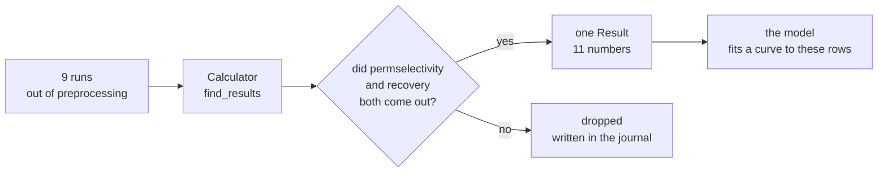
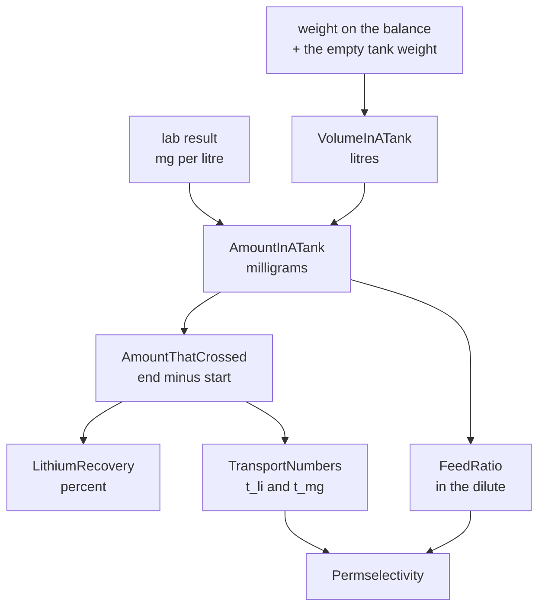
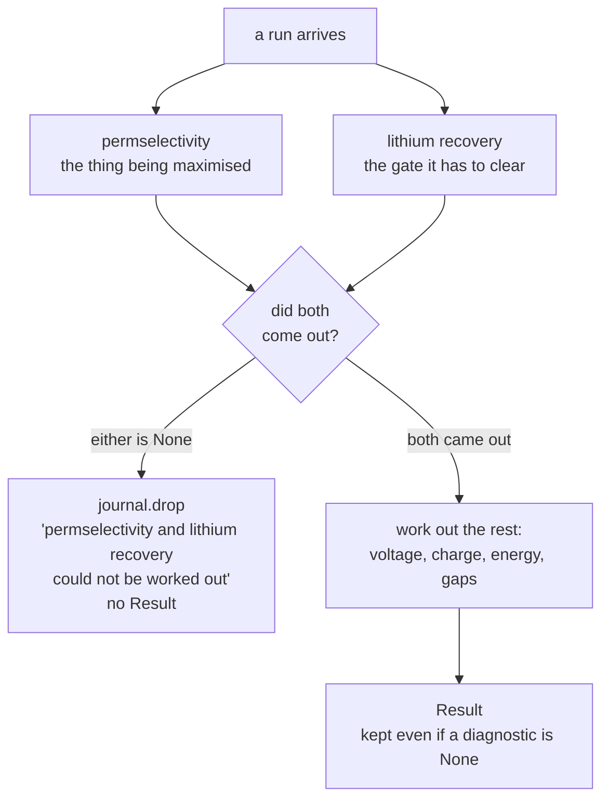
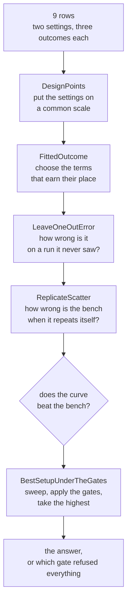
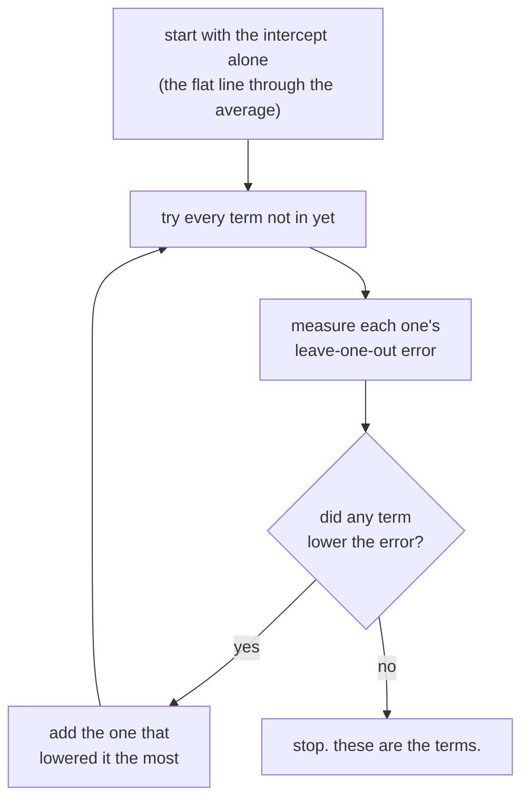
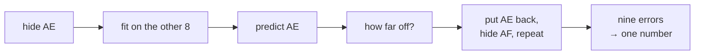
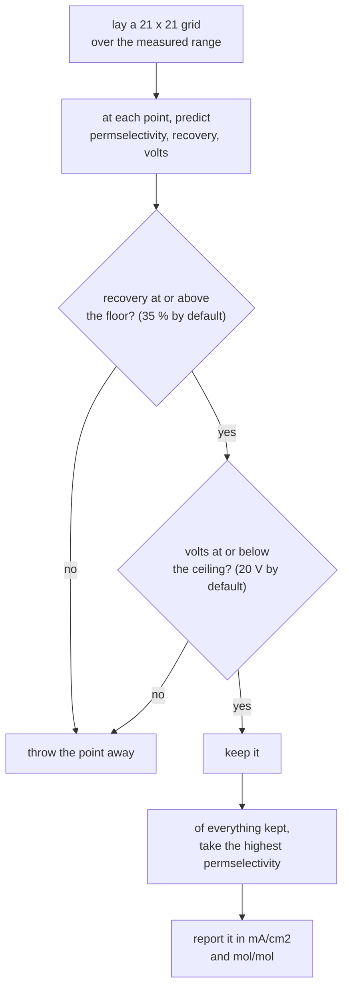

# How the numbers are worked out

Two stages, one after the other.

**Part one — the calculator.** Preprocessing hands over runs that can be believed, and each
run is turned into **one row of numbers**.

Nine runs arrive, not twenty-one. Preprocessing drops the runs marked not for use, the runs
the lab has not answered for, and — since the question is about one membrane — every run made
on a membrane other than the one being modelled. Which membrane that is comes from the
`MEMBRANES_MODELLED` setting, and it is GO-10 unless told otherwise.

**Part two — the model.** Those rows, and nothing else, become a curve and an answer.

Run AE is used throughout so you can follow every number.

---

# Part one — the calculator

---

## The job in one picture



Nine runs in, nine rows out. A row is `Result`: the two settings the run was made at, three
outcomes, and three diagnostics.

---

## Why anything has to be calculated at all

Nothing in the four CSV files is a result. The files hold weights off a balance,
concentrations from the lab, and voltages and currents from the power supply. Every number
the model is fitted to has to be built from those.

The lab reports a **concentration**, in mg/L. On its own that says nothing, because the
tanks gain and lose liquid all run — water crosses the membranes and sample bottles are
drawn off. Only *concentration times volume* can be compared between one minute and another.
That is the whole reason the chain below exists.

---

## The chain

Each box depends on the one before it. Nothing jumps ahead.



### Step 1 — how much liquid was in the tank?

Nothing measured volume directly. The tank sat on a balance all run, so the liquid is
**whatever the balance read, less the weight of the empty tank**.

```
litres = (weight_g - tare_g) / 1000
```

AE's concentrate at minute 0 weighed 2119.7 g and the empty tank weighs 96.2 g:

```
(2119.7 - 96.2) / 1000 = 2.0235 L
```

At minute 240 it weighed 2101.5 g, so **2.0053 L**. The tank lost 18 g of liquid over the
run — which is exactly why the next step cannot use concentration alone.

*Class: `VolumeInATank.find_litres`. Treating 1 g of these dilute salt solutions as 1 mL is
about 0.5 % wrong and is a stated assumption, named in `constants.py`.*

### Step 2 — how much metal was in it?

```
milligrams = (mg per litre from the lab) x litres
```

AE's concentrate held 63.56 mg/L of lithium at minute 0 and 218.5 mg/L at minute 240:

```
minute   0:   63.56 x 2.0235 = 128.61 mg
minute 240:  218.50 x 2.0053 = 438.16 mg
```

*Class: `AmountInATank.find_milligrams`. Needs three things: a sample at that minute, a
result for that metal, and a weight. Any one missing and the answer is `None`.*

### Step 3 — how much crossed the membrane?

The last sampled minute, minus the first.

```
438.16 - 128.61 = 309.55 mg of lithium crossed into the concentrate
```

**The subtraction is the point.** The concentrate did not start empty — it was filled with a
starting salt, and AE already held 128.61 mg of lithium before any current flowed. Forget to
subtract it and AE reads 54 % recovery instead of 38 %.

*Class: `AmountThatCrossed.find_milligrams`. The readings arrive in no particular order, so
the two ends are found **by minute**, not by position in the list. Fewer than two sampled
minutes and the answer is `None`.*

### Step 4 — recovery

What crossed, against what the feed started with.

```
recovery % = 100 x (lithium that crossed) / (lithium the dilute started with)
```

AE's dilute held 403.1 mg/L in 2.0063 L = 808.74 mg at minute 0:

```
100 x 309.55 / 808.74 = 38.27 %
```

Two things worth knowing:

- **It is milligrams on both sides**, so the molar mass cancels. There is nothing to gain by
  converting to moles, and the code does not.
- It is measured against what the feed held **at the start**, never against what it ended
  with. What was there before anything moved is the whole prize.

*Class: `LithiumRecovery.find_percent`.*

### Step 5 — transport numbers

Now magnesium joins in. A transport number is the share of the **electrical charge** each
metal carried, not the share of the ions. Magnesium ions carry two charges each; lithium
carries one. So each metal is counted in millimoles and then weighted by its charge.

```
millimoles = milligrams / (grams per mole)
charge carried = millimoles x (1 for lithium, 2 for magnesium)
```

AE: 309.55 mg of lithium and 254.67 mg of magnesium crossed.

```
lithium:    309.55 / 6.94    = 44.60 mmol  x 1  =  44.60
magnesium:  254.67 / 24.305  = 10.48 mmol  x 2  =  20.96
                                                   -----
                                            total 65.56

t_li = 44.60 / 65.56 = 0.6803
t_mg = 20.96 / 65.56 = 0.3197
```

*Class: `TransportNumbers.find_numbers`. The charge each ion carries lives on the `Metal`
object, so it travels with the metal and cannot be forgotten at a call site.*

### Step 6 — what the feed was offering

The stack can only move what it is given. If a feed holds far more magnesium than lithium,
far more magnesium will cross even from a membrane with no preference at all. So the feed
ratio has to be measured, in millimoles per litre, at the dilute's first sampled minute.

AE's dilute at minute 0: 403.1 mg/L lithium, 1657.0 mg/L magnesium.

```
lithium:    403.1 / 6.94   = 58.08 mmol/L
magnesium: 1657.0 / 24.305 = 68.17 mmol/L

feed Li/Mg = 58.08 / 68.17 = 0.8520
```

> **There are two feed ratios and they are not the same.** `find_li_over_mg_in_the_dilute`
> is **measured** in the tank and is what permselectivity divides by.
> `find_mg_over_li_from_the_setup` comes from the run's setup columns, is the other way up,
> and is the one the model uses as a design column. They are kept apart by name on purpose.

### Step 7 — permselectivity

How far the stack preferred lithium, **against what the feed offered**.

```
permselectivity = (t_li / t_mg) / (feed Li/Mg)
```

AE:

```
(0.6803 / 0.3197) / 0.8520  =  2.1284 / 0.8520  =  2.498
```

**No preference is 0.5, not 1.** If the stack moved the two metals in exactly the proportion
the feed presented, this number would come out 0.5 whatever the feed was. That is the entire
job of dividing by the feed ratio: it pins the neutral point in one place, so a run fed
1.43 mol/mol and a run fed 11.42 mol/mol can be compared at all.

AE at 2.498 is about five times better than no preference.

*Class: `Permselectivity.find_value`.*

### Step 8 — the electrical numbers

These come from the power log rather than the tanks, so they do not wait on the lab.

| number | how | AE |
|---|---|---|
**charge passed** | the trapezoid of supply current against minute, x 60 | 1178.55 C → **54.56 mA·h/cm²** |
**current density** | the **median** supply current ÷ membrane area | **13.67 mA/cm²** |
**highest voltage** | the largest supply voltage in the run | **16.0 V** |
**energy per mole of lithium** | trapezoid of volts x amps, ÷ moles of lithium crossed | **91.92 W·h/mol** |

The median is used for current density, not the mean, so one bad reading cannot move it. The
`set_current_ma` column is empty throughout this data, so the current is always the measured
one.

### Step 9 — the balance gaps

A check on the bookkeeping, not a result.

```
gap % = 100 x (what the dilute lost - what the concentrate and rinse gained)
              / (what the dilute lost)
```

If every milligram that left the dilute arrived somewhere, this is 0. AE's lithium gap is
**-19.6 %** and its magnesium gap **+35.0 %**.

A positive gap means metal went missing — mostly the liquid carried away in sample bottles,
which the calculation deliberately does not account for. A **negative** gap means more metal
arrived than left, which cannot physically happen and means the readings disagree.

**These correct nothing.** They are there so you can tell a trustworthy row from a shaky one.
Treat a large gap as a warning about that row, and do not quote the gaps as results.

---

## Which runs survive this stage



**The two outcomes are permselectivity and lithium recovery.** Nothing else can cost a run
its place.

Why those two and not the others: permselectivity is the number being maximised and recovery
is the gate it has to clear, so between them they are the question. A run that cannot answer
the question has nothing to contribute to it.

Everything else may be missing and the run still stands. A run with no power log still has
its permselectivity; it just carries `None` where its voltage would be. That is deliberate —
losing a run over a diagnostic would be throwing away the thing you came for.

On the current data no run is dropped here. All nine survive preprocessing and all nine
calculate.

---

## The one rule that runs through all of it

**A number that cannot be worked out is `None`.** Never a zero, never a guess, never a
default. If a weight is missing, the volume is `None`; the amount built on it is `None`; and
whatever needed that amount is `None` too. The absence travels all the way up and shows in
the report as a dash.

This is why the report can be trusted: a number that is printed was measured and calculated,
and a number that could not be is visibly absent rather than quietly invented.

---

## What comes out

One `Result` per run, eleven fields:

| field | what it is | can it be None? |
|---|---|---|
`run_code` | which run | no |
`cem` | which membrane | no |
`current_density_ma_cm2` | **a setting** — a model input | no |
`feed_mg_li_ratio` | **a setting** — a model input, from the setup | no |
`permselectivity` | **the objective** | no — a run without it is dropped |
`li_recovery_pct` | **a gate**, must reach the recovery floor | no — same |
`highest_voltage_v` | **a gate**, must stay under the voltage ceiling | yes |
`charge_passed_mah_cm2` | a check that runs are comparable | yes |
`energy_per_mol_li_wh` | secondary interest | yes |
`li_balance_gap_pct` | diagnostic | yes |
`mg_balance_gap_pct` | diagnostic | yes |

AE's finished row:

```
run_code                AE
cem                     GO-10
current_density_ma_cm2  13.67
feed_mg_li_ratio        1.4277
permselectivity         2.4982
li_recovery_pct         38.2749
highest_voltage_v       16.0
charge_passed_mah_cm2   54.5625
energy_per_mol_li_wh    91.9208
li_balance_gap_pct      -19.6449
mg_balance_gap_pct      35.0019
```

Nine rows like this are the entire input to the model. Everything after this point — the
polynomial, the leave-one-out error, the search for the best setup — works on these numbers
and never looks at a reading again.

---

## Where the code lives

```
src/limodel/analyzer/calculate/
    calculator.py     Calculator.find_results: runs in, Results out
    result.py         the row itself
    constants.py      molar masses, Faraday, the tank names, the tare columns
    metal.py          LITHIUM and MAGNESIUM, each carrying its mass and its charge
    quantities/       one class per number, in the order of the chain above
```

Every class has a test file beside it under `tests/analyzer/calculate/`, and the expected
values in those tests were worked out by hand from round numbers, so they pin the arithmetic
rather than echoing it.

---

# Part two — the model

Nine rows arrive. No reading is ever looked at again.

The model has to answer one question: **what setting gives the best permselectivity, without
breaking the recovery floor or the voltage ceiling?** To answer it, it has to turn nine
scattered points into a curve, decide whether that curve is worth believing, and then search
it.



This happens three times over — once for permselectivity, once for recovery, once for volts —
because every quantity a limit is placed on needs its own prediction.

---

## Step 1 — put the two settings on a common scale

The two settings are not comparable as they stand. Current density runs from 4.50 to 25.67,
the feed ratio from 1.43 to 11.42. Squaring numbers of that size makes the squared terms far
larger than the linear ones, and the fit ends up driven by whichever setting happens to carry
the bigger numbers.

So each setting is **logged**, then shifted and stretched so its lowest run sits at −1 and its
highest at +1. The coded settings are called `x1` (current density) and `x2` (the feed ratio).

```
x1 = (ln J − 2.374635) / 0.870558
x2 = (ln R − 1.395778) / 1.039721
```

The nine runs come out like this:

| run | J | R | x1 | x2 |
|---|---|---|---|---|
AE | 13.67 | 1.43 | +0.276 | **−1.000** |
AF | 13.67 | 2.86 | +0.276 | −0.333 |
AG | 13.67 | 5.71 | +0.276 | +0.333 |
AH | 7.50 | 1.43 | −0.413 | −1.000 |
AI | 7.50 | 1.43 | −0.413 | −1.000 |
AJ | 4.50 | 1.43 | **−1.000** | −1.000 |
AN | 25.67 | 1.43 | **+1.000** | −1.000 |
AP | 25.67 | 1.43 | +1.000 | −1.000 |
AT | 13.67 | 11.42 | +0.276 | **+1.000** |

**Look at the x1 column against the x2 column.** Six of the nine runs share x2 = −1.000, and
all but three share x1 = +0.276. The settings were never varied together — that shape is the
single most important fact about this data, and everything later follows from it.

A setting that never varied at all is **dropped** rather than refused. If every run had used
the same feed ratio, `x2` would be useless and the fit would simply be made in `x1` alone, and
the report would say so.

*Class: `DesignPoints`. It also converts back, because an answer has to be reported in
mA/cm² and mol/mol, not in coded units.*

---

## Step 2 — decide which terms the curve is allowed

The shape being fitted is a second-order polynomial. The terms available:

```
intercept    x1    x2    x1²    x2²
```

**The `x1·x2` interaction term is deliberately not on that list.** Over these nine runs it is
an exact copy of the terms already there:

```
J·R = 1.4277·J + 13.6667·R − 19.5118        exact, to 7.1e-15
```

That is Step 1's cross shape showing its consequences: because the feed ratio only ever moved
at one current density, the product of the two carries nothing the two columns do not already
carry. There is no number to find.

Terms are then added **one at a time, cheapest first**, and only if they make the curve better
at predicting a run it has not seen:



A squared term may only enter once its own linear term is already in, because a curve without
its slope cannot be read.

**The real trace, for recovery:**

```
start  intercept                        error 15.052
  tried  x1 -> 16.244     x2 -> 7.898
  add x2                                error  7.898
  tried  x1 -> 9.950      x2² -> 7.122
  add x2²                               error  7.122
  tried  x1 -> 9.471
  stop, nothing beats 7.122
```

Read what that says: **adding current density makes the prediction worse every single time** —
16.244 against 15.052, then 9.950 against 7.898, then 9.471 against 7.122. The feed ratio
helps a great deal; current density never helps at all. So the surviving equation is

```
recovery % = 11.5776 − 15.627·x2 + 6.08016·x2²
```

and it has no current-density term in it, on the evidence, not by oversight.

*Class: `FittedOutcome`. The arithmetic of a single fit is ordinary least squares, done by
`numpy.linalg.lstsq`.*

---

## Step 3 — find out whether the curve is worth anything

This is the step most people skip, and it is the one that matters.

### Why you cannot judge a fit by how close it sits to its own points

Give a curve enough terms and it will pass through every point exactly. That proves nothing —
it has memorised nine runs, not learnt anything about the tenth.

### Leave-one-out

So the curve is tested on runs it has never seen, nine times over:



Every run gets its turn as the hidden one. There is no train/test split because with nine
rows a hold-out set measures nothing — move one run between the piles and the answer moves
with it.

*Class: `LeaveOneOutError.find_rmse`.*

### The yardstick: what the bench does when it repeats itself

A number like 7.122 means nothing on its own. It needs something to be compared against, and
the honest comparison is **the bench disagreeing with itself**.

Some settings were run twice. AH and AI are the same setting; so are AN and AP. The spread
inside those pairs is the experiment's own noise, and **no curve can be expected to do better
than that**:

```
AH 36.6  vs  AI 37.7     differ by  1.1
AN 39.5  vs  AP 26.3     differ by 13.2
                         pooled → 6.612
```

*Class: `ReplicateScatter.find_spread`.*

### The verdict, printed beside every fit

```
recovery %   intercept +11.58, x2 -15.63, x2_squared +6.08
             off by 7.122 against a bench scatter of 6.612 from 2 repeats,
             which is worse than the bench repeating itself, so this fit
             has earned no conclusion
```

7.122 against 6.612. The curve is **worse at predicting a run than simply running it twice
would be**. That sentence is printed automatically whenever it happens, so a fit cannot be
read as a result when it is not one.

All three GO-10 fits currently say this. The reason is visible in the table in Step 1: AN and
AP sit at the identical setting and disagree by 13.2 points of recovery. A curve cannot
resolve an effect smaller than the gap between two runs of the same thing.

---

## Step 4 — search the curve for the best setting

Only now does the model answer the question it was built for.



Both limits are settings, `RECOVERY_FLOOR_PCT` and `VOLTAGE_CEILING_V`, so either can be
changed without touching the code. The floor is a judgement about what makes a run worth
doing and may be revised; the ceiling is physical, the point above which the membranes fail.
The report prints whichever limits are actually in force, under the run table.

**The grid stays inside the settings that were actually run.** It never extrapolates, because
an answer has to be a setting the bench has evidence for. A recommendation outside the
measured range would be a guess wearing a number.

### What it answers today

```
no best setup    nothing inside the measured range cleared the lithium recovery floor
```

All 441 points were refused, every one of them by the recovery gate and none by the voltage
gate. The reason is arithmetic: the recovery curve's highest point anywhere on the grid is
**33.28 %**, and the floor is 35 %.

And that ceiling of 33.28 % is itself a consequence of Step 3. Six GO-10 runs sit at the
lowest feed ratio and they measured 38.3, 36.6, 37.7, 21.1, 39.5 and 26.3. Their average is
33.25. A curve that cannot see current density can only predict their average — so it predicts
33.25, and the floor is above it, even though four of those six runs cleared the floor in real
life.

**Nothing is refusing to answer out of caution.** The model is reporting, correctly, that
these nine runs do not support a recommendation.

*Classes: `BestSetupUnderTheGates`, with `Surrogate` running the whole of Part two and
`SurrogateModels` carrying what it found.*

---

## What would change the answer

Not a different curve, and not different code. Two things on the bench:

1. **Settle AN against AP.** They are the same setting and disagree by 13.2 points. A third
   run at 25.67 mA/cm² and a feed of 1.43 would say which is representative, and would roughly
   halve the scatter that every fit is currently judged against.

2. **Move both settings at once.** Every run so far changed the feed ratio *or* the current
   density, never both. One run away from both edges — say 25.67 mA/cm² at a feed of 5.71 —
   would make the interaction term exist for the first time.

Until then the honest output of Part two is the one it is giving: three equations, each
labelled as having earned no conclusion, and no recommended setting.
