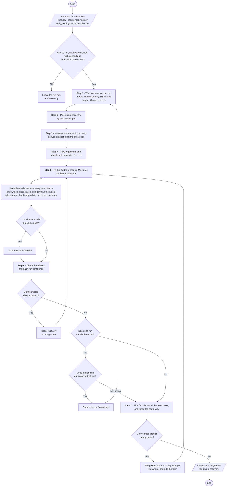
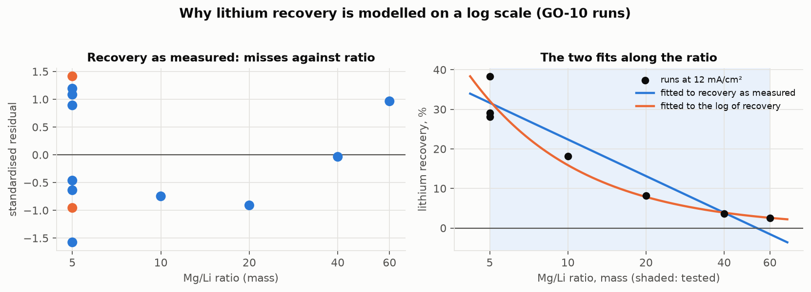
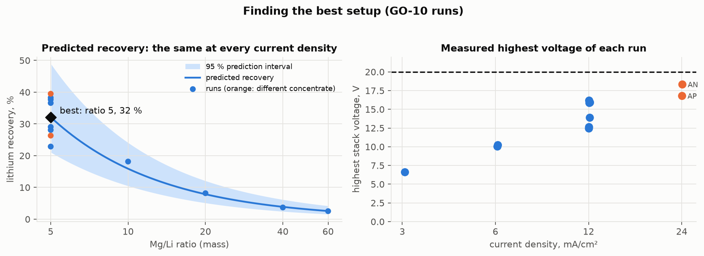

# Plan for building the model

The steps from the lab's data to a polynomial for lithium recovery, and from the polynomial to the
setup that recovers the most lithium. Each step answers four questions: **What** it produces,
**Why** it is needed, **How** it is done, and its **Results**: what it shows on the lab's real
runs. The reviewers asked for quantitative results rather than description, so every Results
section is a number, a table or a figure.

**Scope: GO-10 membranes, lithium recovery.** The model is built from the GO-10 runs; runs on every
other membrane are left out. Its one output is lithium recovery, and its job is to suggest the
setup that recovers the most lithium. Permselectivity and the stack voltage can be modelled the
same way later.

## The path at a glance

From the data files to the polynomial, every step and every decision on one page. Read it from
top to bottom; each step is explained in full below.

| Shape | Means |
|---|---|
| Rounded box | where the path starts and ends |
| Slanted box | what goes in (the data files) and what comes out (the polynomial) |
| Rectangle | something that is done |
| Diamond | a question; the path follows the answer, Yes or No |

The polynomial is then used in Step 8, to find the setup with the highest predicted recovery, and
tested in Step 9 on runs it has never seen.

See [polynomial.md](polynomial.md) for the equation itself; the per-run quantities are defined in
[Step 1](#step-1-one-row-of-numbers-per-run).

| Step | Status |
|---|---|
| 1. One row of numbers per run | to do |
| 2. Look at the data before fitting | to do |
| 3. Measure the scatter between repeat runs | to do |
| 4. Prepare the inputs | to do |
| 5. Fit a ladder of candidate models and compare them | to do |
| 6. Check the chosen model | to do |
| 7. Compare with a flexible model | to do |
| 8. Find the setup that recovers the most lithium | to do |
| 9. Test on runs the model has never seen | to do |

<strong>The GO-10 runs used in the results</strong>

Every Results section is worked on the lab's real GO-10 runs. They are the GO-10 runs fed with
400 mg/L of lithium that passed the standard charge, about 48.5 mA·h per cm² of membrane. Every
number is taken from the lab's workbook (`ED_data_from M-BF(Updated).xlsx`).

| Run | Current density (mA/cm²) | Mg/Li ratio, mass (molar) | Concentrate at the start | Lithium recovery (%) | Highest stack voltage (V) |
|---|---|---|---|---|---|
| AJ | 3.06 | 5 (1.43) | LiCl, 0.5 g/L | 22.87 | 6.60 |
| AH | 6.09 | 5 (1.43) | LiCl, 0.5 g/L | 36.59 | 10.03 |
| AI | 6.11 | 5 (1.43) | LiCl, 0.5 g/L | 37.66 | 10.22 |
| AE | 12.12 | 5 (1.43) | LiCl, 0.5 g/L | 38.27 | 15.93 |
| BD | 12.07 | 5 (1.43) | LiCl, 0.5 g/L | 29.06 | 15.85 |
| BE | 12.05 | 5 (1.43) | LiCl, 0.5 g/L | 28.09 | 16.17 |
| AF | 12.12 | 10 (2.86) | LiCl, 0.5 g/L | 18.15 | 15.89 |
| AG | 12.11 | 20 (5.71) | LiCl, 0.5 g/L | 8.18 | 13.88 |
| AT | 12.04 | 40 (11.42) | LiCl, 0.5 g/L | 3.69 | 12.63 |
| AW | 12.03 | 60 (17.13) | LiCl, 0.5 g/L | 2.53 | 12.44 |
| AN | 24.11 | 5 (1.43) | **NaCl, 5 g/L** | 39.50 | 18.32 |
| AP | 24.06 | 5 (1.43) | **LiCl, 5 g/L** | 26.32 | 16.79 |

Where each number comes from in the workbook, on each run's sheet: recovery is the whole-run value
in column AZ (the last concentrate sample against the first); current density is the average of
the hourly values in column H; the voltage is the highest multimeter reading in column E.

- **Not yet in the data files:** BD and BE (repeats of AE's settings, run two months later), and
  AW's lab results. Once they are, every result is redone from the data files by the project's own
  code, and should agree with these.
- **AN and AP started with a stronger concentrate.** They are kept, drawn apart in every figure,
  and each result is also checked without them.
- **Not used:** BA (ran 18 hours, so it passed a different charge), and BB, BC and BF (other
  feeds).

---

## Step 1: One row of numbers per run

<strong>What</strong>

For every GO-10 run, one row of numbers: the two inputs the model learns from, current density
$`i`$ and Mg/Li feed ratio $`R`$, and the output it predicts, lithium recovery. Charge per lithium
offered $`q`$ is worked out
for every run as well, to describe it, but is not a model input (see
[Charge per lithium offered](#charge-per-lithium-offered)).

<strong>Why</strong>

A model learns only from input–output pairs, one per experiment, and everything after this step
(the fit, the checks, the recommendation) inherits any error in these numbers. So every number is
calculated from the raw readings (tank weights, lab concentrations, meter readings) by stated
equations, never copied from a derived cell, and every definition follows the lab's workbook so
that each result can be checked against the lab's own. Lithium recovery is the output because the
question is which setup harvests the most of the lithium on offer.

<strong>How</strong>

Each symbol below has one meaning only. Current density is $`i`$, never $`J`$.

**Where the definitions come from.** The lab's workbook (`ED_data_from M-BF(Updated).xlsx`) is the
source: every definition below follows it, and names the workbook columns it matches. Cell
references are to the run sheets (`New_set_…`), using run AE's rows; the whole-run results are in
row 28. Where the GO-10 manuscript defines a quantity differently, a **Differs from the
manuscript** note says how.

#### The two tanks the calculations use

| Tank | CSV label | What happens to it |
|---|---|---|
| Diluate | `dil` | starts as the feed (lithium and magnesium); loses ions as they cross the membranes |
| Concentrate | `conc` | receives what crossed; this is where the lithium is collected |

So what **crossed** is measured as the gain in the concentrate, and what was **on offer** is
measured in the diluate at the start. The third tank, the electrode rinse (`rinse`), only flows
past the electrodes and is not used in any calculation.

#### The row each run produces

Every run is boiled down to four numbers: the two inputs the model learns from, $`q`$, which
describes the run, and the one output. Two of them are read almost straight from the CSV files. The
other two need the building blocks that follow, which is why the building blocks come first.

| Number | Role | Calculated from |
|---|---|---|
| Current density, $`i`$ | input | average current through the stack (`stack_readings.csv` → `meter_current_ma`) and membrane area (`runs.csv` → `area_cm2`); no building block needed |
| Mg/Li feed ratio, $`R`$ | input | planned feed concentrations (`runs.csv` → `li_feed_mg_l`, `mg_feed_mg_l`); no building block needed |
| Charge per lithium offered, $`q`$ | input | **[charge passed](#building-blocks)**, the number of cell pairs (`runs.csv` → `cell_pairs`), and the lithium in the diluate at the start (**[metal in a tank](#building-blocks)** → **[moles](#building-blocks)**) |
| Lithium recovery | output | the lithium that crossed into the concentrate (**[metal that crossed](#building-blocks)**), and the lithium in the diluate at the start (**[metal in a tank](#building-blocks)**) |

The building blocks in **bold** link to the table that defines them, in the next section. Each of
the four numbers then has its own section below, under *Inputs* and *Output*.

#### Which current

The current is recorded twice, and both readings are correct. The supply current
(`supply_current_a`) is what the power supply delivers. How much of it actually passes through the
stack is decided by the stack itself, and that is the multimeter reading (`meter_current_ma`).
Every quantity here describes the stack, so every current $`I`$ below is the multimeter current,
turned from mA into A. The workbook does the same: every current-based column (G, H, I, J, L)
is calculated from the multimeter column F, and the supply column D is never used.

#### Building blocks

| Quantity | Equation | Meaning | Where the values are (CSV files and models) | Used by |
|---|---|---|---|---|
| Volume in a tank | $`\displaystyle V = \frac{w - w_0}{1000}`$ (L) | balance reading less the empty tank, taking 1 g = 1 mL | $`w`$: CSV `tank_readings.csv` → `weight_g`; Model `TankReading.weight_g`  $`w_0`$: CSV `runs.csv` → `tare_conc_g`, `tare_dil_g` or `tare_rinse_g`, matching the reading's `tank`; Model `Run.tare_conc_g`, `Run.tare_dil_g`, `Run.tare_rinse_g` Workbook: columns AJ (concentrate) and AR (diluate) | [Metal in a tank](#building-blocks) (*V*) |
| Metal in a tank | $`\displaystyle m = c\,V`$ (mg) | lab concentration (mg/L) times volume; concentration alone means little because the tanks gain and lose water all run | $`c`$: CSV `samples.csv` → `li_mg_l`, joined to its tank reading on `run_code`, `minute`, `tank`; Model `Sample.li_mg_l`, reached as `TankReading.sample`  $`V`$: the row above Workbook: e.g. `AL24*AJ24` | [Metal that crossed](#building-blocks) (both ends) [Charge per lithium offered](#charge-per-lithium-offered) (lithium offered) [Lithium recovery](#lithium-recovery) (lithium at the start) |
| Metal that crossed | $`\displaystyle \Delta m = m_{\text{end}} - m_{\text{start}}`$ | the change between the first and last sampled minute | the earliest and latest `minute` of that run and tank with both a sample and a weight: CSV `samples.csv` and `tank_readings.csv` → `minute`; Model `TankReading.minute`, over `Run.tank_readings` Workbook: `AL24*AJ24 - AL8*AJ8` (lithium, concentrate) | [Lithium recovery](#lithium-recovery) (lithium gained) |
| Moles | $`\displaystyle n = m / M`$ | milligrams turned into millimoles, with $`M`$ = 6.94 g/mol for lithium | none: the molar mass is a constant | [Charge per lithium offered](#charge-per-lithium-offered) (*n*Li,offered) |
| Charge passed | $`\displaystyle Q = \sum_k \frac{1}{2}\,(I_k + I_{k+1})\,(\tau_{k+1} - \tau_k)`$ | area under the current–time curve, in coulombs, with $`I_k`$ the current through the stack and $`\tau_k`$ the time of reading $`k`$ in seconds; no meter totals it, so it is summed from the power log, read mostly every 5 minutes. See [How the charge is added up](#how-the-charge-is-added-up) below. | $`I`$: CSV `stack_readings.csv` → `meter_current_ma`, ÷ 1000 to amps; Model `StackReading.meter_current_ma`  $`\tau`$: CSV `stack_readings.csv` → `minute` × 60; Model `StackReading.minute`, over `Run.stack_readings` Workbook: column I, total in I54 | [Charge per lithium offered](#charge-per-lithium-offered) (*Q*) |

##### How the charge is added up

Charge is current × time. The difficulty is that the current wasn't measured continuously; someone
wrote it down every 5 minutes for most of a run. Long runs switch to every 15 or 30 minutes later
on, and now and then a reading was missed. So the program works it out piece by piece:

1. Take two readings in a row, say at 0 and 5 minutes.
2. Average them. That's roughly the current flowing between them.
3. Multiply by the time between them, in seconds (5 min = 300 s). That's the charge for that
   slice.
4. Do the same for every pair of readings, and add up the slices.

Because each slice uses its own gap, a missed reading or a wider spacing needs no special handling.

Example: the first 20 minutes of run AE, a 12 mA/cm² run (`stack_readings.csv`, columns `minute`
and `meter_current_ma`, turned into amps). The reading at minute 5 was never written down, so the first gap is
10 minutes:

| Time | Current |
|---|---|
| 0 min | 0.0721 A |
| 10 min | 0.0724 A |
| 15 min | 0.0725 A |
| 20 min | 0.0725 A |

- 0 → 10 min: average 0.07225 A × 600 s = 43.35 C
- 10 → 15 min: average 0.07245 A × 300 s = 21.74 C
- 15 → 20 min: average 0.0725 A × 300 s = 21.75 C
- **Total charge = 86.84 C**

The program has to calculate this because nothing on the bench measures total charge directly. In
maths this is called "the area under the current–time curve", because if you plot current against
time, the charge is the area underneath the line.

The workbook (column I) adds the charge up an hour at a time: the hour's average current × 3600 s,
or the same slice method where readings are 30 minutes apart. Summing slice by slice over every
reading is the same idea done more finely, and for run AE the two agree: 1046.9 C here against
1046.8 C in the workbook (I54).

#### Inputs: the settings chosen at the bench

Under each equation, every variable is traced to where it comes from: a CSV column and the model
attribute that holds it, a constant, or a link to the calculation that produces it. The model
classes are in `src/limodel/models/`.

##### Current density

**Current density, $`i`$ (mA/cm²)**

$$\displaystyle i = \frac{\bar I \times 1000}{A}, \qquad A = 6\ \text{cm}^2$$

Variables:

| Symbol | What it is | Where it comes from |
|---|---|---|
| $`\bar I`$ | average current through the stack over the run's readings, in A | CSV: `stack_readings.csv` → `meter_current_ma`, ÷ 1000 to amps Model: `StackReading.meter_current_ma`, one per item of `Run.stack_readings` |
| $`A`$ | membrane area per cell pair, in cm² | CSV: `runs.csv` → `area_cm2` Model: `Run.area_cm2` |
| 1000 | turns A into mA | fixed |

How hard the current is pushed through each square centimetre of membrane: the driving force.
More current moves ions faster but needs more voltage, and more of it can go to magnesium: lithium
near the membrane can run short, and magnesium then carries more of the current.

Workbook: column H, `=G/I2`, with G the `AVERAGE` of the multimeter column F, hour by hour. For run
AE that is 12.11 mA/cm² in the first hour.

##### Feed ratio

**Mg/Li feed ratio, $`R`$ (mol/mol)**

$$\displaystyle R = \frac{c^{\text{feed}}_{\text{Mg}} / 24.305}{c^{\text{feed}}_{\text{Li}} / 6.94}$$

Variables:

| Symbol | What it is | Where it comes from |
|---|---|---|
| $`c^{\text{feed}}_{\text{Mg}}`$ | magnesium in the feed as set up, in mg/L | CSV: `runs.csv` → `mg_feed_mg_l` Model: `Run.mg_feed_mg_l` |
| $`c^{\text{feed}}_{\text{Li}}`$ | lithium in the feed as set up, in mg/L | CSV: `runs.csv` → `li_feed_mg_l` Model: `Run.li_feed_mg_l` |
| 24.305, 6.94 | molar masses of Mg and Li, in g/mol; they turn mg/L into mmol/L | constant |

How much magnesium competes with each lithium. Real brines have high $`R`$, which is why it matters.
The model uses $`\ln R`$ (Step 4).

Workbook: cell E4, `=(E2*6.94)/(E1*24.305)`, from the planned feed in E1 (Li) and E2 (Mg); 1.43
for run AE. The workbook names runs by the mass ratio in E3 (5 for run AE), but calculates with
the molar one.

**Differs from the manuscript:** the manuscript's model uses the *mass* ratio (Na/Li 5–75). For
the model the two are interchangeable: the molar ratio is the mass ratio × 6.94 / 24.305, so
$`\ln R`$ only shifts by a constant, and coding to −1…+1 (Step 4) removes the shift. The fit is
identical either way; only the axis labels change.

##### Charge per lithium offered

**Charge per lithium offered, $`q`$ (dimensionless)**

$$\displaystyle q = \frac{Q\,N / F}{n_{\text{Li,offered}}}, \qquad N = 10 \text{ cell pairs}, \quad F = 96\,485\ \text{C/mol}$$

Variables:

| Symbol | What it is | Where it comes from |
|---|---|---|
| $`Q`$ | total charge passed over the run, in C | calculation: [Charge passed](#building-blocks) |
| $`N`$ | number of cell pairs | CSV: `runs.csv` → `cell_pairs` Model: `Run.cell_pairs` |
| $`F`$ | Faraday constant, 96 485 C/mol | constant |
| $`n_{\text{Li,offered}}`$ | lithium in the diluate at its first sampled minute, in mol | calculation: [Metal in a tank](#building-blocks) for the `dil` tank at its first sampled minute, turned into moles as in [Moles](#building-blocks) |

$`Q N / F`$ is the moles of charge moved across all $`N`$ membranes; $`n_{\text{Li,offered}}`$ is the lithium the
diluate held at the start. It says how hard the run was pushed against how much lithium there was
to move. $`q = 1`$ means just enough charge to move every lithium, had lithium alone carried the
current; anything above 1 is charge spent on magnesium or lost. It exists because the runs no
longer pass equal charge and the tanks differ in size, so neither current density nor duration
describes a run on its own. This one number takes in run length, tank size and feed strength
together, and it answers "how long should it run".

Not in the workbook or the manuscript: $`q`$ is this project's own input. It is built from two
quantities the workbook does have: the equivalents transported, $`QN/F`$ (column J, `=I*10/96485`,
summed over the run), and the lithium the diluate started with (`AT8*AR8`).

**Not a model input for the present runs.** Across the 9 GO-10 runs with lab results, $`q`$ only
ranges from 0.87 to 1.04: every run passed about 1040–1056 C into about 2 L of diluate at about
400 mg/L of lithium, so the design holds it nearly constant, and its small spread comes from differences in
the measured feed rather than from a chosen setting. A model cannot learn the effect of an input
that hardly varies; it would fit noise. So the model's inputs are current density and feed ratio
(see [Step 2](#step-2-look-at-the-data-before-fitting)). $`q`$ is still worked out for every run, to
describe it, and becomes an input once runs vary the charge.

##### Charge per lithium offered, in simple terms

> Here it is with run AE's real numbers.
>
> **What q measures:** how much charge you pushed through the stack, compared with how much lithium
> there was to move.
>
> **Think of charge as tickets.** Each unit of charge lets one positive charge cross a membrane. A
> lithium ion (Li⁺) needs 1 ticket. A magnesium ion (Mg²⁺) needs 2, because it carries two charges.
>
> **Step 1: count the tickets.**
> - Run AE passed 1046.9 C of charge through the stack over its 4 hours (the area under the current curve from
>   earlier).
> - Dividing by Faraday's constant turns coulombs into moles of tickets: 1046.9 / 96 485 = 10.85 mmol.
> - The stack has 10 cell pairs, and the same current crosses all 10 membranes. So each ticket is
>   used 10 times: 10.85 × 10 = **108.5 mmol of tickets**.
>
> **Step 2: count the lithium.**
> - The diluate started with 2.006 L at 403.1 mg/L, so 808.7 mg of lithium.
> - 808.7 / 6.94 = **116.5 mmol of lithium**.
>
> **Step 3: divide.**
> - q = 108.5 / 116.5 = **0.93**
>
> **What 0.93 means.** Run AE was given enough tickets to move 93% of its lithium, if lithium had
> got all of them. It didn't: AE's recovery was only about 38%. Magnesium took many of the tickets,
> two at a time, and some were wasted. So:
>
> - **q = 1:** exactly enough charge for all the lithium, in the ideal case.
> - **q above 1:** extra charge, which ends up spent on magnesium or wasted.
>
> **Why not just use current density or run time?** They don't tell you how big the job was.
> Picture two runs with the same current for the same 4 hours, one with a 2 L tank and one with a
> 4 L tank. The 4 L tank holds twice the lithium, so the same charge is only half as much push per
> lithium. Current density and time can't tell those two runs apart; q can: about 0.93 for the
> first and about 0.47 for the second.
>
> **The same formula, turned around, gives the run length.** You choose the q you want and the current, and it
> tells you how long to run:
>
> hours = q × (lithium available) × F / (N × current)
>
> For AE's tank at AE's current, aiming for q = 1.5 gives about **6.4 hours**.

#### Output: what is measured

##### Lithium recovery

**Lithium recovery (%)**

$$\displaystyle \text{recovery} = 100 \times \frac{\Delta m^{\text{conc}}_{\text{Li}}}{m^{\text{dil}}_{\text{Li,start}}}\ \%$$

Variables:

| Symbol | What it is | Where it comes from |
|---|---|---|
| $`\Delta m^{\text{conc}}_{\text{Li}}`$ | milligrams of lithium the concentrate gained | calculation: [Metal that crossed](#building-blocks) for the `conc` tank |
| $`m^{\text{dil}}_{\text{Li,start}}`$ | milligrams of lithium in the diluate at its first sampled minute | calculation: [Metal in a tank](#building-blocks) for the `dil` tank at its first sampled minute |
| 100 | turns the fraction into a percent | fixed |

How much of the lithium on offer was actually harvested: the share of the diluate's lithium that
ended up in the concentrate. It is what the model predicts, and the setup the model recommends is
the one that makes it highest.

Workbook: column AZ, `=(AL24*AJ24-AL8*AJ8)*100/(AT8*AR8)`; whole run in AZ28. For run AE,
**38.27 %**.

**Differs from the manuscript:** the manuscript's "Li recovery efficiency" (Eq 4) is
$`(C_{\text{out}} - C_{\text{in}})/C_{\text{in}} \times 100`$ on the concentrate's lithium
concentration: how much the concentrate was enriched, not what share of the feed's lithium was
collected.

<strong>Results</strong>

To show: the full results table, one row per run; one run worked by hand beside the program's
answer; each run's recovery set beside the workbook's own value; and the mass-balance gap (lithium
that left the diluate against lithium that arrived in the concentrate) as evidence the numbers are
sound.

Defining these quantities has already shown one thing the progress report must change. **Feed
ratio units:** the report's dataset table says "by mass". Ions compete for the current per ion,
not per gram, so the ratio is molar. The two differ by 24.305 / 6.94 ≈ 3.5, so a mass ratio of 60
is a molar ratio of about 17.

#### Run AE's recovery, worked by hand

Real numbers, from the lab's workbook (run AE's sheet), whole run:

| Quantity | Working | Value |
|---|---|---|
| Lithium in the concentrate at the first sample | 63.56 mg/L (AL8) × 2.0235 L (AJ8) | 128.61 mg |
| Lithium in the concentrate at the last sample | 218.5 mg/L (AL24) × 2.0053 L (AJ24) | 438.16 mg |
| Lithium the concentrate gained, $`\Delta m^{\text{conc}}_{\text{Li}}`$ | 438.16 − 128.61 | **309.54 mg** |
| Lithium in the diluate at the start, $`m^{\text{dil}}_{\text{Li,start}}`$ | 403.1 mg/L (AT8) × 2.0063 L (AR8) | **808.74 mg** |
| Recovery | 100 × 309.54 / 808.74 | **38.27 %** |

The workbook's own value, AZ28, is 38.27 %: the hand calculation and the workbook agree. Every
other run's recovery is in the table of runs at the top of this plan.

## Step 2: Look at the data before fitting

<strong>What</strong>

Before choosing any equation, examine two things: the *design*, meaning which combinations of
settings were actually run, and the *shape* lithium recovery takes as each input changes.

<strong>Why</strong>

A model can only learn what the design lets it see. A combination of settings that was never run
cannot be estimated; settings that always moved together cannot be separated; an input that hardly
varies cannot be learned at all. And the shapes say which terms an equation needs (straight,
curved, levelling off) and on which scale: $`R`$ or $`\ln R`$. Looking first stops the model from
being given terms the data cannot support.

<strong>How</strong>

**The design.** For the membrane being modelled, a table (or plot) of current density against feed
ratio, one entry per run, beside each run's other conditions: starting concentrate, run length and
total charge. It shows the combinations that are missing, settings that moved together, conditions
that differ between runs, and which runs are repeats.

**The shapes.** Lithium recovery plotted against each input,
using runs where the other input is held fixed, so that only one thing changes along each plot.
The ratio plots are drawn twice, against $`R`$ and against $`\ln R`$: whichever is closer to a
straight line is the evidence for Step 4's choice. Runs whose other conditions differ are drawn
apart.

In each plot, look for:

- whether the trend is straight, curved, or levelling off, which decides whether a squared term is
  needed;
- any point far from the others, a candidate to check with the lab;
- how far apart repeat runs sit, the noise level everything else is judged against.

<strong>Results</strong>

The design of the GO-10 runs (listed at the top of this plan): current density across, Mg/Li feed
ratio (by mass, as the runs are named) down, one run code per run.

| Mg/Li (mass) ↓ \ current density (mA/cm²) → | 3 | 6 | 12 | 24 |
|---|---|---|---|---|
| 5 | AJ | AH, AI | AE, BD, BE | AN, AP |
| 10 | | | AF | |
| 20 | | | AG | |
| 40 | | | AT | |
| 60 | | | AW | |

#### What the design shows

1. **It is a cross, by design.** 12 mA/cm² is the lab's chosen operating current (confirmed by
   the lab). The design varies one factor at a time around the base run AE (12 mA/cm², ratio 5):
   current density was varied at ratio 5, and the ratio at 12 mA/cm². Each arm answers its own
   question: what current density does at ratio 5, and what the ratio does at the operating
   current. No run combines a high current with a high magnesium load, so the model cannot learn
   whether the best current depends on the ratio: the $`i \times R`$ interaction term cannot be
   estimated.
2. **Current density and run length are tied.** Every run passed the same charge per area, so
   3 mA/cm² ran 16 h, 6 ran 8 h, 12 ran 4 h and 24 ran 2 h. Any effect of current density is also
   an effect of run length, and the data cannot separate the two.
3. **The ratio was changed through magnesium alone.** Every run's feed held 400 mg/L of lithium;
   only the magnesium changed (2000, 4000, 8000, 16 000 and 24 000 mg/L for ratios 5, 10, 20, 40
   and 60). So the feed ratio and the magnesium concentration are the same variable here, and the
   data cannot tell an effect of the *ratio* from an effect of *more magnesium*. What the model
   learns about $`R`$ holds for a 400 mg/L lithium feed; a brine with the same ratio but a
   different lithium concentration is outside what was tested. It is also why charge per lithium
   offered barely varies: the lithium on offer was the same in every run.
4. **The 24 mA/cm² runs started differently.** Their concentrate began as NaCl at 5 g/L (AN) or
   LiCl at 5 g/L (AP); every other run began with LiCl at 0.5 g/L. They are not directly
   comparable with the rest, and are drawn apart in every figure.
5. **Two groups of repeats,** both at ratio 5: AH and AI at 6 mA/cm², and AE, BD and BE at
   12 mA/cm². BD and BE were run two months after AE. Step 3 rests on them.
6. **The high-ratio end rests on one run per ratio:** AT (40) and AW (60).
7. **Charge per lithium offered barely varies** (0.87 to 1.04), so it is not a model input for
   these runs; see [Charge per lithium offered](#charge-per-lithium-offered). The inputs are current
   density and feed ratio.

#### What the shapes show

Because of the cross, each input is seen with the other held fixed: current density at ratio 5,
the ratio at 12 mA/cm².

- **Against current density** (ratio 5): 22.9 % at 3 mA/cm², 36.6 and 37.7 % at 6, 28.1 to
  38.3 % at 12, and 26.3 and 39.5 % at 24 (the two runs with a different concentrate). Beyond
  6 mA/cm² there is no clear trend: the three runs at 12 mA/cm² differ from each other more than
  the levels differ. Only the 3 mA/cm² run is clearly lower, and it is a single run.
- **Against the ratio** (12 mA/cm²): from 31.8 % on average at ratio 5 to 18.2, 8.2, 3.7 and
  2.5 % at ratios 10, 20, 40 and 60. Recovery roughly halves each time the ratio doubles.
- **Against $`\ln R`$ the points are still curved.** A straight line in $`\ln R`$ will not follow
  them, which already hints that the logarithm of recovery may be needed (Step 6).
- **The spread at the base run** (28.1 to 38.3 %) is as large as any trend in current density;
  Step 3 measures it.

## Step 3: Measure the scatter between repeat runs

<strong>What</strong>

One number saying how much the lithium recovery of two runs made at identical settings disagrees.
This is the experiment's own noise, called the *pure error*.

<strong>Why</strong>

Two runs with every setting the same never give identical results: each feed is made up
separately, membranes age, and every sample and lab analysis carries its own error. No model can
predict a new run more precisely than the experiment repeats itself. So this number is the floor
that every later error is measured against: a model whose prediction error (Step 5) is close to
it has captured everything there is to capture, and one that misses by much more is missing
something real. The lack-of-fit test in Step 5 cannot be done without it.

<strong>How</strong>

#### Which runs count as repeats

Two runs are repeats, and fall in the same group, only if they match on every one of these
settings. The settings decide which runs are grouped together; once the groups exist, the equation
below never looks at them again.

| Setting | Why it must match | Where it comes from |
|---|---|---|
| Membrane | different membranes move ions differently, so a difference between them is the membrane's effect, not noise | CSV: `runs.csv` → `cem` Model: `Run.cem` |
| Planned feed | the lithium and magnesium the feed was made up with set the ratio, an input of the model, so runs at different ratios are expected to differ | CSV: `runs.csv` → `li_feed_mg_l`, `mg_feed_mg_l` Model: `Run.li_feed_mg_l`, `Run.mg_feed_mg_l` |
| Current density | an input of the model, for the same reason; matched to the nearest design level (3, 6, 12 or 24 mA/cm²), see the note below | calculation: [Current density](#current-density) |
| Starting concentrate | the salt the concentrate starts with sets the concentration difference across the membrane, and so how much diffuses back; runs started differently are not the same experiment | CSV: `runs.csv` → `conc_start_salt`, `conc_start_g_l` Model: `Run.conc_start_salt`, `Run.conc_start_g_l` |
| Run length | a longer run passes more charge and strips more of the diluate, so recovery moves with it | CSV: `stack_readings.csv` → `minute`, the run's largest Model: `StackReading.minute`, over `Run.stack_readings` |
| Included | a run the lab does not stand behind would put its own problem into the noise estimate | CSV: `runs.csv` → `include` Model: `Run.include` |

For example, among the GO-10 runs:

| Runs | Membrane | Planned feed (Li / Mg, mg/L) | Current density (mA/cm²) | Starting concentrate | Run length | Included | Same group? |
|---|---|---|---|---|---|---|---|
| AH, AI | GO-10 | 400 / 2000 | 6 | LiCl 0.5 g/L | 8 h | yes | **yes**: one group |
| AN, AP | GO-10 | 400 / 2000 | 24 | NaCl 5 g/L against **LiCl 5 g/L** | 2 h | yes | **no**: the starting concentrate differs |
| AE, BA | GO-10 | 400 / 2000 | 12 | LiCl 0.5 g/L | 4 h against **18 h** | yes | **no**: the run length differs |

The intended current is not recorded: `runs.csv` → `set_current_ma` (`Run.set_current_ma`) is
empty for every GO-10 run. So "same current" is judged from the *measured* current density, which
is never exactly equal between repeats (12.1 against 12.0 mA/cm²), by matching it to the nearest
design level. Filling in `set_current_ma` would make the grouping exact, since it records what was
intended rather than what was measured.

#### Pooling the scatter

The scatter within the groups is pooled over all of them:

$$\displaystyle s_{\text{pe}}^2 = \frac{\sum_g \sum_{j \in g} \left(y_j - \bar y_g\right)^2}{\nu_{\text{pe}}}, \qquad \nu_{\text{pe}} = \sum_g \left(n_g - 1\right)$$

Variables:

| Symbol | What it is | Where it comes from |
|---|---|---|
| $`s_{\text{pe}}^2`$ | the pure-error variance: the experiment's own noise, squared, in points of recovery squared | calculation: the first equation above |
| $`s_{\text{pe}}`$ | the pure-error standard deviation: the typical difference between two runs at the same settings, in points of recovery; the number used in every later step | calculation: $`\sqrt{s_{\text{pe}}^2}`$ |
| $`\sum_g`$ | add up over every group of repeats | notation |
| $`g`$ | a group of repeat runs | [Which runs count as repeats](#which-runs-count-as-repeats) |
| $`\sum_{j \in g}`$ | add up over every run $`j`$ belonging to group $`g`$ | notation |
| $`j`$ | one run, counted within its group | the runs of group $`g`$ |
| $`y_j`$ | the lithium recovery of run $`j`$ | calculation: [Lithium recovery](#lithium-recovery) |
| $`\bar y_g`$ | the average recovery of the runs in group $`g`$ | calculation: the mean of $`y_j`$ for the runs in $`g`$ |
| $`\left(y_j - \bar y_g\right)^2`$ | how far run $`j`$ sits from its own group's average, squared, so that misses above and below both count | calculation |
| $`\nu_{\text{pe}}`$ | the degrees of freedom: how many independent comparisons the repeats give; each group gives one fewer than its number of runs, because its average was taken from those same runs | calculation: the second equation above |
| $`n_g`$ | the number of runs in group $`g`$ | count |

Step 3 reads nothing new from the files: it reuses Step 1's numbers and groups them.

For a single pair of runs the equations reduce to

$$\displaystyle s_{\text{pe}} = \frac{\left|y_1 - y_2\right|}{\sqrt{2}}, \qquad \nu_{\text{pe}} = 1$$

Variables:

| Symbol | What it is | Where it comes from |
|---|---|---|
| $`y_1`$, $`y_2`$ | the recovery of the two runs in the pair | calculation: as $`y_j`$ above |
| $`\lvert y_1 - y_2 \rvert`$ | the size of their difference, ignoring its sign | calculation |
| $`\sqrt{2}`$ | both runs carry error, so their difference is $`\sqrt{2}`$ times noisier than either run alone | constant |

How far $`s_{\text{pe}}`$ can be trusted depends on $`\nu_{\text{pe}}`$. Its 95 % confidence
interval for the true standard deviation is

$$\displaystyle s_{\text{pe}} \sqrt{\frac{\nu_{\text{pe}}}{\chi^2_{0.975,\,\nu_{\text{pe}}}}} \;\le\; \sigma \;\le\; s_{\text{pe}} \sqrt{\frac{\nu_{\text{pe}}}{\chi^2_{0.025,\,\nu_{\text{pe}}}}}$$

Variables:

| Symbol | What it is | Where it comes from |
|---|---|---|
| $`\sigma`$ | the true standard deviation of the experiment's noise, which $`s_{\text{pe}}`$ estimates and which can never be known exactly | unknown; the interval says where it lies |
| $`s_{\text{pe}}`$ | the pure-error standard deviation | calculation: the first equations above |
| $`\nu_{\text{pe}}`$ | its degrees of freedom | calculation: the first equations above |
| $`\chi^2_{q,\,\nu}`$ | the value of the chi-squared distribution with $`\nu`$ degrees of freedom below which a share $`q`$ of its values fall | statistical table |
| $`\chi^2_{0.975,\,\nu_{\text{pe}}}`$ | the upper value, which sets the interval's lower end | statistical table |
| $`\chi^2_{0.025,\,\nu_{\text{pe}}}`$ | the lower value, which sets the interval's upper end | statistical table |
| 0.975, 0.025 | the two tails left outside a 95 % interval, 2.5 % on each side | fixed |

With one degree of freedom that interval runs from about 0.45 to about 32 times the estimate,
which says almost nothing; with four it narrows to about 0.6 to 2.9 times. Several repeats are
needed for the number to be useful, and the most valuable place for them is the base run, which
sits on both arms of the design.

The scatter is also given relative to the typical size of recovery:

$$\displaystyle \text{relative scatter} = \frac{s_{\text{pe}}}{\bar y}$$

Variables:

| Symbol | What it is | Where it comes from |
|---|---|---|
| $`s_{\text{pe}}`$ | the pure-error standard deviation | calculation: the first equations above |
| $`\bar y`$ | the average recovery of every run in the repeat groups | calculation: the mean of all $`y_j`$ used above |

#### Measuring the scatter, in simple terms

> **The idea.** Weigh yourself twice in a row and the scale might say 70.2 kg, then 70.5 kg. You
> did not change; that 0.3 kg is how precise the scale is. If you weigh yourself after lunch and it
> says 70.4 kg, you cannot claim lunch made a difference: the change is smaller than the scale's
> own wobble.
>
> Runs work the same way. Two runs at exactly the same settings never give exactly the same recovery:
> each feed is made up separately, the membranes age, and every lab result has its own error. That
> disagreement is the experiment's wobble, the pure error.
>
> **Why it matters.** It is the yardstick for everything after this step:
>
> - **For the model (Step 5):** if the model misses unseen runs by about the wobble, it is as good
>   as any model can be. If it misses by much more, it is missing something real.
> - **For the data (Step 2):** a difference between two runs only means something if it is bigger
>   than the wobble.
>
> **Calculating it.** Take AH and AI, two runs at 6 mA/cm² and ratio 5, which recovered 36.59 %
> and 37.66 % of their lithium:
>
> - difference = 1.07 points
> - wobble $`s_{\text{pe}}`$ = 1.07 / √2 = **0.76 points**
>
> The √2 is there because both runs carry error, so their difference is noisier than either run
> alone. With more repeats, each run's distance from its own group's average is measured, and all
> the groups are combined: that is the formula above.
>
> **How much to trust it.** A wobble estimated from one pair is very unreliable:
>
> | Repeats behind the estimate (degrees of freedom) | True wobble could be anywhere from … to … |
> |---|---|
> | 1 (a single pair) | 0.45× to 32× the estimate |
> | 3 | 0.57× to 3.7× |
> | 4 | 0.6× to 2.9× |
>
> With one pair, the number says almost nothing. Several repeats are needed, and the best place for
> them is the base run (12 mA/cm², ratio 5), because it sits on both arms of the cross.

<strong>Results</strong>

To show: $`s_{\text{pe}}`$, its relative size, its degrees of freedom and its 95 % interval, and the
groups of repeat runs it came from.

#### The GO-10 repeats

| Group | Runs (recovery, %) | Group average | Squared distances from the average | Sum |
|---|---|---|---|---|
| 6 mA/cm², ratio 5 | AH 36.59, AI 37.66 | 37.13 | 0.29, 0.29 | 0.57 |
| 12 mA/cm², ratio 5 | AE 38.27, BD 29.06, BE 28.09 | 31.81 | 41.77, 7.54, 13.81 | 63.13 |

- Sum over both groups: 0.57 + 63.13 = **63.70**
- Degrees of freedom: (2 − 1) + (3 − 1) = **3**
- $`s_{\text{pe}}^2`$ = 63.70 / 3 = 21.23, so $`s_{\text{pe}}`$ = **4.61 points** of recovery
- 95 % interval for the true value: **2.6 to 17.2 points**
- Relative to the average recovery of these five runs (33.9 %): 4.61 / 33.9 = **13.6 %**

Reading it:

- **Almost all of the scatter is at the base run.** AH and AI agree within 1.1 points. AE
  recovered 9 to 10 points more than BD and BE, which were run at the same settings two months
  later. Whether that is a drift (an ageing membrane, a different piece of membrane, a different
  batch of feed) or ordinary scatter is a question for the lab, and it matters: if it is a drift,
  part of this "noise" is a real change, and the pure error overstates the experiment's own
  scatter.
- **Three degrees of freedom**, so the true scatter could lie anywhere from 2.6 to 17 points.
- **Not repeats:** AN and AP share a setting but not a starting concentrate; BA ran 18 hours.

## Step 4: Prepare the inputs

<strong>What</strong>

Put the two inputs into the form the fit uses: the feed ratio as its logarithm, and both inputs
rescaled (*coded*) to run from −1 at the lowest tested value to +1 at the highest.

<strong>Why</strong>

**The logarithm of the ratio.** The ratio is varied in doubling steps, and what matters to
transport across a membrane is the *factor* by which one ion outnumbers another: the potentials
that drive and oppose ion transport depend on the logarithm of a concentration ratio. On a log
scale, each doubling is an equal step. A parabola in $`R`$ itself would also have to turn back up
somewhere and predict selectivity improving as magnesium rises, which is not physical. A squared
term in $`\ln R`$ can still turn, so if one is kept (Step 5), its turning point must lie outside
the tested range.

**The logarithm of current density, perhaps.** Current density was also varied in doubling steps.
Whether $`i`$ or $`\ln i`$ describes recovery better is not assumed: both are tried in Step 5,
and the leave-one-out error decides.

**Coding.** Over the tested range, an input and its square rise almost together, so least squares
cannot tell their effects apart, and both coefficients come out unstable with large standard
errors. Centring the input on the middle of its range removes most of that overlap. Coding also
makes the coefficients comparable: each one says how much the output changes from the middle of
the tested range to its edge, whatever the input's units. And the intercept becomes the predicted
output at the centre of the design.

<strong>How</strong>

#### What Step 4 starts from

| Symbol | What it is | Where it comes from |
|---|---|---|
| $`i`$ | current density, in mA/cm² | calculation: [Current density](#current-density) |
| $`R`$ | Mg/Li feed ratio, molar | calculation: [Feed ratio](#feed-ratio) |
| the runs being fitted | the GO-10 runs that are included and whose recovery could be worked out | CSV: `runs.csv` → `cem`, `include` Model: `Run.cem`, `Run.include` recovery: [Lithium recovery](#lithium-recovery) |

Step 4 reads nothing new from the files: it reshapes Step 1's two inputs.

#### Taking logarithms

$$\displaystyle v_1 = i \;\text{ or }\; \ln i, \qquad v_2 = \ln R$$

Variables:

| Symbol | What it is | Where it comes from |
|---|---|---|
| $`v_1`$ | current density on the scale the fit uses; both scales are tried in Step 5 | calculation: from $`i`$ |
| $`v_2`$ | the feed ratio on the scale the fit uses | calculation: from $`R`$ |
| $`\ln`$ | the natural logarithm: $`\ln 2 = 0.693`$, so every doubling adds 0.693 | notation |

#### Coding

For each input $`v`$, that is $`v_1`$ and then $`v_2`$:

$$\displaystyle x = \frac{v - v_{\text{mid}}}{v_{\text{half}}}, \qquad v_{\text{mid}} = \frac{v_{\max} + v_{\min}}{2}, \qquad v_{\text{half}} = \frac{v_{\max} - v_{\min}}{2}$$

Variables:

| Symbol | What it is | Where it comes from |
|---|---|---|
| $`x`$ | the coded input: −1 at the lowest value among the fitted runs, 0 at the middle, +1 at the highest. $`x_1`$ is coded current density, $`x_2`$ coded $`\ln R`$ | calculation: the first equation above |
| $`v`$ | the input being coded: $`v_1`$ or $`v_2`$ | calculation: [Taking logarithms](#taking-logarithms) |
| $`v_{\text{mid}}`$ | the middle of the input's range: becomes 0 | calculation: the second equation above |
| $`v_{\text{half}}`$ | half the width of the range: becomes 1 | calculation: the third equation above |
| $`v_{\min}`$, $`v_{\max}`$ | the lowest and highest values of $`v`$ among the runs being fitted | calculation: over the runs being fitted, see [What Step 4 starts from](#what-step-4-starts-from) |

The scales are fixed by the runs being fitted, so they change when runs are added: a new run beyond
the old range moves $`v_{\min}`$ or $`v_{\max}`$, and every coded value with it.

#### Turning a coded value back into a real one

Every prediction is reported in real units:

$$\displaystyle v = v_{\text{mid}} + v_{\text{half}}\, x, \qquad i = e^{v_1} \;\text{ when } v_1 = \ln i, \qquad R = e^{v_2}$$

Variables:

| Symbol | What it is | Where it comes from |
|---|---|---|
| $`x`$, $`v_{\text{mid}}`$, $`v_{\text{half}}`$ | as in [Coding](#coding) | calculation |
| $`e^{v}`$ | the exponential, which undoes the natural logarithm: $`e^{\ln i} = i`$ | notation |

#### Checking that coding removed the overlap

For each column $`j`$ of a fitted model:

$$\displaystyle \text{VIF}_j = \frac{1}{1 - r_j^2}$$

Variables:

| Symbol | What it is | Where it comes from |
|---|---|---|
| $`\text{VIF}_j`$ | the variance inflation factor of column $`j`$: how many times larger its coefficient's variance is than it would be with no overlap. 1 means no overlap at all; above about 10, that column's coefficient cannot be trusted | calculation: the equation above |
| $`j`$ | one column of the fitted model, other than the intercept: $`x_1`$, $`x_2`$, $`x_1^2`$ or $`x_2^2`$ | the model chosen in Step 5 |
| $`r_j^2`$ | the share of column $`j`$'s variation that the model's other columns explain: the R² of a least-squares fit of column $`j`$ on the other columns | calculation: that fit |

#### Preparing the inputs, in simple terms

> **Logarithms: equal steps for equal factors.** The lab doubled the ratio each time: 5, 10, 20, 40.
> On an ordinary ruler those are unequal steps (5, then 10, then 20 apart). On a log scale every
> doubling is the same step, as each octave on a piano is the same distance up the keyboard:
>
> | R | 5 | 10 | 20 | 40 |
> |---|---|---|---|---|
> | ln R | 1.61 | 2.30 | 3.00 | 3.69 |
>
> Each step is 0.69, which is ln 2. Current density (3, 6, 12, 24) was doubled the same way.
>
> **Coding: one shared ruler from −1 to +1.** Current density runs from 3 to 24 mA/cm²; ln R from
> 1.61 to 3.69. Coding puts both on the same ruler: the lowest tested value becomes −1, the highest
> +1, the middle 0. For current density: middle = (24 + 3) / 2 = 13.5, half-width = (24 − 3) / 2
> = 10.5, so 12 mA/cm² becomes (12 − 13.5) / 10.5 = −0.14.
>
> It helps in two ways. Every coefficient then means the same thing: how much the output changes
> from the middle of what was tested to its edge, so they can be compared. And it untangles an
> input from its square. On the raw scale both rise together (3 → 9, 24 → 576), so least squares
> cannot tell which one deserves the credit. After coding, $`x`$ runs from −1 to +1 while
> $`x^2`$ is high at both ends and low in the middle, so the two move independently.
>
> **VIF: is a column already explained by the others?** If one column can be predicted from the
> others, the fit cannot tell which of them is doing the work, and its coefficient wobbles. A VIF
> of 1 means the column is entirely its own; a VIF of 10 means the others already explain 90 % of
> it.

<strong>Results</strong>

To show: the coding formula for each input with its $`v_{\text{mid}}`$ and $`v_{\text{half}}`$, and
a VIF table for the chosen model.

#### The GO-10 inputs, coded

| Input | $`v_{\min}`$ | $`v_{\max}`$ | $`v_{\text{mid}}`$ | $`v_{\text{half}}`$ | Coded levels |
|---|---|---|---|---|---|
| $`\ln i`$ | 1.118 (AJ, 3.06 mA/cm²) | 3.183 (AN, 24.11 mA/cm²) | 2.151 | 1.032 | 3 → −1, 6 → −0.33, 12 → +0.33, 24 → +1 |
| $`i`$ | 3.06 | 24.11 | 13.59 | 10.53 | 3 → −1, 6 → −0.71, 12 → −0.14, 24 → +1 |
| $`\ln R`$ | 0.356 (ratio 5) | 2.841 (AW, ratio 60) | 1.599 | 1.242 | 5 → −1, 10 → −0.44, 20 → +0.12, 40 → +0.67, 60 → +1 |

On the log scale, the doubling steps of current density become equal steps; on the plain scale,
three of the four levels crowd into the lower half.

- **Coding removes most of the overlap** between current density and its square: their correlation
  falls from 0.97 to 0.26. It does not reach 0, because seven of the twelve runs sit at
  12 mA/cm², away from the middle of the range.
- **Ratio and current density hardly overlap:** their coded values have a correlation of 0.13, so
  a model with both has a VIF of 1.02 for each.
- **The chosen model** (Step 5) has a single input, the ratio, so there is nothing for it to
  overlap with.
- **AN and AP set the top of the current-density range**; without them it would end at
  12.12 mA/cm². **AW sets the top of the ratio range.**

## Step 5: Fit a ladder of candidate models and compare them

<strong>What</strong>

Fit a short list of equations for lithium recovery, fixed in advance, each adding one term to the
one before, and choose one of them by rules also fixed in advance.

<strong>Why</strong>

Many different polynomials can pass close to a handful of points, so a curve that fits is not, by
itself, evidence that it is right. The reviewers asked why this polynomial; the answer is a
comparison. The chosen equation has to do better than every simpler one and must not be beaten by
any richer one, judged by how well it fits and, above all, by how well it predicts runs it was not
fitted to. Fixing the list before fitting matters: choosing terms by trial and error (stepwise
selection) makes the p-values look better than they are, because each term was picked for looking
significant.

<strong>How</strong>

#### What Step 5 starts from

| Symbol | What it is | Where it comes from |
|---|---|---|
| $`x_1`$ | coded current density, from $`i`$ or from $`\ln i`$ | calculation: [Coding](#coding), Step 4 |
| $`x_2`$ | coded $`\ln R`$ | calculation: [Coding](#coding), Step 4 |
| $`y_k`$ | the measured lithium recovery of run $`k`$, or its logarithm (see [When the log of recovery is needed](#when-the-log-of-recovery-is-needed), Step 6) | calculation: [Lithium recovery](#lithium-recovery) |
| $`k`$ | one of the runs being fitted, numbered 1 to $`n`$ | the runs being fitted: [What Step 4 starts from](#what-step-4-starts-from) |
| $`s_{\text{pe}}`$, $`\nu_{\text{pe}}`$ | the pure error and its degrees of freedom | calculation: [Pooling the scatter](#pooling-the-scatter), Step 3 |

Step 5 reads nothing new from the files.

#### The candidates

| Model | Equation | Coefficients, $`p`$ |
|---|---|---|
| M0 | $`\hat y = b_0`$ | 1 |
| M1 | $`\hat y = b_0 + b_2 x_2`$ | 2 |
| M2 | $`\hat y = b_0 + b_2 x_2 + b_1 x_1`$ | 3 |
| M3 | $`\hat y = b_0 + b_2 x_2 + b_1 x_1 + b_3 x_1^2`$ | 4 |
| M4 | $`\hat y = b_0 + b_2 x_2 + b_1 x_1 + b_3 x_1^2 + b_4 x_2^2`$ | 5 |

Variables:

| Symbol | What it is | Where it comes from |
|---|---|---|
| $`\hat y`$ | the output the model predicts | calculation: the equation |
| $`b_0`$ | the intercept: the predicted output at the centre of the design, where $`x_1 = x_2 = 0`$ | fitted, below |
| $`b_1`$, $`b_2`$ | how much the output changes from the centre to the edge of the tested range of current density and of ratio | fitted, below |
| $`b_3`$, $`b_4`$ | the curvature in current density and in ratio: how much the trend bends | fitted, below |
| $`x_1^2`$, $`x_2^2`$ | the coded inputs squared, which let the line bend | calculation: from $`x_1`$, $`x_2`$ |
| $`p`$ | the number of coefficients in the model, intercept included | count |

There is no $`x_1 x_2`$ term: the design cannot estimate it (Step 2). The ladder is run twice,
once with $`x_1`$ from $`i`$ and once from $`\ln i`$ (Step 4).

**Why the ratio comes first.** Ions compete for the current, so more magnesium per lithium must
lower the share of the current that lithium carries: the ratio's effect is certain from the
chemistry, while current density's is not. The ladder therefore adds the ratio first, then current
density, then the bends.

**Changed after the real runs.** The first version of this plan added current density first. On
the real runs, current density had no detectable effect, so every model containing it failed the
rule that each term be significant, while the ratio alone, the model the runs support, was not on
the list. The order was changed for that reason. It is reported here so that the reader can judge
the change.

#### Fitting by least squares

$$\displaystyle b = \left(X^\top X\right)^{-1} X^\top y$$

Variables:

| Symbol | What it is | Where it comes from |
|---|---|---|
| $`b`$ | the model's coefficients $`b_0, b_1, \ldots`$, as one column | calculation: the equation above |
| $`X`$ | the design matrix: one row per run $`k`$, one column per term of the model (a column of 1s for $`b_0`$, then $`x_1`$, $`x_2`$, …) | calculation: from $`x_1`$, $`x_2`$ of each run |
| $`X^\top`$ | $`X`$ turned on its side (rows become columns) | notation |
| $`\left(X^\top X\right)^{-1}`$ | the inverse of $`X^\top X`$, the matrix that undoes it | calculation |
| $`y`$ | the measured values $`y_k`$, as one column | [What Step 5 starts from](#what-step-5-starts-from) |

This is the set of coefficients that makes the sum of squared misses as small as it can be.

#### How well it fits

$$\displaystyle e_k = y_k - \hat y_k, \qquad SS_{\text{res}} = \sum_k e_k^2, \qquad SS_{\text{tot}} = \sum_k \left(y_k - \bar y\right)^2, \qquad s^2 = \frac{SS_{\text{res}}}{n - p}$$

$$\displaystyle R^2 = 1 - \frac{SS_{\text{res}}}{SS_{\text{tot}}}, \qquad R^2_{\text{adj}} = 1 - \left(1 - R^2\right) \frac{n - 1}{n - p}$$

Variables:

| Symbol | What it is | Where it comes from |
|---|---|---|
| $`e_k`$ | the residual of run $`k`$: how far its measured output is from the fitted one | calculation |
| $`\hat y_k`$ | the fitted output of run $`k`$ | calculation: the model at run $`k`$'s settings |
| $`\sum_k`$ | add up over every run being fitted | notation |
| $`SS_{\text{res}}`$ | the residual sum of squares: what the model leaves unexplained | calculation |
| $`\bar y`$ | the average output over the runs being fitted | calculation |
| $`SS_{\text{tot}}`$ | the total sum of squares: the variation there is to explain, measured from the average | calculation |
| $`n`$ | the number of runs being fitted | count |
| $`n - p`$ | the residual degrees of freedom: runs left over once the coefficients are fitted | calculation |
| $`s^2`$, $`s`$ | the residual variance and its square root, the typical miss on the fitted runs | calculation |
| $`R^2`$ | the share of the variation the model explains; the standard name of the statistic, unrelated to the feed ratio $`R`$ | calculation |
| $`R^2_{\text{adj}}`$ | $`R^2`$ penalised for the number of coefficients, so a term that explains nothing lowers it | calculation |

#### Whether the model, and each term, earns its place

$$\displaystyle F_{\text{overall}} = \frac{\left(SS_{\text{tot}} - SS_{\text{res}}\right) / (p - 1)}{SS_{\text{res}} / (n - p)} \quad \text{compared with } F_{p-1,\,n-p}$$

$$\displaystyle F_{\text{partial}} = \frac{\left(SS_{\text{res,small}} - SS_{\text{res,big}}\right) / \left(p_{\text{big}} - p_{\text{small}}\right)}{SS_{\text{res,big}} / \left(n - p_{\text{big}}\right)} \quad \text{compared with } F_{p_{\text{big}} - p_{\text{small}},\,n - p_{\text{big}}}$$

$$\displaystyle t_j = \frac{b_j}{\operatorname{se}(b_j)}, \qquad \operatorname{se}(b_j)^2 = s^2 \left[\left(X^\top X\right)^{-1}\right]_{jj} \quad \text{compared with } t_{n-p}$$

Variables:

| Symbol | What it is | Where it comes from |
|---|---|---|
| $`F_{\text{overall}}`$ | the overall F statistic: explained variation per coefficient against unexplained variation per leftover degree of freedom. Large means the model beats predicting the average | calculation: the first equation above |
| $`F_{\text{partial}}`$ | the same comparison for one rung of the ladder: how much the added term cut the misses, against the bigger model's leftover misses | calculation: the second equation above |
| small, big | the model one rung down the ladder, and the model being judged | the ladder |
| $`F_{d_1,\,d_2}`$ | the F distribution with $`d_1`$ and $`d_2`$ degrees of freedom; a statistic beyond its 95th percentile has a p-value below 0.05 | statistical table |
| $`t_j`$ | coefficient $`j`$ divided by its standard error: how many standard errors it sits from zero | calculation: the third equation above |
| $`j`$ | one coefficient of the model: 0 for $`b_0`$, 1 for $`b_1`$, … | the model |
| $`\operatorname{se}(b_j)`$ | the standard error of coefficient $`j`$: how much it would vary if the runs were repeated | calculation |
| $`\left[\cdot\right]_{jj}`$ | the entry in row $`j`$, column $`j`$ of the matrix | notation |
| $`t_{n-p}`$ | the t distribution with $`n - p`$ degrees of freedom, read for the p-value | statistical table |

The F and t here are statistics, not Faraday's constant $`F`$ nor the transport numbers
$`t_{\text{Li}}`$, $`t_{\text{Mg}}`$; their subscripts keep them apart.

#### How well it predicts runs it has not seen

$$\displaystyle \text{RMSE}_{\text{LOO}} = \sqrt{\frac{1}{n} \sum_k \left(y_k - \hat y_{(-k)}\right)^2}, \qquad \text{MAE}_{\text{LOO}} = \frac{1}{n} \sum_k \left|y_k - \hat y_{(-k)}\right|, \qquad y_k - \hat y_{(-k)} = \frac{e_k}{1 - h_{kk}}$$

Variables:

| Symbol | What it is | Where it comes from |
|---|---|---|
| $`\hat y_{(-k)}`$ | run $`k`$'s output predicted by the model fitted to every run except $`k`$ | calculation: the third equation above |
| $`y_k - \hat y_{(-k)}`$ | the leave-one-out miss of run $`k`$ | calculation |
| $`\text{RMSE}_{\text{LOO}}`$ | the root of the average squared miss: the typical miss on a run the model has not seen, in the output's units | calculation: the first equation above |
| $`\text{MAE}_{\text{LOO}}`$ | the average size of the miss, ignoring its sign; less swayed by one large miss than the RMSE | calculation: the second equation above |
| $`\lvert \cdot \rvert`$ | the size of a number, ignoring its sign | notation |
| $`h_{kk}`$ | the leverage of run $`k`$: how far its settings sit from the others' | calculation: [Leverage](#leverage), Step 6 |

The third equation is why no refitting is needed: for least squares, each leave-one-out miss follows
from the ordinary residual and the leverage.

#### Whether it misses by more than the noise

$$\displaystyle F_{\text{lof}} = \frac{\left(SS_{\text{res}} - SS_{\text{pe}}\right) / \left(n_{\text{set}} - p\right)}{SS_{\text{pe}} / \nu_{\text{pe}}} \quad \text{compared with } F_{n_{\text{set}} - p,\,\nu_{\text{pe}}}$$

Variables:

| Symbol | What it is | Where it comes from |
|---|---|---|
| $`F_{\text{lof}}`$ | the lack-of-fit statistic: the misses the noise cannot account for, against the noise | calculation: the equation above |
| $`SS_{\text{pe}}`$ | the pure-error sum of squares, the numerator of $`s_{\text{pe}}^2`$ | calculation: [Pooling the scatter](#pooling-the-scatter), Step 3 |
| $`SS_{\text{res}} - SS_{\text{pe}}`$ | the lack-of-fit sum of squares: the part of the misses left once the noise is taken out | calculation |
| $`n_{\text{set}}`$ | the number of distinct settings among the runs being fitted (repeats count once) | count |
| $`\nu_{\text{pe}}`$ | the pure error's degrees of freedom | Step 3 |

#### Choosing the model

The lowest leave-one-out RMSE, with every coefficient significant at the 5 % level and the
lack-of-fit test not significant. When two candidates' leave-one-out RMSEs are within the pure error
$`s_{\text{pe}}`$ of each other, the simpler one is taken. No candidate may use more than
$`n - 2`$ coefficients, so that some degrees of freedom are always left to judge it with. If a
squared term is kept, its turning point must lie outside $`[-1, 1]`$, or have a physical
explanation:

$$\displaystyle x^\ast = -\frac{b_{\text{linear}}}{2\, b_{\text{squared}}}$$

Variables:

| Symbol | What it is | Where it comes from |
|---|---|---|
| $`x^\ast`$ | the coded value at which the fitted curve turns: its peak or its trough | calculation: the equation above |
| $`b_{\text{linear}}`$, $`b_{\text{squared}}`$ | the input's two coefficients: $`b_1`$ and $`b_3`$ for current density, $`b_2`$ and $`b_4`$ for ratio | fitted |
| $`[-1, 1]`$ | the tested range, in coded units | Step 4 |

| Statistic | What it tells the reader |
|---|---|
| R² | share of the variation explained; always rises as terms are added, so never used alone |
| Adjusted R² | R² penalised for the number of terms |
| Overall F-test and p-value | whether the model beats predicting the average |
| Partial F-test against the rung below | whether the term just added earned its place |
| p-value of each coefficient | whether each term is distinguishable from zero |
| Leave-one-out RMSE and MAE | how far a prediction of an unseen run is likely to miss |
| Lack-of-fit F-test | whether the model misses by more than the experiment's own noise |

**Differs from the manuscript:** the manuscript judged its models on a 75/25 split of the runs and
4-fold cross-validation. With few runs, a quarter held out is two or three runs, and the verdict
depends on which ones. Leave-one-out uses every run for fitting and still tests every run, so it
is used here instead. The manuscript's reported statistics (R², RMSE, MAE, F-statistic and its
p-value) are all included.

#### Fitting the ladder, in simple terms

> **The ladder is a recipe tried one ingredient at a time.** Start with the plainest guess, the
> average of all runs (M0). Add one term and ask whether the prediction got better by more than
> chance would give; keep climbing while each new term pays its way, and stop when it no longer
> does. Fixing the rungs in advance stops the recipe being tuned to the runs it is judged on.
>
> **What each statistic asks:**
>
> - **R²:** what share of the ups and downs does the model explain? 0.9 means 90 %. It always
>   goes up when a term is added, even a useless one, so it is never used alone.
> - **Adjusted R²:** the same, with a charge for every term, so a useless term makes it fall.
> - **F-tests:** is the improvement bigger than what chance alone would give? The overall one asks
>   it of the whole model against the plain average; the partial one asks it of the last term
>   added.
> - **t-test of a coefficient:** is this term's effect clearly different from zero, or could it be
>   zero and the fit be noise?
> - **Leave-one-out error:** cover up one run, fit the model to the rest, predict the covered run,
>   and note the miss; do that for every run. The typical miss is the honest answer to "how far
>   off will a new run be?", because no run is ever predicted by a model that saw it.
> - **Lack-of-fit test:** is the model missing by more than the experiment's own wobble (Step 3)?
>   If it is, something real is left unexplained.
>
> **The rule in one sentence:** take the model that predicts unseen runs best, provided every term
> in it is real and it misses by no more than the noise; if a simpler model does almost as well,
> take the simpler one.

<strong>Results</strong>

To show: one table with a row per candidate and a column per statistic above; and the chosen
equation with each coefficient, its standard error and p-value, written both in coded and in real
units.

The ladder is fitted twice on the GO-10 runs: first to recovery as measured, then, because Step 6
sends it back, to the logarithm of recovery. Both passes use $`x_1`$ from $`\ln i`$; with
$`x_1`$ from $`i`$ the choice is the same, because the chosen model has no current-density term.
The leave-one-out errors are in points of recovery in both passes, so the two can be compared.

#### First pass: recovery as measured

12 runs, 9 distinct settings, pure error 4.61 points with 3 degrees of freedom.

| Model | $`p`$ | R² | Adjusted R² | F (p-value) | Partial F (p-value) | LOO RMSE | LOO MAE | Lack-of-fit F (p-value) | Every term significant? |
|---|---|---|---|---|---|---|---|---|---|
| M0 | 1 | 0 | 0 | | | 14.07 | 11.96 | 11.37 (0.035) | |
| **M1** | 2 | 0.825 | 0.807 | 47.0 (< 0.001) | 47.0 (< 0.001) | **6.40** | 5.87 | 1.93 (0.32) | yes |
| M2 | 3 | 0.830 | 0.792 | 22.0 (< 0.001) | 0.30 (0.60) | 7.76 | 6.95 | 2.16 (0.28) | no: current density, p = 0.60 |
| M3 | 4 | 0.843 | 0.785 | 14.4 (0.001) | 0.68 (0.43) | 11.70 | 9.10 | 2.34 (0.26) | no: current density and its square |
| M4 | 5 | 0.887 | 0.822 | 13.7 (0.002) | 2.66 (0.15) | 10.09 | 7.17 | 1.91 (0.31) | no: three terms |

The rules, in order:

1. **M0 fails the lack-of-fit test** (p = 0.035): predicting the average misses by more than the
   noise.
2. **M2, M3 and M4 each carry a term that is not significant**, and their leave-one-out errors
   rise (7.8 to 11.7 points): the added terms fit noise. Current density adds nothing: its
   p-value is 0.60.
3. **M1, the ratio alone, is chosen.** Its leave-one-out error, 6.4 points, is above the pure
   error (4.6) but no other candidate comes close.
4. **Without AN and AP** the choice is the same; current density's p-value is then 0.67.

Step 6 then finds that this model predicts a negative recovery at ratio 60, and sends the ladder
back, fitted to the logarithm of recovery.

#### Second pass: the logarithm of recovery

The same runs; R², F and the lack-of-fit test are on the log scale, where the pure error is 0.139
(about 14 %).

| Model | $`p`$ | R² | Adjusted R² | F (p-value) | Partial F (p-value) | LOO RMSE | LOO MAE | Lack-of-fit F (p-value) | Every term significant? |
|---|---|---|---|---|---|---|---|---|---|
| M0 | 1 | 0 | 0 | | | 15.55 | 13.96 | 63.3 (0.003) | |
| **M1** | 2 | 0.967 | 0.964 | 296.5 (< 0.001) | 296.5 (< 0.001) | **5.61** | 4.59 | 1.95 (0.31) | yes |
| M2 | 3 | 0.970 | 0.963 | 143.4 (< 0.001) | 0.65 (0.44) | 7.45 | 5.79 | 2.09 (0.29) | no: current density, p = 0.44 |
| M3 | 4 | 0.977 | 0.968 | 112.8 (< 0.001) | 2.54 (0.15) | 9.82 | 6.94 | 1.75 (0.34) | no |
| M4 | 5 | 0.977 | 0.964 | 74.9 (< 0.001) | 0.09 (0.78) | 10.61 | 7.32 | 2.16 (0.28) | no |

M1 is chosen again: the ratio alone. It explains 97 % of the variation in the logarithm of
recovery, and predicts unseen runs to within 5.6 points, closer than the first pass.

#### The chosen equation

$$\displaystyle \ln \widehat{\text{recovery}} = 2.207 - 1.263\, x_2, \qquad x_2 = \frac{\ln R - 1.599}{1.242}$$

Standard errors 0.066 and 0.073; both p-values below $`10^{-8}`$. In real units:

$$\displaystyle \widehat{\text{recovery}} = 46.1 \times R^{-1.02}\ \%$$

Variables:

| Symbol | What it is | Where it comes from |
|---|---|---|
| $`\widehat{\text{recovery}}`$ | the predicted whole-run lithium recovery, in % | calculation: the equations above |
| $`x_2`$ | the coded ratio | [Coding](#coding), Step 4; 1.599 and 1.242 are the GO-10 runs' $`v_{\text{mid}}`$ and $`v_{\text{half}}`$ |
| $`R`$ | the molar Mg/Li feed ratio | [Feed ratio](#feed-ratio), Step 1 |
| 46.1 | the predicted recovery at a molar ratio of 1, $`e^{2.207 + 1.263 \times 1.599 / 1.242}`$ | calculation |
| −1.02 | how steeply recovery falls with the ratio, $`-1.263 / 1.242`$ | calculation |

By mass ratio, the same equation reads about $`165 \times R_{\text{mass}}^{-1.02}`$: 32 % at
ratio 5, 16 % at 10, 2.6 % at 60.

**What it says.** Recovery is close to inversely proportional to the Mg/Li ratio: double the
magnesium per lithium, and half as much lithium is recovered. That is what ions sharing a fixed
charge would give: every run passed the same charge per area, so the more magnesium there is per
lithium, the smaller lithium's share of that charge. Current density does not appear: within 3 to
24 mA/cm², at the same charge, the runs show no effect of it larger than their own scatter.

## Step 6: Check the chosen model

<strong>What</strong>

Check that the chosen equation's errors behave as least squares assumes, and that no single run
decides the result; and produce the figure that shows how well the surrogate performs.

<strong>Why</strong>

The statistics of Step 5 (F, t, p-values) and the intervals of Step 8 assume errors that are
independent (no drift from one run to the next, as a membrane ages), equally spread at every
level, and roughly normal. If the residuals show a pattern,
a term is missing and those numbers are wrong. With few runs, one unusual run can also pull the
whole surface towards itself. And the predicted-against-measured plot is how the reviewers judge
whether the surrogate is good enough.

<strong>How</strong>

#### What Step 6 starts from

| Symbol | What it is | Where it comes from |
|---|---|---|
| the chosen model | one equation per output, with its $`p`$ coefficients $`b_j`$ | [Choosing the model](#choosing-the-model), Step 5 |
| $`X`$ | the chosen model's design matrix | calculation: [Fitting by least squares](#fitting-by-least-squares), Step 5 |
| $`y_k`$, $`\hat y_k`$, $`e_k`$ | run $`k`$'s measured output, fitted output and residual | calculation: [How well it fits](#how-well-it-fits), Step 5 |
| $`\hat y_{(-k)}`$ | run $`k`$'s output predicted with run $`k`$ left out | calculation: [How well it predicts runs it has not seen](#how-well-it-predicts-runs-it-has-not-seen), Step 5 |
| $`s^2`$, $`s`$, $`n`$, $`p`$, $`\operatorname{se}(b_j)`$ | the residual variance and the typical miss, the number of runs and of coefficients, a coefficient's standard error | calculation: Step 5 |
| $`s_{\text{pe}}`$ | the pure error | calculation: [Pooling the scatter](#pooling-the-scatter), Step 3 |
| the date of each run | the day the run was done, to put the runs in order | CSV: `runs.csv` → `run_date` Model: `Run.run_date` |

Step 6 reads one new column, the run date; everything else comes from Steps 3 and 5.

#### Parity plot

Measured $`y_k`$ against the leave-one-out prediction $`\hat y_{(-k)}`$, with the line where they
are equal and a band around it:

$$\displaystyle y = \hat y \pm 2\, s_{\text{pe}}$$

Variables:

| Symbol | What it is | Where it comes from |
|---|---|---|
| $`y = \hat y`$ | the line of perfect prediction | notation |
| $`2\, s_{\text{pe}}`$ | the half-width of the band: a run measured again lands within about two pure errors of its true value 19 times in 20 | calculation: from $`s_{\text{pe}}`$ |

Points inside the band are predicted about as well as the experiment repeats itself. The
leave-one-out prediction is plotted rather than the fitted value, because a fitted value has
already seen the run it is compared with.

#### Standardised residuals

Residuals at the edge of the design are smaller than in the middle, because the fit is pulled
towards runs with high leverage. Dividing each residual by its own standard deviation puts them
all on one scale:

$$\displaystyle r_k = \frac{e_k}{s \sqrt{1 - h_{kk}}}$$

Variables:

| Symbol | What it is | Where it comes from |
|---|---|---|
| $`r_k`$ | the standardised residual of run $`k`$: its residual in units of its own standard deviation | calculation: the equation above |
| $`e_k`$, $`s`$ | the residual and the typical miss | Step 5 |
| $`h_{kk}`$ | the leverage of run $`k`$ | calculation: [Leverage](#leverage) |

If the errors are normal, about 1 run in 20 has $`\lvert r_k \rvert`$ above 2; such runs are
flagged, and checked with the lab.

#### Residual plots

$`r_k`$ against $`\hat y_k`$, against each input $`x_1`$ and $`x_2`$, and against the run date.
Each should scatter evenly around zero:

| Pattern | What it means | What is done |
|---|---|---|
| a curve against $`\hat y_k`$ or an input | a term is missing | the next rung of the ladder is reconsidered (Step 5) |
| a funnel: the spread grows with $`\hat y_k`$ | the noise grows with the output's size | the output is modelled on a log scale (below) |
| a predicted recovery below 0 % | a straight line has run past what recovery can be | the output is modelled on a log scale (below) |
| a trend against the run date | the runs drift with time, for example as membranes age | reported to the lab; the date cannot be added as an input with so few runs |

#### When the log of recovery is needed

Recovery cannot be negative, and as magnesium rises it falls by a factor rather than by a fixed
amount. If the residuals curve against an input or open into a funnel, or the model predicts a
recovery below 0 %, the ladder of Step 5 is refitted with the logarithm of recovery as the output,
and each prediction is turned back into a recovery:

$$\displaystyle \widehat{\text{recovery}} = e^{\widehat{\ln \text{recovery}}}$$

Variables:

| Symbol | What it is | Where it comes from |
|---|---|---|
| $`\widehat{\ln \text{recovery}}`$ | the logarithm of recovery as the refitted model predicts it | calculation: the Step 5 ladder, fitted to the logarithm of recovery |
| $`\widehat{\text{recovery}}`$ | that prediction turned back into a recovery, in % | calculation: the equation above |
| $`e^{v}`$ | the exponential, which undoes the natural logarithm | notation |

A model of the logarithm can never predict a negative recovery, and it lets each step in ratio cut
recovery by the same factor. The two versions are compared by their leave-one-out error worked out
in points of recovery, so both are judged in the same units.

#### Normal Q–Q plot

The standardised residuals, sorted from lowest to highest, against the values a normal sample of
the same size would be expected to have:

$$\displaystyle z_k = \Phi^{-1}\!\left(\frac{\text{rank}_k - 0.5}{n}\right)$$

Variables:

| Symbol | What it is | Where it comes from |
|---|---|---|
| $`z_k`$ | the value run $`k`$'s residual would be expected to have if the errors were normal | calculation: the equation above |
| $`\text{rank}_k`$ | the place of $`r_k`$ when the residuals are sorted: 1 for the lowest, $`n`$ for the highest | calculation: from $`r_k`$ |
| $`\Phi^{-1}`$ | the inverse of the standard normal distribution: the value below which a given share of a normal population lies. $`\Phi^{-1}(0.5) = 0`$, $`\Phi^{-1}(0.975) = 1.96`$ | statistical table |

The points should lie close to the line $`r = z`$. The Shapiro–Wilk test is reported beside the
plot, a p-value below 0.05 meaning the residuals are unlikely to be normal. With fewer than about
ten runs, the plot and the test can show only gross departures, such as one run far off the line.

#### Leverage

How far a run's settings sit from the others', and so how strongly the fit is pulled towards it:

$$\displaystyle h_{kk} = \left[X \left(X^\top X\right)^{-1} X^\top\right]_{kk}$$

Variables:

| Symbol | What it is | Where it comes from |
|---|---|---|
| $`h_{kk}`$ | the leverage of run $`k`$: the share of its own fitted value that comes from its own measurement, between 0 and 1 | calculation: the equation above |
| $`X`$, $`X^\top`$, $`\left(X^\top X\right)^{-1}`$ | as in [Fitting by least squares](#fitting-by-least-squares) | Step 5 |
| $`\left[\cdot\right]_{kk}`$ | the entry in row $`k`$, column $`k`$ of the matrix | notation |
| $`p/n`$ | the average leverage: the leverages always add up to $`p`$ | calculation |

Leverage depends only on the settings, not on the recoveries, so it can be worked out before any run
is measured. Runs above $`2p/n`$ are flagged. When $`2p/n`$ is 1 or more, that rule can flag
nothing, and runs above 0.5 are flagged instead: more than half of their fitted value is their own
measurement. A run with $`h_{kk} = 1`$ is fitted exactly whatever it measured, so it cannot be
checked at all: its residual is zero, and its leave-one-out miss and Cook's distance cannot be
worked out. In a cross-shaped design the end of each arm has high leverage by construction; those
runs are expected to be flagged, and deserve the most checking.

#### Cook's distance

How much all the fitted values move when run $`k`$ is left out:

$$\displaystyle D_k = \frac{e_k^2}{p\, s^2} \cdot \frac{h_{kk}}{\left(1 - h_{kk}\right)^2}$$

Variables:

| Symbol | What it is | Where it comes from |
|---|---|---|
| $`D_k`$ | Cook's distance of run $`k`$: its influence on the whole fit | calculation: the equation above |
| $`e_k^2 / (p\, s^2)`$ | how badly run $`k`$ is fitted | calculation |
| $`h_{kk} / \left(1 - h_{kk}\right)^2`$ | how much pull run $`k`$ has | calculation |
| $`4/n`$, 1 | the levels above which a run is flagged, and above which it is serious | rules of thumb |

A run needs both a large miss and a large pull to have a large $`D_k`$.

#### Refitting without a flagged run

Each flagged run is left out, the chosen model refitted with the coding kept as it was, and each
coefficient's change measured against its own standard error:

$$\displaystyle \Delta_{jk} = \frac{b_j - b_{j(-k)}}{\operatorname{se}(b_j)}$$

Variables:

| Symbol | What it is | Where it comes from |
|---|---|---|
| $`\Delta_{jk}`$ | how far coefficient $`j`$ moves when run $`k`$ is left out, in standard errors | calculation: the equation above |
| $`b_j`$, $`\operatorname{se}(b_j)`$ | coefficient $`j`$ with every run, and its standard error | Step 5 |
| $`b_{j(-k)}`$ | coefficient $`j`$ refitted without run $`k`$ | calculation: [Fitting by least squares](#fitting-by-least-squares), without run $`k`$ |

A shift of more than one standard error means that run, more than the others, decides that
coefficient. The change in the recommended setup (Step 8) is reported too. No run is dropped
without a reason from the lab: an unusual result is a question for the lab, not a reason to delete
a run.

#### Checking the model, in simple terms

> **The residuals are what the model could not explain.** If the model has caught everything real,
> what is left should look like the experiment's own wobble: no pattern, about the same size
> everywhere.
>
> - **Parity plot:** each run's measured value against what the model predicted *without having
>   seen that run*. The closer to the diagonal, the better; inside the band means as close as a
>   repeat run would be.
> - **Residual plots:** the misses, plotted against everything that might explain them. A smile or
>   a frown means a bend the model lacks; a fan opening out means the noise grows with the value;
>   a slope against the date means something changed over time.
> - **Q–Q plot:** are the misses shaped like ordinary random noise, mostly small with a few larger
>   ones? Then the points sit on a straight line.
>
> **Leverage and influence: is one run doing all the work?** A seesaw with one child far out at the
> end: that child decides which way it tips. A run at an extreme setting, alone there, is that
> child. Leverage says how far out a run sits; Cook's distance says whether it is actually tipping
> the result. A run far out that agrees with the others is harmless; a run far out that disagrees
> moves everything.
>
> **The test of a worrying run:** fit again without it. If the answer barely moves, the model does
> not depend on it. If it moves by more than its own uncertainty, that one run is carrying the
> conclusion, and it is checked with the lab, or repeated.

<strong>Results</strong>

To show: the parity plot, the residual plots and the Q–Q plot with its Shapiro–Wilk p-value; and
a table of each run's leverage, standardised residual and Cook's distance, with the flagged runs
and the coefficient shifts when each is left out.

#### First pass: why the log of recovery is needed

- **The misses curve against the ratio.** The ratio-only model fitted to recovery as measured
  misses high at ratio 5, low at 10 and 20, and high again at 60.
- **It predicts a recovery that cannot exist.** The straight line crosses zero inside the tested
  range: at ratio 60 it predicts −1.6 % (95 % interval −17.6 to 14.5 %). AW recovered 2.5 %.
- **So the ladder is refitted to the logarithm of recovery** (Step 5, second pass). That curve
  follows the runs along the whole ratio arm and stays above zero.

#### Checks of the final model

| Run | AJ | AH | AI | AE | BD | BE | AF | AG | AT | AW | AN | AP |
|---|---|---|---|---|---|---|---|---|---|---|---|---|
| Measured recovery (%) | 22.9 | 36.6 | 37.7 | 38.3 | 29.1 | 28.1 | 18.2 | 8.2 | 3.7 | 2.5 | 39.5 | 26.3 |
| Predicted, run left out (%) | 33.6 | 31.6 | 31.5 | 31.4 | 32.6 | 32.7 | 15.7 | 7.8 | 4.0 | 2.6 | 31.3 | 33.0 |
| Leverage $`h_{kk}`$ | 0.12 | 0.12 | 0.12 | 0.12 | 0.12 | 0.12 | 0.09 | 0.16 | **0.34** | **0.49** | 0.12 | 0.12 |
| Standardised residual $`r_k`$ | **−2.02** | 0.77 | 0.94 | 1.04 | −0.60 | −0.80 | 0.78 | 0.25 | −0.35 | −0.13 | 1.23 | −1.19 |
| Cook's distance $`D_k`$ | 0.27 | 0.04 | 0.06 | 0.07 | 0.02 | 0.04 | 0.03 | 0.01 | 0.03 | 0.01 | 0.10 | 0.09 |

Flagged above $`2p/n`$ = 0.33 for leverage, $`4/n`$ = 0.33 for Cook's distance, and beyond ±2 for
the standardised residual.

Reading them:

- **Parity:** every run but AJ is predicted, left out, within two pure errors (9.2 points). AJ was
  predicted 33.6 % and recovered 22.9 %.
- **Standardised residuals:** AJ is just beyond −2, so it is flagged, and checked with the lab;
  every other run lies within ±1.3.
- **Against current density:** no trend from 6 to 24 mA/cm²; only AJ, at 3 mA/cm², is low. If that
  is real, recovery falls at a low current density, perhaps because lithium diffuses back over
  AJ's 16 hours. A single run cannot show it; a repeat at 3 mA/cm² can (Step 9).
- **Q–Q:** the points lie close to the line; Shapiro–Wilk p = 0.44, so nothing suggests the errors
  are not normal.
- **Leverage:** AT (0.34) and AW (0.49), the far end of the ratio arm, are flagged, as expected by
  construction.
- **Cook's distance:** no run reaches 0.33; the largest is AJ's, 0.27.
- **Refitting without AT, or without AW,** moves each coefficient by 0.23 standard errors at most:
  no single run decides the result.
- **On the log scale there is no funnel:** the spread of the misses does not grow with the level.

## Step 7: Compare with a flexible model

<strong>What</strong>

Fit a far more flexible model, one that assumes no equation shape at all, to the same runs, and
judge it by the same leave-one-out error.

<strong>Why</strong>

A polynomial can only follow the shapes its terms allow. If a model free to follow any shape
predicts unseen runs no better, the polynomial has captured what the data contains, and its
simplicity and readability win. If the flexible model is clearly better, the polynomial is missing
something. The manuscript makes the same comparison.

<strong>How</strong>

#### What Step 7 starts from

| Symbol | What it is | Where it comes from |
|---|---|---|
| $`i`$, $`R`$ | the two inputs, in their own units: trees need neither logarithms nor coding (below) | calculation: [Current density](#current-density), [Feed ratio](#feed-ratio) |
| $`y_k`$, $`k`$, $`n`$ | the measured output of run $`k`$, and the number of runs being fitted | [What Step 5 starts from](#what-step-5-starts-from) |
| $`\hat y_{(-k)}`$ of the polynomial, $`\text{RMSE}_{\text{LOO}}`$, $`\text{MAE}_{\text{LOO}}`$, $`SS_{\text{tot}}`$ | the chosen polynomial's leave-one-out predictions and errors, and the variation there is to explain | calculation: [How well it predicts runs it has not seen](#how-well-it-predicts-runs-it-has-not-seen), [How well it fits](#how-well-it-fits), Step 5 |
| $`s_{\text{pe}}`$ | the pure error | calculation: [Pooling the scatter](#pooling-the-scatter), Step 3 |

Step 7 reads nothing new from the files.

#### One tree

A regression tree asks a few yes-or-no questions about the inputs, such as "is $`i`$ below 9?",
and each combination of answers leads to a leaf with one value:

$$\displaystyle f(i, R) = w_\ell \quad \text{when } (i, R) \text{ falls in leaf } \ell$$

Variables:

| Symbol | What it is | Where it comes from |
|---|---|---|
| $`f`$ | one tree: a rule that turns a setting into a number | calculation: grown as below |
| $`\ell`$ | one leaf of the tree: a rectangle of settings, bounded by the thresholds of the questions above it | the tree |
| $`w_\ell`$ | the value the tree gives every setting in leaf $`\ell`$ | calculation: [Growing the trees](#growing-the-trees) |

A tree of depth 2 asks at most two questions in a row, so it has at most four leaves. Its
prediction is flat inside each leaf and jumps at each threshold.

#### Boosting: adding trees one at a time

$$\displaystyle \hat y^{(0)} = \bar y, \qquad \hat y^{(m)} = \hat y^{(m-1)} + \eta\, f_m(i, R), \qquad m = 1, 2, \ldots, M$$

Variables:

| Symbol | What it is | Where it comes from |
|---|---|---|
| $`\hat y^{(m)}`$ | the prediction after $`m`$ trees; $`\hat y^{(M)}`$ is the model's prediction | calculation: the equation above |
| $`\bar y`$ | the starting prediction: the average output of the runs it learns from | calculation |
| $`f_m`$ | tree number $`m`$, grown to predict what the first $`m - 1`$ trees still miss, $`y_k - \hat y^{(m-1)}_k`$ | calculation: [Growing the trees](#growing-the-trees) |
| $`\eta`$ | the learning rate: the share of each tree's correction that is kept | setting, below |
| $`M`$ | the number of trees | setting, below |

Each tree corrects part of what the trees before it left over, so the prediction is built up in
many small steps.

#### Growing the trees

Each question is the threshold that most reduces the squared misses, and each leaf's value is the
average leftover miss of its runs, pulled towards zero:

$$\displaystyle w_\ell = \frac{S_\ell}{n_\ell + \lambda}, \qquad S_\ell = \sum_{k \in \ell} \left(y_k - \hat y^{(m-1)}_k\right)$$

$$\displaystyle \text{gain} = \frac{1}{2} \left[\frac{S_{\text{left}}^2}{n_{\text{left}} + \lambda} + \frac{S_{\text{right}}^2}{n_{\text{right}} + \lambda} - \frac{\left(S_{\text{left}} + S_{\text{right}}\right)^2}{n_{\text{left}} + n_{\text{right}} + \lambda}\right] - \gamma$$

Variables:

| Symbol | What it is | Where it comes from |
|---|---|---|
| $`S_\ell`$ | the sum of the leftover misses of the runs in leaf $`\ell`$ | calculation: the first line above |
| $`k \in \ell`$ | the runs whose settings fall in leaf $`\ell`$ | the tree |
| $`n_\ell`$ | the number of runs in leaf $`\ell`$ | count |
| $`\lambda`$ | the shrinkage of each leaf value towards zero, so a leaf holding one run does not copy it in full | setting, below |
| gain | how much a candidate question reduces the squared misses; the question with the largest gain is asked, and none is asked if no gain is positive | calculation: the second line above |
| left, right | the runs on either side of a candidate threshold: below it and above it | the candidate question |
| $`\gamma`$ | the least gain a question must bring to be asked | setting, below |

The settings, as in the manuscript, with XGBoost's own values for the ones the manuscript does not
state:

| Setting | Value | Source |
|---|---|---|
| Number of trees, $`M`$ | 100 | manuscript |
| Depth of each tree | at most 2 | manuscript |
| Learning rate, $`\eta`$ | 0.3 | XGBoost's default |
| Leaf shrinkage, $`\lambda`$ | 1 | XGBoost's default |
| Least gain, $`\gamma`$ | 0 | XGBoost's default |
| Fewest runs in a leaf | 1 | XGBoost's default |
| Starting prediction, $`\hat y^{(0)}`$ | the average output | XGBoost's default since version 2.0 |

Nothing is tuned: tuning the settings on the same few runs that judge the model would flatter it.

**No logarithms, no coding.** A tree only asks whether a value is above or below a threshold, so
any change of scale that keeps the order of the values, such as $`i`$ against $`\ln i`$, coded or not, gives the
same questions and the same predictions.

#### Judging it the same way

Leave-one-out as in Step 5, but by refitting: the trees are grown on every run but $`k`$, run
$`k`$ is predicted, and this is repeated for every run. The leverage shortcut of Step 5 holds only
for least squares. Then $`\text{RMSE}_{\text{LOO}}`$ and $`\text{MAE}_{\text{LOO}}`$ as in Step 5,
and the cross-validated R² that the manuscript reports:

$$\displaystyle Q^2 = 1 - \frac{\sum_k \left(y_k - \hat y_{(-k)}\right)^2}{SS_{\text{tot}}}$$

Variables:

| Symbol | What it is | Where it comes from |
|---|---|---|
| $`Q^2`$ | the share of the variation the model predicts on runs it has not seen. 1 is perfect, 0 is no better than predicting the average, and below 0 is worse than that | calculation: the equation above |
| $`\hat y_{(-k)}`$ | run $`k`$'s output predicted by the model fitted without it: for the trees, by refitting; for the polynomial, as in Step 5 | calculation |
| $`SS_{\text{tot}}`$ | the variation there is to explain | [How well it fits](#how-well-it-fits), Step 5 |

$`Q^2`$ is worked out for the polynomial too, so the two are compared on the same three numbers.

#### The rule, fixed in advance

| Result | What it means | What is done |
|---|---|---|
| The trees' $`\text{RMSE}_{\text{LOO}}`$ is not lower than the polynomial's by more than $`s_{\text{pe}}`$ | the polynomial has captured what the runs contain | the polynomial stands |
| It is lower by more than $`s_{\text{pe}}`$ | the polynomial misses a shape the runs contain | the runs the trees predict much better show where; back to the residual plots (Step 6) and the ladder (Step 5) |

Either way, the trees are a check on the polynomial, never the basis of a recommendation. They
predict in steps, so their optimum is a whole leaf rather than a point; and their prediction for a
run at the edge of the design, left out, is the value of the nearest runs still in, because a tree
cannot predict beyond the runs it was grown on.

**Differs from the manuscript:** the manuscript compared the two models on a 75/25 split and
4-fold cross-validation; here, leave-one-out, as in Step 5. The manuscript's statistics, R² on
unseen runs, that is $`Q^2`$, RMSE and MAE, are all reported.

#### The flexible model, in simple terms

> **One tree is a game of twenty questions, cut down to two.** "Is the current density below 9?
> Is the ratio below 15?" Two answers put a setting in one of four boxes, and every setting in a
> box gets the same prediction, the average of the runs in it.
>
> **Boosting is a team of a hundred such players, taking turns.** The first predicts the average.
> Each next one looks only at what the team still gets wrong and corrects a part of it (30 %),
> never the whole, so that no single player can chase one odd run. Together they can follow
> almost any shape, with no equation chosen in advance.
>
> **Why compare with it?** If this free-form team cannot predict unseen runs better than the
> simple curve, the curve has found everything the runs can tell. If it can, the curve is missing
> something, and the runs it predicts better show where.
>
> **Its weakness:** every prediction is an average of runs it has seen, so beyond the last run it
> can only repeat that run. Asked about a setting past the end of the tested range, it answers
> with the edge value, however the trend was heading.

<strong>Results</strong>

To show: the leave-one-out RMSE, MAE and $`Q^2`$ of the polynomial and of the boosted trees side by
side, with $`s_{\text{pe}}`$; each model's leave-one-out prediction of every run; and both models'
parity plots.

#### The GO-10 runs

| Model | LOO RMSE (points) | LOO MAE (points) | $`Q^2`$ |
|---|---|---|---|
| Polynomial (M1, log of recovery) | 5.61 | 4.59 | 0.81 |
| Boosted trees | 10.28 | 8.36 | 0.36 |
| Pure error, for comparison | 4.61 | | |

Each run predicted with itself left out:

| Run | AJ | AH | AI | AE | BD | BE | AF | AG | AT | AW | AN | AP |
|---|---|---|---|---|---|---|---|---|---|---|---|---|
| Measured recovery (%) | 22.9 | 36.6 | 37.7 | 38.3 | 29.1 | 28.1 | 18.2 | 8.2 | 3.7 | 2.5 | 39.5 | 26.3 |
| Polynomial | 33.6 | 31.6 | 31.5 | 31.4 | 32.6 | 32.7 | 15.7 | 7.8 | 4.0 | 2.6 | 31.3 | 33.0 |
| Boosted trees | 36.7 | 23.0 | 36.4 | 29.2 | 28.4 | 32.2 | **38.2** | 12.1 | 2.5 | **10.2** | 26.4 | 38.2 |

Reading it:

- **The rule:** the trees' leave-one-out error is higher than the polynomial's, not lower, so the
  polynomial stands.
- **The trees' biggest misses are on the ratio arm.** Left out, AF (ratio 10) is given the value of
  the ratio-5 runs, 38.2 %, and AW (ratio 60), beyond every other ratio, is given 10.2 %: a tree
  can only repeat values of runs it has seen. The polynomial follows the trend between and beyond
  them.
- **The right panel shows why:** fitted to all the runs, the trees give a staircase along the ratio,
  while the polynomial gives a smooth curve through the runs.
- **The manuscript's own comparison** (GO-10, Na/Li brines) found the same order: cross-validated
  R² of 0.68 for the polynomial and −0.21 for XGBoost.

## Step 8: Find the setup that recovers the most lithium

<strong>What</strong>

The one setup, a Mg/Li ratio, a current density and the run length that goes with it, with the
highest predicted lithium recovery, inside the tested range and with the stack voltage at or below
20 V.

<strong>Why</strong>

This is the question the model is built to answer: which setup harvests the most of the lithium on
offer. Of the setup, only the current density and the run length are the lab's to choose; a
brine's ratio is set by nature. So the ratio in the answer says which brines the process suits
best, and the current density says how to run it.

<strong>How</strong>

#### What Step 8 starts from

| Symbol | What it is | Where it comes from |
|---|---|---|
| $`\widehat{\text{recovery}}`$ | the chosen equation, its prediction turned back into a recovery | [Choosing the model](#choosing-the-model), Step 5; [When the log of recovery is needed](#when-the-log-of-recovery-is-needed), Step 6 |
| $`n`$, $`p`$, $`s`$, $`\left(X^\top X\right)^{-1}`$ | the chosen model's runs, coefficients, typical miss and the matrix from the fit | calculation: [Fitting by least squares](#fitting-by-least-squares), [How well it fits](#how-well-it-fits), Step 5 |
| $`v_{\text{mid}}`$, $`v_{\text{half}}`$, $`v_{\min}`$, $`v_{\max}`$ | the coding of each input, and the lowest and highest tested values | calculation: [Coding](#coding), Step 4 |
| $`s_{\text{pe}}`$ | the pure error of recovery | calculation: [Pooling the scatter](#pooling-the-scatter), Step 3 |
| $`Q`$, $`A`$ | the charge each run passed, and the membrane area per cell pair | calculation: [building blocks](#building-blocks), Step 1 CSV: `runs.csv` → `area_cm2` Model: `Run.area_cm2` |
| each run's highest stack voltage | the highest voltage across the stack during the run, in V | CSV: `stack_readings.csv` → `meter_voltage_v`, the run's highest Model: `StackReading.meter_voltage_v`, over `Run.stack_readings` |
| each run's starting concentrate | the salt and strength the concentrate began with | CSV: `runs.csv` → `conc_start_salt`, `conc_start_g_l` Model: `Run.conc_start_salt`, `Run.conc_start_g_l` |

Step 8 reads one new column, the stack voltage, to check the 20 V limit against what was measured.

#### The question, as an equation

$$\displaystyle \max_{i,\,R}\; \widehat{\text{recovery}}(i, R) \quad \text{subject to} \quad i_{\min} \le i \le i_{\max}, \qquad R_{\min} \le R \le R_{\max}$$

Variables:

| Symbol | What it is | Where it comes from |
|---|---|---|
| $`\max_{i,\,R}`$ | the setting, current density and ratio, that makes what follows as large as it can be | notation |
| $`\widehat{\text{recovery}}(i, R)`$ | the chosen equation evaluated at the setting $`(i, R)`$: coded as in Step 4, the prediction turned back into a recovery | calculation |
| $`i_{\min}`$, $`i_{\max}`$, $`R_{\min}`$, $`R_{\max}`$ | the lowest and highest tested current densities and ratios: a polynomial is not to be trusted beyond the runs it was fitted to | Step 4: $`v_{\min}`$, $`v_{\max}`$ |

The settings are searched on a fine grid: every 0.1 mA/cm² of current density, and 60 ratios evenly
spaced on a log scale. With two inputs and a smooth equation, a grid finds the best value without
the risk of a search method stopping at the wrong place.

#### The 20 V limit

20 V is the most the stack can hold; above it the membranes break (the lab). There is no model of
the voltage yet, so the limit is checked against what was measured: a current density is allowed
only if every tested run at that current density, with the same starting concentrate, stayed at or
below 20 V.

#### The uncertainty of the prediction

Every prediction carries a 95 % prediction interval: the range a new run at that setting is
expected to fall in, 19 times in 20. It is worked out on the scale the model was fitted on, the
logarithm of recovery, and then turned back:

$$\displaystyle \hat y_0 \pm t_{0.975,\,n-p}\; s \sqrt{1 + h_0}, \qquad h_0 = x_0^\top \left(X^\top X\right)^{-1} x_0, \qquad \text{recovery between } e^{\hat y_0 - \text{half-width}} \text{ and } e^{\hat y_0 + \text{half-width}}$$

Variables:

| Symbol | What it is | Where it comes from |
|---|---|---|
| $`\hat y_0`$ | the predicted logarithm of recovery at the setting being considered | calculation: the chosen equation |
| $`x_0`$ | that setting, coded and written as one row of the design matrix: 1, then the model's terms | calculation: [Coding](#coding), Step 4 |
| $`h_0`$ | the leverage of that setting: how far it is from the tested runs | calculation: the second equation above; the same as [Leverage](#leverage), Step 6, for a setting not yet run |
| $`t_{0.975,\,n-p}`$ | the t value that leaves 2.5 % in each tail, with $`n - p`$ degrees of freedom | statistical table |
| $`s`$ | the typical miss of the model, on the log scale | Step 5 |
| the 1 under the root | the new run's own scatter; $`h_0`$ adds the uncertainty of the fitted equation | |
| half-width | $`t_{0.975,\,n-p}\, s \sqrt{1 + h_0}`$: the distance from the prediction to either end of the interval, on the log scale | calculation |
| $`e^{v}`$ | the exponential, which turns a logarithm back into a recovery | notation |

Turned back, the interval is wider above the prediction than below it: recovery can rise further
than it can fall.

#### How close to the best is close enough

A run cannot tell apart two settings whose recovery differs by less than the experiment's own
scatter. So a working window is reported with the best setup: every setting whose predicted
recovery is within one pure error of the best,

$$\displaystyle \widehat{\text{recovery}}(i, R) \ge \widehat{\text{recovery}}_{\text{best}} - s_{\text{pe}}$$

Variables:

| Symbol | What it is | Where it comes from |
|---|---|---|
| $`\widehat{\text{recovery}}_{\text{best}}`$ | the highest predicted recovery found | calculation: [The question, as an equation](#the-question-as-an-equation) |
| $`s_{\text{pe}}`$ | the pure error of recovery: the smallest difference a run can show | Step 3 |

#### When the model cannot choose

If an input has no term in the chosen equation, the predicted recovery is the same at every value
of it, and recovery cannot choose. For current density the rule is then the **shortest safe run**:
the highest tested current density whose runs, with the same starting concentrate, all stayed at
or below 20 V. Every run passes the same charge, so a higher current density delivers it in less
time.

#### Run length

The tested runs all passed the same charge per membrane area, so each current density was tested
with one run length, and recovery is a whole-run result at that charge. A recommended current
density therefore comes with its run length:

$$\displaystyle \tau = \frac{Q / A}{i}$$

Variables:

| Symbol | What it is | Where it comes from |
|---|---|---|
| $`\tau`$ | the run length that goes with current density $`i`$, in hours | calculation: the equation above |
| $`Q / A`$ | the charge per membrane area the tested runs passed, in mA·h/cm² (1 mA·h = 3.6 C) | calculation: [building blocks](#building-blocks), Step 1 |
| $`i`$ | the recommended current density, in mA/cm² | [The question, as an equation](#the-question-as-an-equation) |

#### Conditions stated with the recommendation

- **Run length comes with it.** A recommendation is for that current density *and* that run
  length; a longer run at the same current density passes more charge, and its recovery was never
  tested.
- **Off the two arms of the cross, the model assumes no interaction:** that current density has
  the same effect at every ratio. That assumption is untested until runs off the arms exist.
- **The voltage limit is checked by measurement, not predicted**, so only current densities that
  were actually run, with the same concentrate, can be recommended.
- **Nothing outside the tested range is recommended.**

#### Finding the best setup, in simple terms

> **The question: which setup gets the most lithium out?** Try every setting the runs cover, in
> small steps, and take the one with the highest predicted recovery.
>
> **When the answer is flat:** if the model says recovery is the same at every current density,
> recovery cannot pick the current. Then pick the fastest run the stack is known to survive: the
> same charge, in less time, without going over 20 V.
>
> **Why an interval:** the prediction is an estimate with an error bar. A new run at the
> recommended setup should land inside it 19 times in 20.
>
> **Why a window, not a point:** settings whose predicted recoveries differ by less than two repeat
> runs would cannot be told apart by any experiment, so all of them are good answers.

<strong>Results</strong>

To show: the best setup (ratio, current density, run length) with its predicted recovery and
interval, the working window, and the voltage measured at each tested current density.

#### The best setup for the GO-10 runs

1. **Ratio: 5, the lowest tested.** Predicted recovery **32.1 %**, 95 % interval 21.1 to 49.0 %.
   Recovery falls as about 1/R, so the less magnesium per lithium, the more lithium is recovered;
   the working window (within one pure error, 4.6 points) reaches only ratio 5.8. For brines this
   means the process suits low-magnesium brines best: at ratio 60 it recovers about 2.6 %.
2. **Current density: the model cannot choose.** It has no current-density term (Step 5), so every
   current density from 3.06 to 24.11 mA/cm² predicts 32.1 % at ratio 5. The shortest-safe-run
   rule decides:

   | Current density | Run length | Highest voltage measured | Starting concentrate |
   |---|---|---|---|
   | 3 mA/cm² | 16 h | 6.6 V | standard (LiCl, 0.5 g/L) |
   | 6 mA/cm² | 8 h | 10.0 and 10.2 V | standard |
   | 12 mA/cm² | 4 h | 15.9, 15.9 and 16.2 V at ratio 5 (12.4 to 15.9 V at higher ratios) | standard |
   | 24 mA/cm² | 2 h | 18.3 and 16.8 V | **NaCl or LiCl at 5 g/L, not the standard** |

   - **24 mA/cm² stayed under 20 V only with a stronger, more conductive concentrate.** With the
     standard concentrate it was never run. The standard runs at ratio 5 climb by about 1.0 V per
     mA/cm² (6.6 V at 3, 10.1 V at 6, 16.0 V at 12), and a straight line through them reaches
     20 V near 16 mA/cm². So 24 mA/cm² with the standard concentrate could break the 20 V limit.
   - **The shortest safe run is therefore 12 mA/cm², for 4 hours.**
3. **The recommended setup: ratio 5, 12 mA/cm², 4 hours, standard concentrate.** Predicted
   recovery 32 % (21 to 49 %). It is also the lab's chosen operating point and its best-repeated
   setting: AE, BD and BE recovered 38.3, 29.1 and 28.1 %.
4. **The interval, worked:** the predicted logarithm of recovery is 2.207 + 1.263 = 3.470. With
   $`t_{0.975,\,10}`$ = 2.23, $`s`$ = 0.179 and the setting's leverage $`h_0`$ = 0.117, the
   half-width is 2.23 × 0.179 × √1.117 = 0.42, so recovery lies between $`e^{3.05}`$ = 21.1 % and
   $`e^{3.89}`$ = 49.0 %. It is wide because the pure error is large, mostly the gap between AE
   and BD, BE (Step 3).
5. **Without AN and AP** the same model is chosen, with practically the same coefficients (2.207
   and −1.262), so the answer is the same.
6. **The 3 mA/cm² run** (AJ, 22.9 %) is the one hint that a low current density recovers less. It
   does not change the answer, because the model cannot confirm it (Step 6), but it is one more
   reason not to run slowly.

## Step 9: Test on runs the model has never seen

<strong>What</strong>

Predict the recovery of runs whose lab results have not arrived yet, write the predictions down with
their intervals and the date before the results exist, and compare when they arrive.

<strong>Why</strong>

Leave-one-out still tests on runs the modeller had seen while choosing the model. A prediction
written down before the result exists cannot have been tuned to it, so it is the strongest test
there is.

<strong>How</strong>

#### What Step 9 starts from

| Symbol | What it is | Where it comes from |
|---|---|---|
| the chosen equation and its interval | as in Step 8 | [The uncertainty of the prediction](#the-uncertainty-of-the-prediction), Step 8 |
| $`\text{RMSE}_{\text{LOO}}`$ | the chosen model's leave-one-out error | Step 5 |
| a new run's planned settings | the feed it will be made up with, and the current it will be run at | CSV: `runs.csv` → `li_feed_mg_l`, `mg_feed_mg_l`, `set_current_ma`, `area_cm2` Model: `Run.li_feed_mg_l`, `Run.mg_feed_mg_l`, `Run.set_current_ma`, `Run.area_cm2` |
| a new run's measured recovery | worked out exactly as for the fitted runs, once its lab results arrive | calculation: [Lithium recovery](#lithium-recovery), Step 1 |

#### Writing the predictions down first

For each new run, before its lab results exist: its ratio $`R`$ from the planned feed
([Feed ratio](#feed-ratio)), its planned current density from the planned current and the area,
both coded as in Step 4; then its recovery predicted with its 95 % interval (Step 8). The
predictions are committed to the repository with their date, so the record shows they came first.

Once the run is done, its measured current density may differ a little from the planned one. The
prediction is then also worked out at the measured current density: that uses only an input, not
an output, so it is still blind.

#### Checking each run

$$\displaystyle e_0 = y_0 - \hat y_0, \qquad \text{inside if } \lvert e_0 \rvert \le \text{half-width}$$

Variables:

| Symbol | What it is | Where it comes from |
|---|---|---|
| $`y_0`$ | the new run's measured output | calculation: Step 1 |
| $`\hat y_0`$, half-width | the prediction written down before, and its interval's half-width | Step 8 |
| $`e_0`$ | the miss on the new run | calculation: the equation above |

#### Is the model overconfident?

If the intervals are honest, each new run lands outside its interval with a probability of 5 %. So
the number of misses among the new runs follows a binomial distribution, and a count that would be
very unlikely means the intervals are too narrow:

$$\displaystyle \Pr\left(\text{at least } n_{\text{miss}} \text{ misses}\right) = \sum_{a = n_{\text{miss}}}^{n_{\text{new}}} \binom{n_{\text{new}}}{a}\, 0.05^{a}\, 0.95^{\,n_{\text{new}} - a}$$

Variables:

| Symbol | What it is | Where it comes from |
|---|---|---|
| $`n_{\text{new}}`$ | the number of new runs inside the fitted range | count |
| $`n_{\text{miss}}`$ | how many of them fell outside their interval | count |
| $`a`$ | a possible number of misses, counted up from $`n_{\text{miss}}`$ to $`n_{\text{new}}`$ | notation |
| $`\binom{n_{\text{new}}}{a}`$ | the number of ways of choosing which $`a`$ of the $`n_{\text{new}}`$ runs miss | calculation |
| 0.05, 0.95 | the chance that one run misses its 95 % interval, and that it does not | the interval's definition |

If that probability is below 5 %, the model is overconfident. What a count of misses means:

| New runs | 1 miss or more | 2 or more | 3 or more |
|---|---|---|---|
| 3 | 14 %: nothing unusual | 0.7 %: overconfident | |
| 4 | 19 % | 1.4 %: overconfident | |
| 10 | 40 % | 8.6 % | 1.2 %: overconfident |

So one miss in a handful of runs is expected and says nothing; two in a handful say the intervals
are too narrow.

#### Was leave-one-out honest?

$$\displaystyle \text{RMSE}_{\text{new}} = \sqrt{\frac{1}{n_{\text{new}}} \sum e_0^2}$$

Variables:

| Symbol | What it is | Where it comes from |
|---|---|---|
| $`\text{RMSE}_{\text{new}}`$ | the typical miss on the new runs inside the fitted range | calculation: the equation above |
| $`\sum`$ | add up over the new runs inside the fitted range | notation |

It is set beside $`\text{RMSE}_{\text{LOO}}`$. If it is much larger, leave-one-out was optimistic:
the model was chosen, in part, to suit the runs it was then tested on.

#### Which new runs, and in what order

- **First, a confirmation run at the recommended setup** (Step 8): the one prediction the
  project's conclusion rests on.
- **Then a run off the arms of the cross**, such as a lower current at a higher ratio: the only
  test of the no-interaction assumption.
- **A repeat at the end of an arm**, where leverage is highest (Step 6): it checks the run that
  carries the curve, and adds to the pure error.
- **Runs outside the fitted range test extrapolation** and are reported apart: the model makes no
  promise there, so a miss is information, not a failure.

Afterwards the new runs join the data, and Steps 1 to 8 are repeated: the coding of Step 4
changes, and so may the chosen model.

#### Testing on unseen runs, in simple terms

> **A forecast in a sealed envelope.** Write down "tomorrow: 18 °C, give or take 2" before
> tomorrow comes. It can only be checked fairly because it could not be adjusted after the fact.
> Leave-one-out is a good rehearsal, but the model was chosen while every run was in view; a
> prediction dated before the result is the real test.
>
> **One miss is not a failure.** A 95 % interval is meant to miss 1 time in 20. With four new
> runs, one miss happens about one time in five by chance alone. Two misses out of four happen
> less than 2 times in 100, and then the error bars are too narrow.
>
> **The run that matters most** is the one at the recommended setup: if the model's best
> setting performs as predicted, the recommendation stands on a measured run, not only on a model.

<strong>Results</strong>

To show: a table with one row per new run: its settings, whether it is inside the fitted range,
the predicted recovery with its interval and the date it was written down, the measured recovery,
and whether it fell inside; the count of misses with its binomial probability; and
$`\text{RMSE}_{\text{new}}`$ beside $`\text{RMSE}_{\text{LOO}}`$.

#### The next GO-10 runs

No GO-10 run is waiting for its results: AW's are in the workbook and have been used. So the blind
test needs new runs. Their predictions, to be written down and dated before they are run:

| New run | Why this one | Predicted recovery (95 % interval) |
|---|---|---|
| 12 mA/cm², ratio 5, 4 h, standard concentrate | the recommended setup (Step 8); it also asks whether AE or BD and BE are typical | 32.1 % (21.1 to 49.0 %) |
| 3 mA/cm², ratio 5, 16 h | repeats AJ, the run that missed most (Step 6): is recovery really lower at a low current density? | 32.1 % (21.1 to 49.0 %) |
| 6 mA/cm², ratio 20, 8 h | off the arms of the cross: does current density still have no effect at a high ratio? | 7.9 % (5.1 to 12.1 %) |

- **The intervals are wide** because the pure error is large, mostly the gap between AE and BD,
  BE at the base run. Each new run at ratio 5 also adds to the pure error and narrows them.
- **24 mA/cm² with the standard concentrate is not proposed** until its voltage is known to stay
  under 20 V (Step 8).

