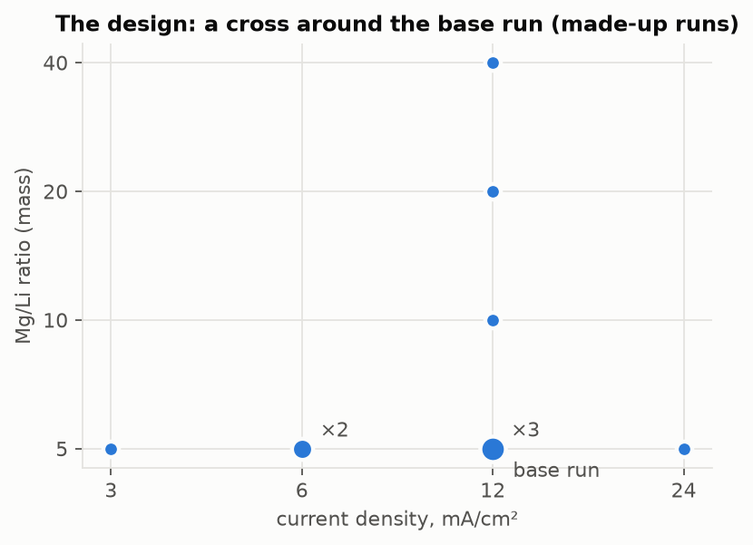
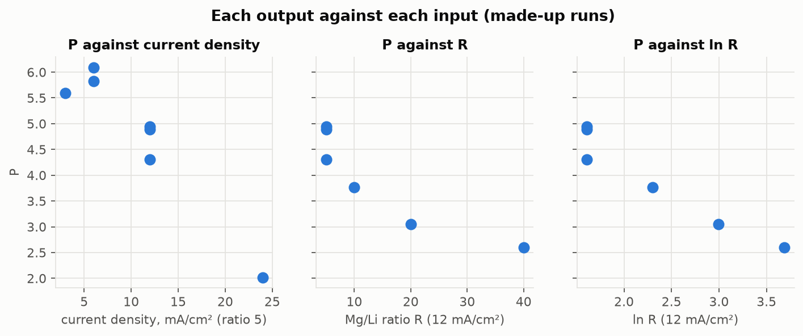
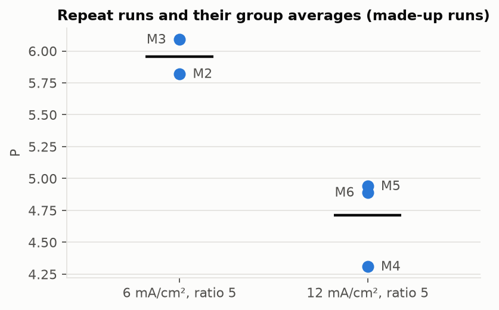
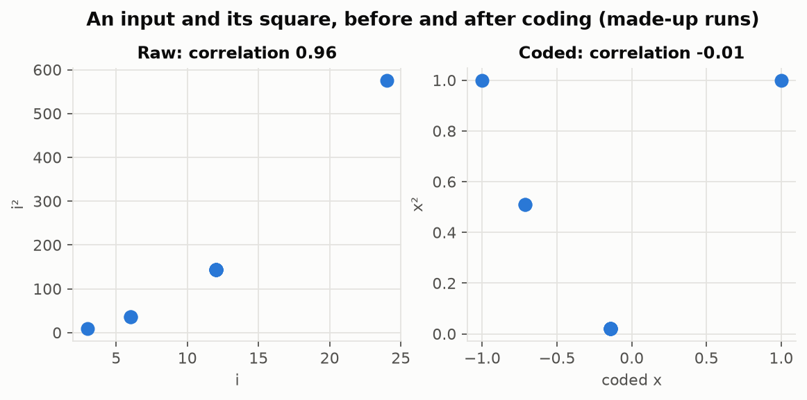
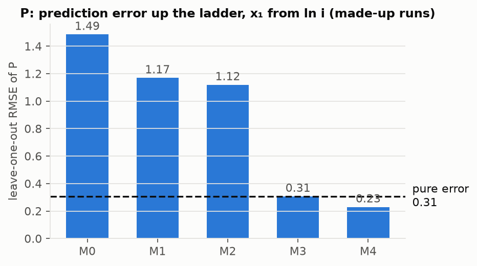
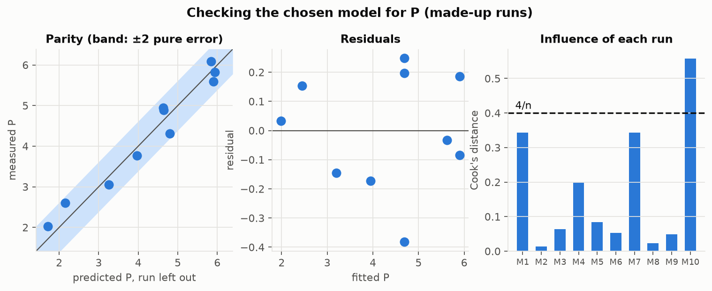
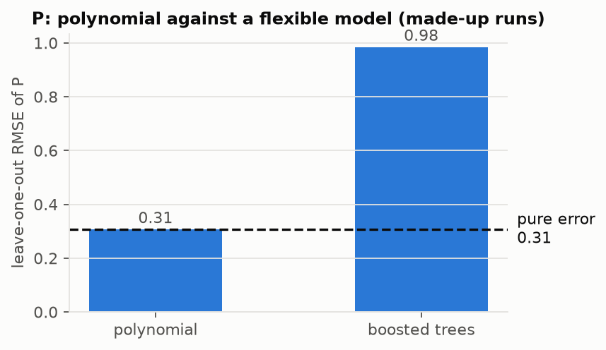
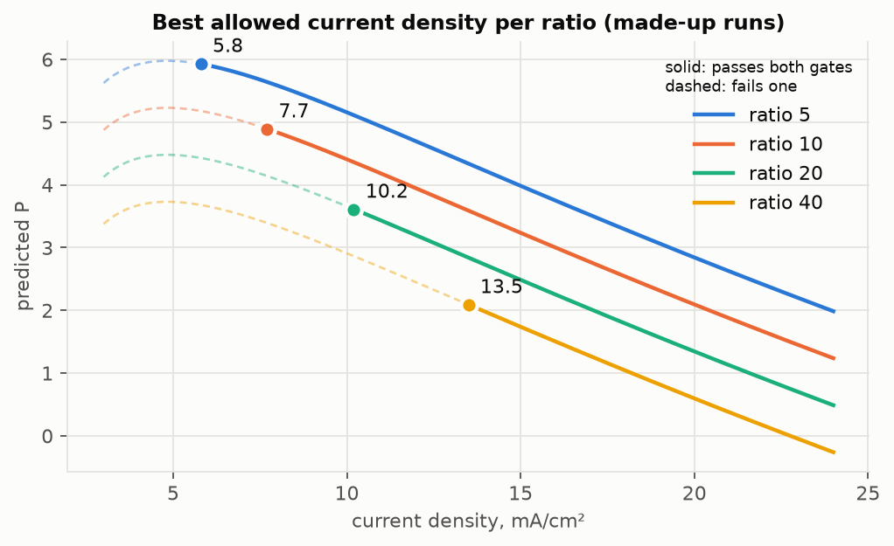
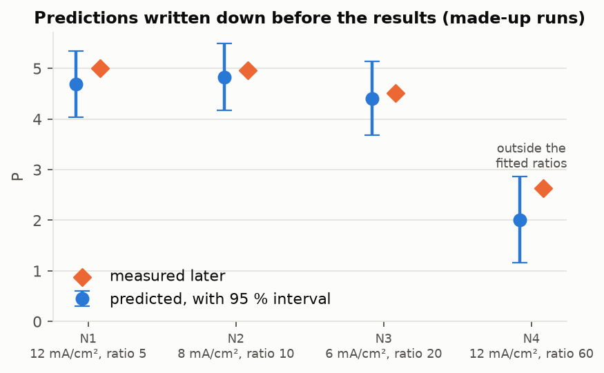

# Plan for building the model

The steps from preprocessed data to a recommended setting. Each step answers four questions:
**What** it produces, **Why** it is needed, **How** it is done, and its **Results**: what it shows,
or will show once it is done. The reviewers asked for quantitative results rather than description,
so every Results section is a number, a table or a figure.

**Scope: GO-10 membranes only.** The model is built from the GO-10 runs; runs on every other
membrane are left out.

See [polynomial.md](polynomial.md) for the equation itself and
[how-the-calculator-works.md](how-the-calculator-works.md) for the per-run quantities.

| Step | Status |
|---|---|
| 1. One row of numbers per run | to do |
| 2. Look at the data before fitting | partly done |
| 3. Measure the scatter between repeat runs | to do |
| 4. Prepare the inputs | to do |
| 5. Fit a ladder of candidate models and compare them | **next — the main gap** |
| 6. Check the chosen model | to do |
| 7. Compare with a flexible model | planned |
| 8. Find the best setting under the limits | to do |
| 9. Test on runs the model has never seen | waits for AV–AY lab results |

<strong>The made-up runs used in the examples</strong>

Every step ends with an example worked on made-up numbers, so that what each step produces can be
seen before the real runs go through it. Nothing in these examples is real data. The ten runs were
invented to look like the lab's design (a cross around a base run at 12 mA/cm² and ratio 5, with
repeats) and generated from known equations plus random noise. Because the true equations are
known, the examples also show whether the method finds them.

| Run | Current density (mA/cm²) | Mg/Li ratio (mass) | P | Lithium recovery (%) | Highest stack voltage (V) |
|---|---|---|---|---|---|
| M1 | 3 | 5 | 5.59 | 24.0 | 7.2 |
| M2 | 6 | 5 | 5.82 | 34.6 | 8.6 |
| M3 | 6 | 5 | 6.09 | 34.9 | 8.9 |
| M4 | 12 | 5 | 4.31 | 50.3 | 12.4 |
| M5 | 12 | 5 | 4.94 | 47.8 | 12.3 |
| M6 | 12 | 5 | 4.89 | 49.2 | 12.4 |
| M7 | 24 | 5 | 2.02 | 62.0 | 19.6 |
| M8 | 12 | 10 | 3.77 | 43.9 | 11.6 |
| M9 | 12 | 20 | 3.05 | 37.8 | 11.1 |
| M10 | 12 | 40 | 2.60 | 32.9 | 10.6 |

The equations they were generated from:

$$\displaystyle P = 6.0 - 1.6 \left(\ln \frac{i}{5}\right)^2 - 0.9 \ln \frac{R}{5}$$

$$\displaystyle \text{recovery} = \left(22 + 13 \log_2 \frac{i}{3}\right) \left(\frac{R}{5}\right)^{-0.15}$$

$$\displaystyle U_{\max} = 5 + 0.62\, i - 0.9 \ln \frac{R}{5}$$

Variables:

| Symbol | What it is | Where it comes from |
|---|---|---|
| $`i`$ | current density, in mA/cm² | made up, as in the table |
| $`R`$ | Mg/Li feed ratio, by mass | made up, as in the table |
| $`P`$, recovery, $`U_{\max}`$ | the three outputs, as defined in Step 1 | generated by these equations, plus noise |
| noise | random scatter added to each run: standard deviation 0.25 in P, 1.5 points in recovery, 0.3 V in voltage | made up, so that Step 3 has something to find |

So the made-up P is highest at 5 mA/cm² and falls as magnesium rises; recovery rises with current
and falls with magnesium; voltage rises with current.

---

## Step 1: One row of numbers per run

<strong>What</strong>

For every GO-10 run, one row of numbers: the two inputs the model learns from, current density
$`i`$ and Mg/Li feed ratio $`R`$, and the three outputs it predicts: permselectivity $`P`$, lithium
recovery and highest stack voltage $`U_{\max}`$. Charge per lithium offered $`q`$ is worked out
for every run as well, to describe it, but is not a model input (see
[Charge per lithium offered](#charge-per-lithium-offered)).

<strong>Why</strong>

A model learns only from input–output pairs, one per experiment, and everything after this step
(the fit, the checks, the recommendation) inherits any error in these numbers. So every number is
calculated from the raw readings (tank weights, lab concentrations, meter readings) by stated
equations, never copied from a derived cell, and every definition follows the lab's workbook so
that each result can be checked against the lab's own. The three outputs are the ones the research
question needs: P is what is maximised; recovery and voltage are the limits, and a limit can only
be respected if it can be predicted.

<strong>How</strong>

Each symbol below has one meaning only. Current density is $`i`$, never $`J`$.

**Where the definitions come from.** The lab's workbook (`ED_data_from M-BF(Updated).xlsx`) is the
source: every definition below follows it, and names the workbook columns it matches. Cell
references are to the run sheets (`New_set_…`), using run AE's rows; the whole-run results are in
row 28. Where the GO-10 manuscript defines a quantity differently, a **Differs from the
manuscript** note says how.

#### The two tanks the calculations use

| Tank | CSV label | What happens to it |
|---|---|---|
| Diluate | `dil` | starts as the feed (lithium and magnesium); loses ions as they cross the membranes |
| Concentrate | `conc` | receives what crossed; this is where the lithium is collected |

So what **crossed** is measured as the gain in the concentrate, and what was **on offer** is
measured in the diluate at the start. The third tank, the electrode rinse (`rinse`), only flows
past the electrodes and is not used in any calculation.

#### The row each run produces

Every run is boiled down to six numbers: three inputs and three outputs. Three of them are read
almost straight from the CSV files. The other three need the building blocks that follow, which is
why the building blocks come first.

| Number | Role | Calculated from |
|---|---|---|
| Current density, $`i`$ | input | average current through the stack (`stack_readings.csv` → `meter_current_ma`) and membrane area (`runs.csv` → `area_cm2`); no building block needed |
| Mg/Li feed ratio, $`R`$ | input | planned feed concentrations (`runs.csv` → `li_feed_mg_l`, `mg_feed_mg_l`); no building block needed |
| Charge per lithium offered, $`q`$ | input | **[charge passed](#building-blocks)**, the number of cell pairs (`runs.csv` → `cell_pairs`), and the lithium in the diluate at the start (**[metal in a tank](#building-blocks)** → **[moles](#building-blocks)**) |
| Permselectivity, $`P`$ | output | the lithium and magnesium that crossed into the concentrate (**[metal that crossed](#building-blocks)** → **[moles](#building-blocks)**), and the diluate's concentrations at its first and last samples |
| Lithium recovery | output | the lithium that crossed into the concentrate (**[metal that crossed](#building-blocks)**), and the lithium in the diluate at the start (**[metal in a tank](#building-blocks)**) |
| Highest stack voltage, $`U_{\max}`$ | output | stack voltage (`stack_readings.csv` → `meter_voltage_v`); no building block needed |

The building blocks in **bold** link to the table that defines them, in the next section. Each of the six numbers then has its
own section below, under *Inputs* and *Outputs*.

#### Which current

The current is recorded twice, and both readings are correct. The supply current
(`supply_current_a`) is what the power supply delivers. How much of it actually passes through the
stack is decided by the stack itself, and that is the multimeter reading (`meter_current_ma`).
Every quantity here describes the stack, so every current $`I`$ below is the multimeter current,
turned from mA into A. The workbook does the same: every current-based column (G, H, I, J, L)
is calculated from the multimeter column F, and the supply column D is never used.

#### Building blocks

| Quantity | Equation | Meaning | Where the values are (CSV files and models) | Used by |
|---|---|---|---|---|
| Volume in a tank | $`\displaystyle V = \frac{w - w_0}{1000}`$ (L) | balance reading less the empty tank, taking 1 g = 1 mL | $`w`$: CSV `tank_readings.csv` → `weight_g`; Model `TankReading.weight_g`  $`w_0`$: CSV `runs.csv` → `tare_conc_g`, `tare_dil_g` or `tare_rinse_g`, matching the reading's `tank`; Model `Run.tare_conc_g`, `Run.tare_dil_g`, `Run.tare_rinse_g` Workbook: columns AJ (concentrate) and AR (diluate) | [Metal in a tank](#building-blocks) (*V*) |
| Metal in a tank | $`\displaystyle m = c\,V`$ (mg) | lab concentration (mg/L) times volume; concentration alone means little because the tanks gain and lose water all run | $`c`$: CSV `samples.csv` → `li_mg_l` or `mg_mg_l`, joined to its tank reading on `run_code`, `minute`, `tank`; Model `Sample.li_mg_l`, `Sample.mg_mg_l`, reached as `TankReading.sample`  $`V`$: the row above Workbook: e.g. `AL24*AJ24` | [Metal that crossed](#building-blocks) (both ends) [Charge per lithium offered](#charge-per-lithium-offered) (lithium offered) [Lithium recovery](#lithium-recovery) (lithium at the start) |
| Metal that crossed | $`\displaystyle \Delta m = m_{\text{end}} - m_{\text{start}}`$ | the change between the first and last sampled minute | the earliest and latest `minute` of that run and tank with both a sample and a weight: CSV `samples.csv` and `tank_readings.csv` → `minute`; Model `TankReading.minute`, over `Run.tank_readings` Workbook: `AL24*AJ24 - AL8*AJ8` (lithium, concentrate) | [Moles](#building-blocks) [Permselectivity](#permselectivity) (moles gained by the concentrate) [Lithium recovery](#lithium-recovery) (lithium gained) |
| Moles | $`\displaystyle n = \Delta m / M`$ | $`M`$ = 6.94 g/mol (Li), 24.305 g/mol (Mg) | none: the molar masses are constants Workbook: columns BE (Li) and BF (Mg), in mol | [Permselectivity](#permselectivity) (*n*Li, *n*Mg) [Charge per lithium offered](#charge-per-lithium-offered) (*n*Li,offered) |
| Charge passed | $`\displaystyle Q = \sum_k \frac{1}{2}\,(I_k + I_{k+1})\,(\tau_{k+1} - \tau_k)`$ | area under the current–time curve, in coulombs, with $`I_k`$ the current through the stack and $`\tau_k`$ the time of reading $`k`$ in seconds; no meter totals it, so it is summed from the power log, read mostly every 5 minutes. See [How the charge is added up](#how-the-charge-is-added-up) below. | $`I`$: CSV `stack_readings.csv` → `meter_current_ma`, ÷ 1000 to amps; Model `StackReading.meter_current_ma`  $`\tau`$: CSV `stack_readings.csv` → `minute` × 60; Model `StackReading.minute`, over `Run.stack_readings` Workbook: column I, total in I54 | [Charge per lithium offered](#charge-per-lithium-offered) (*Q*) |

##### How the charge is added up

Charge is current × time. The difficulty is that the current wasn't measured continuously; someone
wrote it down every 5 minutes for most of a run. Long runs switch to every 15 or 30 minutes later
on, and now and then a reading was missed. So the program works it out piece by piece:

1. Take two readings in a row, say at 0 and 5 minutes.
2. Average them. That's roughly the current flowing between them.
3. Multiply by the time between them, in seconds (5 min = 300 s). That's the charge for that
   slice.
4. Do the same for every pair of readings, and add up the slices.

Because each slice uses its own gap, a missed reading or a wider spacing needs no special handling.

Example: the first 20 minutes of run AE, a 12 mA/cm² run (`stack_readings.csv`, columns `minute`
and `meter_current_ma`, turned into amps). The reading at minute 5 was never written down, so the first gap is
10 minutes:

| Time | Current |
|---|---|
| 0 min | 0.0721 A |
| 10 min | 0.0724 A |
| 15 min | 0.0725 A |
| 20 min | 0.0725 A |

- 0 → 10 min: average 0.07225 A × 600 s = 43.35 C
- 10 → 15 min: average 0.07245 A × 300 s = 21.74 C
- 15 → 20 min: average 0.0725 A × 300 s = 21.75 C
- **Total charge = 86.84 C**

The program has to calculate this because nothing on the bench measures total charge directly. In
maths this is called "the area under the current–time curve", because if you plot current against
time, the charge is the area underneath the line.

The workbook (column I) adds the charge up an hour at a time: the hour's average current × 3600 s,
or the same slice method where readings are 30 minutes apart. Summing slice by slice over every
reading is the same idea done more finely, and for run AE the two agree: 1046.9 C here against
1046.8 C in the workbook (I54).

#### Inputs: the settings chosen at the bench

Under each equation, every variable is traced to where it comes from: a CSV column and the model
attribute that holds it, a constant, or a link to the calculation that produces it. The model
classes are in `src/limodel/models/`.

##### Current density

**Current density, $`i`$ (mA/cm²)**

$$\displaystyle i = \frac{\bar I \times 1000}{A}, \qquad A = 6\ \text{cm}^2$$

Variables:

| Symbol | What it is | Where it comes from |
|---|---|---|
| $`\bar I`$ | average current through the stack over the run's readings, in A | CSV: `stack_readings.csv` → `meter_current_ma`, ÷ 1000 to amps Model: `StackReading.meter_current_ma`, one per item of `Run.stack_readings` |
| $`A`$ | membrane area per cell pair, in cm² | CSV: `runs.csv` → `area_cm2` Model: `Run.area_cm2` |
| 1000 | turns A into mA | fixed |

How hard the current is pushed through each square centimetre of membrane: the driving force.
More current moves ions faster but needs more voltage, and it can cost selectivity: lithium near
the membrane can run short, and magnesium then carries more of the current.

Workbook: column H, `=G/I2`, with G the `AVERAGE` of the multimeter column F, hour by hour. For run
AE that is 12.11 mA/cm² in the first hour.

##### Feed ratio

**Mg/Li feed ratio, $`R`$ (mol/mol)**

$$\displaystyle R = \frac{c^{\text{feed}}_{\text{Mg}} / 24.305}{c^{\text{feed}}_{\text{Li}} / 6.94}$$

Variables:

| Symbol | What it is | Where it comes from |
|---|---|---|
| $`c^{\text{feed}}_{\text{Mg}}`$ | magnesium in the feed as set up, in mg/L | CSV: `runs.csv` → `mg_feed_mg_l` Model: `Run.mg_feed_mg_l` |
| $`c^{\text{feed}}_{\text{Li}}`$ | lithium in the feed as set up, in mg/L | CSV: `runs.csv` → `li_feed_mg_l` Model: `Run.li_feed_mg_l` |
| 24.305, 6.94 | molar masses of Mg and Li, in g/mol; they turn mg/L into mmol/L | constant |

How much magnesium competes with each lithium. Real brines have high $`R`$, which is why it matters.
The model uses $`\ln R`$ (Step 4).

Workbook: cell E4, `=(E2*6.94)/(E1*24.305)`, from the planned feed in E1 (Li) and E2 (Mg); 1.43
for run AE. The workbook names runs by the mass ratio in E3 (5 for run AE), but calculates with
the molar one.

**Differs from the manuscript:** the manuscript's model uses the *mass* ratio (Na/Li 5–75). For
the model the two are interchangeable: the molar ratio is the mass ratio × 6.94 / 24.305, so
$`\ln R`$ only shifts by a constant, and coding to −1…+1 (Step 4) removes the shift. The fit is
identical either way; only the axis labels change.

##### Charge per lithium offered

**Charge per lithium offered, $`q`$ (dimensionless)**

$$\displaystyle q = \frac{Q\,N / F}{n_{\text{Li,offered}}}, \qquad N = 10 \text{ cell pairs}, \quad F = 96\,485\ \text{C/mol}$$

Variables:

| Symbol | What it is | Where it comes from |
|---|---|---|
| $`Q`$ | total charge passed over the run, in C | calculation: [Charge passed](#building-blocks) |
| $`N`$ | number of cell pairs | CSV: `runs.csv` → `cell_pairs` Model: `Run.cell_pairs` |
| $`F`$ | Faraday constant, 96 485 C/mol | constant |
| $`n_{\text{Li,offered}}`$ | lithium in the diluate at its first sampled minute, in mol | calculation: [Metal in a tank](#building-blocks) for the `dil` tank at its first sampled minute, turned into moles as in [Moles](#building-blocks) |

$`Q N / F`$ is the moles of charge moved across all $`N`$ membranes; $`n_{\text{Li,offered}}`$ is the lithium the
diluate held at the start. It says how hard the run was pushed against how much lithium there was
to move. $`q = 1`$ means just enough charge to move every lithium, had lithium alone carried the
current; anything above 1 is charge spent on magnesium or lost. It exists because the runs no
longer pass equal charge and the tanks differ in size, so neither current density nor duration
describes a run on its own. This one number takes in run length, tank size and feed strength
together, and it answers "how long should it run".

Not in the workbook or the manuscript: $`q`$ is this project's own input. It is built from two
quantities the workbook does have: the equivalents transported, $`QN/F`$ (column J, `=I*10/96485`,
summed over the run), and the lithium the diluate started with (`AT8*AR8`).

**Not a model input for the present runs.** Across the 9 GO-10 runs with lab results, $`q`$ only
ranges from 0.87 to 1.04: every run passed about 1040–1056 C into about 2 L of diluate at about
400 mg/L of lithium, so the design holds it nearly constant, and its small spread comes from differences in
the measured feed rather than from a chosen setting. A model cannot learn the effect of an input
that hardly varies; it would fit noise. So the model's inputs are current density and feed ratio
(see [Step 2](#step-2-look-at-the-data-before-fitting)). $`q`$ is still worked out for every run, to
describe it, and becomes an input once runs vary the charge.

##### Charge per lithium offered, in simple terms

> Here it is with run AE's real numbers.
>
> **What q measures:** how much charge you pushed through the stack, compared with how much lithium
> there was to move.
>
> **Think of charge as tickets.** Each unit of charge lets one positive charge cross a membrane. A
> lithium ion (Li⁺) needs 1 ticket. A magnesium ion (Mg²⁺) needs 2, because it carries two charges.
>
> **Step 1: count the tickets.**
> - Run AE passed 1046.9 C of charge through the stack over its 4 hours (the area under the current curve from
>   earlier).
> - Dividing by Faraday's constant turns coulombs into moles of tickets: 1046.9 / 96 485 = 10.85 mmol.
> - The stack has 10 cell pairs, and the same current crosses all 10 membranes. So each ticket is
>   used 10 times: 10.85 × 10 = **108.5 mmol of tickets**.
>
> **Step 2: count the lithium.**
> - The diluate started with 2.006 L at 403.1 mg/L, so 808.7 mg of lithium.
> - 808.7 / 6.94 = **116.5 mmol of lithium**.
>
> **Step 3: divide.**
> - q = 108.5 / 116.5 = **0.93**
>
> **What 0.93 means.** Run AE was given enough tickets to move 93% of its lithium, if lithium had
> got all of them. It didn't: AE's recovery was only about 38%. Magnesium took many of the tickets,
> two at a time, and some were wasted. So:
>
> - **q = 1:** exactly enough charge for all the lithium, in the ideal case.
> - **q above 1:** extra charge, which ends up spent on magnesium or wasted.
>
> **Why not just use current density or run time?** They don't tell you how big the job was.
> Picture two runs with the same current for the same 4 hours, one with a 2 L tank and one with a
> 4 L tank. The 4 L tank holds twice the lithium, so the same charge is only half as much push per
> lithium. Current density and time can't tell those two runs apart; q can: about 0.93 for the
> first and about 0.47 for the second.
>
> **The same formula, turned around, gives the run length.** You choose the q you want and the current, and it
> tells you how long to run:
>
> hours = q × (lithium available) × F / (N × current)
>
> For AE's tank at AE's current, aiming for q = 1.5 gives about **6.4 hours**.

#### Outputs: what is measured

##### Permselectivity

**Permselectivity, $`P`$ — maximised**

$$\displaystyle P = \frac{n_{\text{Li}} / n_{\text{Mg}}}{\bar c_{\text{Li}} / \bar c_{\text{Mg}}}$$

$$\displaystyle \bar c = \frac{c_{\text{start}} - c_{\text{end}}}{\ln\left(c_{\text{start}} / c_{\text{end}}\right)}$$

Variables:

| Symbol | What it is | Where it comes from |
|---|---|---|
| $`n_{\text{Li}}`$, $`n_{\text{Mg}}`$ | moles of each metal the concentrate gained over the run | calculation: [Metal that crossed](#building-blocks) for the `conc` tank, then [Moles](#building-blocks) |
| $`\bar c_{\text{Li}}`$, $`\bar c_{\text{Mg}}`$ | each metal's average concentration in the diluate over the run, in mmol/L: the log-mean of its start and end values (when the two are equal, the start value) | calculation: the second equation above |
| $`c_{\text{start}}`$, $`c_{\text{end}}`$ | the metal's concentration in the diluate's first and last samples, divided by its molar mass (6.94 for Li, 24.305 for Mg) | CSV: `samples.csv` → `li_mg_l`, `mg_mg_l`, tank `dil` Model: `Sample.li_mg_l`, `Sample.mg_mg_l` (reached as `TankReading.sample`) |

The top is the Li/Mg ratio that crossed; the bottom is the Li/Mg ratio the membrane was offered,
averaged over the run because the diluate changes as ions leave it (in run AE its lithium falls from
403 to 262 mg/L). So P says whether the membrane picked lithium out of what it was given:
**P = 1 means no preference**, and above 1 lithium is favoured. Only concentrations are needed for
the bottom, so the diluate's volume plays no part.

Workbook: column BI, `(BE/BF) × (log-mean of AV)/24.305 ÷ (log-mean of AT)/6.94`; whole run in
BI28. For run AE, **P = 5.79**.

The workbook also reports the transport numbers, the share of the current each metal carried:
$`t_{\text{Li}} = n_{\text{Li}} / (n_{\text{Li}} + 2n_{\text{Mg}})`$ (column BG; 0.68 for run AE)
and $`t_{\text{Mg}} = 2n_{\text{Mg}} / (n_{\text{Li}} + 2n_{\text{Mg}})`$ (column BH). P does not
use them.

**Differs from the manuscript:** the manuscript (Eq 6) states the same comparison the other way up,
as a relative transport number of the competing ion over lithium, so a *lower* value is better; it
is the reciprocal of P. It averages the start and end concentrations arithmetically rather than
logarithmically, and its wording names the concentrate-in and concentrate-out streams rather than
the diluate. For run AE the arithmetic mean gives P = 5.71 against the workbook's 5.79.

##### Lithium recovery

**Lithium recovery — gate, at least 35 %**

$$\displaystyle \text{recovery} = 100 \times \frac{\Delta m^{\text{conc}}_{\text{Li}}}{m^{\text{dil}}_{\text{Li,start}}}\ \%$$

Variables:

| Symbol | What it is | Where it comes from |
|---|---|---|
| $`\Delta m^{\text{conc}}_{\text{Li}}`$ | milligrams of lithium the concentrate gained | calculation: [Metal that crossed](#building-blocks) for the `conc` tank |
| $`m^{\text{dil}}_{\text{Li,start}}`$ | milligrams of lithium in the diluate at its first sampled minute | calculation: [Metal in a tank](#building-blocks) for the `dil` tank at its first sampled minute |
| 100 | turns the fraction into a percent | fixed |

How much of the lithium on offer was actually harvested. A membrane can be highly selective while
moving almost nothing; this gate rejects that setting.

Workbook: column AZ, `=(AL24*AJ24-AL8*AJ8)*100/(AT8*AR8)`; whole run in AZ28. For run AE,
**38.27 %**.

**Differs from the manuscript:** the manuscript's "Li recovery efficiency" (Eq 4) is
$`(C_{\text{out}} - C_{\text{in}})/C_{\text{in}} \times 100`$ on the concentrate's lithium
concentration: how much the concentrate was enriched, not what share of the feed's lithium was
collected.

##### Highest stack voltage

**Highest stack voltage, $`U_{\max}`$ — gate, at most 20 V**

$$\displaystyle U_{\max} = \max_k U_k$$

Variables:

| Symbol | What it is | Where it comes from |
|---|---|---|
| $`U_k`$ | voltage across the stack at reading $`k`$, in V | CSV: `stack_readings.csv` → `meter_voltage_v` Model: `StackReading.meter_voltage_v` |
| $`k`$ | each reading of the run's power log | CSV: the run's rows of `stack_readings.csv` Model: `Run.stack_readings` |

How much electrical push the stack needed. 20 V is the most the stack can hold; above it the
membranes break. The limit therefore applies at every moment of the run, not just at the start.
The voltage rises as the diluate is stripped of ions and its resistance climbs, so the highest
reading of the run is the one that must stay at or below 20 V.

As with the current, the multimeter reads the stack itself. The workbook's voltage-based columns
(K, average voltage, and L, energy) use the multimeter column E, never the supply column C. The two
readings differ by less than 0.1 V (run AE: 16.00 V supply, 15.93 V multimeter at the start).

Neither the workbook nor the manuscript has a voltage limit: the 20 V ceiling comes from the lab,
as the most the stack can hold.

<strong>Results</strong>

To show: the full results table, one row per run; one run worked by hand beside the program's
answer; each number set beside the workbook's own value for the same run (for run AE: recovery
38.27 %, P 5.79); and the mass-balance gap (lithium that left the diluate against lithium that
arrived in the concentrate) as evidence the numbers are sound.

Defining these quantities has already shown what the progress report must change:

1. **Voltage gate:** the report says *starting* voltage. 20 V is the most the stack can hold at
   any moment, and the voltage climbs during a run, so the limit is checked against the highest
   voltage of the run.
2. **P's definition:** the report's Eq (1) divides $`t_{\text{Li}}/t_{\text{Mg}}`$ by the feed
   ratio, which makes no preference 0.5, while its text says 1. The workbook's definition (mole
   ratio crossed over log-mean ratio offered) is the one to use, and with it no preference is 1.
3. **Feed ratio units:** the report's dataset table says "by mass". Ions compete for the current
   per ion, not per gram, so the ratio is molar. The two differ by 24.305 / 6.94 ≈ 3.5, so a mass
   ratio of 60 is a molar ratio of about 17.

#### Example: run AE's P worked by hand

Real numbers, from the lab's workbook, whole run (row 28):

| Quantity | Working | Value |
|---|---|---|
| Lithium the concentrate gained, $`n_{\text{Li}}`$ | workbook BE28 | 44.60 mmol |
| Magnesium the concentrate gained, $`n_{\text{Mg}}`$ | workbook BF28 | 10.48 mmol |
| Li/Mg ratio that crossed | 44.60 / 10.48 | **4.257** |
| Lithium in the diluate, log-mean | (403.1 − 261.9) / ln(403.1 / 261.9) = 327.4 mg/L, ÷ 6.94 | 47.18 mmol/L |
| Magnesium in the diluate, log-mean | (1657 − 1467) / ln(1657 / 1467) = 1560.1 mg/L, ÷ 24.305 | 64.19 mmol/L |
| Li/Mg ratio offered | 47.18 / 64.19 | **0.7351** |
| P | 4.257 / 0.7351 | **5.791** |

The workbook's own value, BI28, is 5.791: the hand calculation and the workbook agree.

## Step 2: Look at the data before fitting

<strong>What</strong>

Before choosing any equation, examine two things: the *design*, meaning which combinations of
settings were actually run, and the *shape* each output takes as each input changes.

<strong>Why</strong>

A model can only learn what the design lets it see. A combination of settings that was never run
cannot be estimated; settings that always moved together cannot be separated; an input that hardly
varies cannot be learned at all. And the shapes say which terms an equation needs (straight,
curved, levelling off) and on which scale: $`R`$ or $`\ln R`$. Looking first stops the model from
being given terms the data cannot support.

<strong>How</strong>

**The design.** For the membrane being modelled, a table (or plot) of current density against feed
ratio, one entry per run, beside each run's other conditions: starting concentrate, run length and
total charge. It shows the combinations that are missing, settings that moved together, conditions
that differ between runs, and which runs are repeats.

**The shapes.** Each output (P, lithium recovery, highest stack voltage) plotted against each input,
using runs where the other input is held fixed, so that only one thing changes along each plot.
The ratio plots are drawn twice, against $`R`$ and against $`\ln R`$: whichever is closer to a
straight line is the evidence for Step 4's choice. Runs whose other conditions differ are drawn
apart.

In each plot, look for:

- whether the trend is straight, curved, or levelling off, which decides whether a squared term is
  needed;
- any point far from the others, a candidate to check with the lab;
- how far apart repeat runs sit, the noise level everything else is judged against.

<strong>Results</strong>

The design of the GO-10 runs in the data files (AE–AY): AE, AF, AG, AH, AI, AJ, AN, AP, AT and AW.

Current density across, Mg/Li feed ratio (by mass, as the runs are named) down, one run code per
cell.

| Mg/Li (mass) ↓ \ current density (mA/cm²) → | 3 | 6 | 12 | 24 |
|---|---|---|---|---|
| 5 | AJ | AH, AI | AE | AN, AP |
| 10 | | | AF | |
| 20 | | | AG | |
| 40 | | | AT | |
| 60 | | | AW | |

#### What the design shows

1. **It is a cross, by design.** 12 mA/cm² is the lab's chosen operating current (confirmed by
   the lab). The design varies one factor at a time around the base run AE (12 mA/cm², ratio 5):
   current density was varied at ratio 5, and the ratio at 12 mA/cm². Each arm answers its own
   question: what current density does at ratio 5, and what the ratio does at the operating
   current. No run combines a high current with a high magnesium load, so the model cannot learn
   whether the best current depends on the ratio: the $`i \times R`$ interaction term cannot be
   estimated.
2. **Current density and run length are tied.** Every run passed the same charge per area, so
   3 mA/cm² ran 16 h, 6 ran 8 h, 12 ran 4 h and 24 ran 2 h. Any effect of current density is also
   an effect of run length, and the data cannot separate the two.
3. **The ratio was changed through magnesium alone.** Every run's feed held 400 mg/L of lithium;
   only the magnesium changed (2000, 4000, 8000, 16 000 and 24 000 mg/L for ratios 5, 10, 20, 40
   and 60). So the feed ratio and the magnesium concentration are the same variable here, and the
   data cannot tell an effect of the *ratio* from an effect of *more magnesium* (a saltier, more
   conductive feed, which also lowers the voltage). What the model learns about $`R`$ holds for a
   400 mg/L lithium feed; a brine with the same ratio but a different lithium concentration is
   outside what was tested. It is also why charge per lithium offered barely varies: the lithium on
   offer was the same in every run.
4. **The 24 mA/cm² runs started differently.** Their concentrate began as NaCl at 5 g/L (AN) or
   LiCl at 5 g/L (AP); every other run began with LiCl at 0.5 g/L. They are not directly
   comparable with the rest, and are marked apart in every plot.
5. **One pair of repeats:** AH and AI (GO-10, 6 mA/cm², ratio 5). Step 3 rests on it.
6. **The high-ratio end is thin.** AW (ratio 60) has no lab results yet, and AT (ratio 40) has
   only a few samples.
7. **Charge per lithium offered barely varies** (0.87 to 1.04), so it is not a model input for
   these runs; see [Charge per lithium offered](#charge-per-lithium-offered). The inputs are current
   density and feed ratio.

#### The shape plots to make

Because of the cross, each input is seen with the other held fixed:

- **P, lithium recovery and highest stack voltage against current density**, at ratio 5: runs
  AJ, AH, AI, AE (AN, AP drawn apart).
- **The same three against the feed ratio**, at 12 mA/cm²: runs AE, AF, AG, AT (and AW once its
  results arrive), against both $`R`$ and $`\ln R`$.

#### Example with made-up runs

Reading them:

- **The design** is a cross: current density varies at ratio 5, the ratio at 12 mA/cm², with two
  repeats at 6 mA/cm² and three at the base run. No run sits off the arms, so the interaction
  cannot be estimated.
- **P against current density** rises from 3 to 6 mA/cm², then falls: a curve with a peak, so the
  equation needs a squared current-density term.
- **P against R** falls steeply and then flattens; against $`\ln R`$ the same four points lie
  nearly on a straight line. That is the evidence for using $`\ln R`$ (Step 4).
- **The three runs at the base run** spread from 4.31 to 4.94: any trend has to be bigger than
  that to mean something (Step 3).

## Step 3: Measure the scatter between repeat runs

<strong>What</strong>

One number for each output (P, lithium recovery and highest stack voltage) saying how much two runs
made at identical settings disagree. This is the experiment's own noise, called the *pure error*.

<strong>Why</strong>

Two runs with every setting the same never give identical results: each feed is made up
separately, membranes age, and every sample and lab analysis carries its own error. No model can
predict a new run more precisely than the experiment repeats itself. So this number is the floor
that every later error is measured against: a model whose prediction error (Step 5) is close to
it has captured everything there is to capture, and one that misses by much more is missing
something real. The lack-of-fit test in Step 5 cannot be done without it.

<strong>How</strong>

#### Which runs count as repeats

Two runs are repeats, and fall in the same group, only if they match on every one of these
settings. The settings decide which runs are grouped together; once the groups exist, the equation
below never looks at them again.

| Setting | Why it must match | Where it comes from |
|---|---|---|
| Membrane | different membranes move ions differently, so a difference between them is the membrane's effect, not noise | CSV: `runs.csv` → `cem` Model: `Run.cem` |
| Planned feed | the lithium and magnesium the feed was made up with set the ratio, an input of the model, so runs at different ratios are expected to differ | CSV: `runs.csv` → `li_feed_mg_l`, `mg_feed_mg_l` Model: `Run.li_feed_mg_l`, `Run.mg_feed_mg_l` |
| Current density | an input of the model, for the same reason; matched to the nearest design level (3, 6, 12 or 24 mA/cm²), see the note below | calculation: [Current density](#current-density) |
| Starting concentrate | the salt the concentrate starts with sets the concentration difference across the membrane, and so how much diffuses back; runs started differently are not the same experiment | CSV: `runs.csv` → `conc_start_salt`, `conc_start_g_l` Model: `Run.conc_start_salt`, `Run.conc_start_g_l` |
| Run length | a longer run passes more charge and strips more of the diluate, so recovery and P move with it | CSV: `stack_readings.csv` → `minute`, the run's largest Model: `StackReading.minute`, over `Run.stack_readings` |
| Included | a run the lab does not stand behind would put its own problem into the noise estimate | CSV: `runs.csv` → `include` Model: `Run.include` |

For example, among the GO-10 runs:

| Runs | Membrane | Planned feed (Li / Mg, mg/L) | Current density (mA/cm²) | Starting concentrate | Run length | Included | Same group? |
|---|---|---|---|---|---|---|---|
| AH, AI | GO-10 | 400 / 2000 | 6 | LiCl 0.5 g/L | 8 h | yes | **yes**: one group |
| AN, AP | GO-10 | 400 / 2000 | 24 | NaCl 5 g/L against **LiCl 5 g/L** | 2 h | yes | **no**: the starting concentrate differs |
| AE, BA | GO-10 | 400 / 2000 | 12 | LiCl 0.5 g/L | 4 h against **18 h** | yes | **no**: the run length differs |

The intended current is not recorded: `runs.csv` → `set_current_ma` (`Run.set_current_ma`) is
empty for every GO-10 run. So "same current" is judged from the *measured* current density, which
is never exactly equal between repeats (12.1 against 12.0 mA/cm²), by matching it to the nearest
design level. Filling in `set_current_ma` would make the grouping exact, since it records what was
intended rather than what was measured.

#### Pooling the scatter

For each output, the scatter within the groups is pooled over all of them:

$$\displaystyle s_{\text{pe}}^2 = \frac{\sum_g \sum_{j \in g} \left(y_j - \bar y_g\right)^2}{\nu_{\text{pe}}}, \qquad \nu_{\text{pe}} = \sum_g \left(n_g - 1\right)$$

Variables:

| Symbol | What it is | Where it comes from |
|---|---|---|
| $`s_{\text{pe}}^2`$ | the pure-error variance: the experiment's own noise, squared, in the output's units squared | calculation: the first equation above |
| $`s_{\text{pe}}`$ | the pure-error standard deviation: the typical difference between two runs at the same settings, in the output's own units; the number used in every later step | calculation: $`\sqrt{s_{\text{pe}}^2}`$ |
| $`\sum_g`$ | add up over every group of repeats | notation |
| $`g`$ | a group of repeat runs | [Which runs count as repeats](#which-runs-count-as-repeats) |
| $`\sum_{j \in g}`$ | add up over every run $`j`$ belonging to group $`g`$ | notation |
| $`j`$ | one run, counted within its group | the runs of group $`g`$ |
| $`y_j`$ | the output of run $`j`$: P, lithium recovery or highest stack voltage | calculation: [Permselectivity](#permselectivity), [Lithium recovery](#lithium-recovery), [Highest stack voltage](#highest-stack-voltage) |
| $`\bar y_g`$ | the output's average over the runs in group $`g`$ | calculation: the mean of $`y_j`$ for the runs in $`g`$ |
| $`\left(y_j - \bar y_g\right)^2`$ | how far run $`j`$ sits from its own group's average, squared, so that misses above and below both count | calculation |
| $`\nu_{\text{pe}}`$ | the degrees of freedom: how many independent comparisons the repeats give; each group gives one fewer than its number of runs, because its average was taken from those same runs | calculation: the second equation above |
| $`n_g`$ | the number of runs in group $`g`$ | count |

Step 3 reads nothing new from the files: it reuses Step 1's numbers and groups them.

For a single pair of runs the equations reduce to

$$\displaystyle s_{\text{pe}} = \frac{\left|y_1 - y_2\right|}{\sqrt{2}}, \qquad \nu_{\text{pe}} = 1$$

Variables:

| Symbol | What it is | Where it comes from |
|---|---|---|
| $`y_1`$, $`y_2`$ | the output of the two runs in the pair | calculation: as $`y_j`$ above |
| $`\lvert y_1 - y_2 \rvert`$ | the size of their difference, ignoring its sign | calculation |
| $`\sqrt{2}`$ | both runs carry error, so their difference is $`\sqrt{2}`$ times noisier than either run alone | constant |

How far $`s_{\text{pe}}`$ can be trusted depends on $`\nu_{\text{pe}}`$. Its 95 % confidence
interval for the true standard deviation is

$$\displaystyle s_{\text{pe}} \sqrt{\frac{\nu_{\text{pe}}}{\chi^2_{0.975,\,\nu_{\text{pe}}}}} \;\le\; \sigma \;\le\; s_{\text{pe}} \sqrt{\frac{\nu_{\text{pe}}}{\chi^2_{0.025,\,\nu_{\text{pe}}}}}$$

Variables:

| Symbol | What it is | Where it comes from |
|---|---|---|
| $`\sigma`$ | the true standard deviation of the experiment's noise, which $`s_{\text{pe}}`$ estimates and which can never be known exactly | unknown; the interval says where it lies |
| $`s_{\text{pe}}`$ | the pure-error standard deviation | calculation: the first equations above |
| $`\nu_{\text{pe}}`$ | its degrees of freedom | calculation: the first equations above |
| $`\chi^2_{q,\,\nu}`$ | the value of the chi-squared distribution with $`\nu`$ degrees of freedom below which a share $`q`$ of its values fall | statistical table |
| $`\chi^2_{0.975,\,\nu_{\text{pe}}}`$ | the upper value, which sets the interval's lower end | statistical table |
| $`\chi^2_{0.025,\,\nu_{\text{pe}}}`$ | the lower value, which sets the interval's upper end | statistical table |
| 0.975, 0.025 | the two tails left outside a 95 % interval, 2.5 % on each side | fixed |

With one degree of freedom that interval runs from about 0.45 to about 32 times the estimate,
which says almost nothing; with four it narrows to about 0.6 to 2.9 times. Several repeats are
needed for the number to be useful, and the most valuable place for them is the base run, which
sits on both arms of the design.

Each output's scatter is also given relative to its typical size, so the three outputs can be
compared with each other:

$$\displaystyle \text{relative scatter} = \frac{s_{\text{pe}}}{\bar y}$$

Variables:

| Symbol | What it is | Where it comes from |
|---|---|---|
| $`s_{\text{pe}}`$ | the pure-error standard deviation | calculation: the first equations above |
| $`\bar y`$ | the output's average over every run in the repeat groups | calculation: the mean of all $`y_j`$ used above |

#### Measuring the scatter, in simple terms

> **The idea.** Weigh yourself twice in a row and the scale might say 70.2 kg, then 70.5 kg. You
> did not change; that 0.3 kg is how precise the scale is. If you weigh yourself after lunch and it
> says 70.4 kg, you cannot claim lunch made a difference: the change is smaller than the scale's
> own wobble.
>
> Runs work the same way. Two runs at exactly the same settings never give exactly the same P:
> each feed is made up separately, the membranes age, and every lab result has its own error. That
> disagreement is the experiment's wobble, the pure error.
>
> **Why it matters.** It is the yardstick for everything after this step:
>
> - **For the model (Step 5):** if the model misses unseen runs by about the wobble, it is as good
>   as any model can be. If it misses by much more, it is missing something real.
> - **For the data (Step 2):** a difference between two runs only means something if it is bigger
>   than the wobble.
>
> **Calculating it.** Take a pair of repeat runs whose P comes out 5.8 and 5.2:
>
> - difference = 0.6
> - wobble $`s_{\text{pe}}`$ = 0.6 / √2 = **0.42**
>
> The √2 is there because both runs carry error, so their difference is noisier than either run
> alone. With more repeats, each run's distance from its own group's average is measured, and all
> the groups are combined: that is the formula above.
>
> **How much to trust it.** A wobble estimated from one pair is very unreliable:
>
> | Repeats behind the estimate (degrees of freedom) | True wobble could be anywhere from … to … |
> |---|---|
> | 1 (a single pair) | 0.45× to 32× the estimate |
> | 3 | 0.57× to 3.7× |
> | 4 | 0.6× to 2.9× |
>
> With one pair, the number says almost nothing. Several repeats are needed, and the best place for
> them is the base run (12 mA/cm², ratio 5), because it sits on both arms of the cross.

<strong>Results</strong>

To show: for each output, $`s_{\text{pe}}`$, its relative size, its degrees of freedom and its
95 % interval, and the groups of repeat runs it came from.

#### Where the GO-10 repeats stand

- **In the data files:** one pair, AH and AI (6 mA/cm², ratio 5). One degree of freedom: the
  "almost nothing" row above.
- **In the lab's workbook, not yet in the data files:** BD and BE, run at exactly AE's settings
  (GO-10, 12 mA/cm², 400 mg/L lithium, 2000 mg/L magnesium, 4 hours, the same starting
  concentrate). With AE they make a group of three at the base run, adding two degrees of freedom:
  three in all.
- **Not repeats:** BA has the same feed and current as AE but ran 18 hours, so it passed a
  different charge; BB, BC and BF used different feeds.

So the most useful step for Step 3 is bringing the workbook's newer runs into the data files.

#### Example with made-up runs

Two groups of repeats, worked for P:

| Group | Runs (P) | Group average | Squared distances from the average | Sum |
|---|---|---|---|---|
| 6 mA/cm², ratio 5 | M2 5.82, M3 6.09 | 5.955 | 0.0182, 0.0182 | 0.0365 |
| 12 mA/cm², ratio 5 | M4 4.31, M5 4.94, M6 4.89 | 4.713 | 0.1627, 0.0514, 0.0312 | 0.2453 |

- Sum over both groups: 0.0365 + 0.2453 = **0.2817**
- Degrees of freedom: (2 − 1) + (3 − 1) = **3**
- $`s_{\text{pe}}^2`$ = 0.2817 / 3 = 0.0939, so $`s_{\text{pe}}`$ = **0.306**
- 95 % interval for the true value: 0.306 × 0.57 to 0.306 × 3.7, that is **0.17 to 1.14**
- Relative to the average P of these five runs (5.21): 0.306 / 5.21 = **5.9 %**

For all three outputs:

| Output | $`s_{\text{pe}}`$ | Relative | Degrees of freedom | 95 % interval |
|---|---|---|---|---|
| P | 0.306 | 5.9 % | 3 | 0.17 to 1.14 |
| Lithium recovery | 1.03 points | 2.4 % | 3 | 0.58 to 3.84 |
| Highest stack voltage | 0.131 V | 1.2 % | 3 | 0.074 to 0.489 |

The noise actually put into the made-up runs (0.25, 1.5 and 0.3) lies inside every interval, but
each interval is wide: with three degrees of freedom, the upper end is still more than six times the lower.

## Step 4: Prepare the inputs

<strong>What</strong>

Put the two inputs into the form the fit uses: the feed ratio as its logarithm, and both inputs
rescaled (*coded*) to run from −1 at the lowest tested value to +1 at the highest.

<strong>Why</strong>

**The logarithm of the ratio.** The ratio is varied in doubling steps, and what matters to
transport across a membrane is the *factor* by which one ion outnumbers another: the potentials
that drive and oppose ion transport depend on the logarithm of a concentration ratio. On a log
scale, each doubling is an equal step. A parabola in $`R`$ itself would also have to turn back up
somewhere and predict selectivity improving as magnesium rises, which is not physical. A squared
term in $`\ln R`$ can still turn, so if one is kept (Step 5), its turning point must lie outside
the tested range.

**The logarithm of current density, perhaps.** Current density was also varied in doubling steps.
Whether $`i`$ or $`\ln i`$ describes the outputs better is not assumed: both are tried in Step 5,
and the leave-one-out error decides.

**Coding.** Over the tested range, an input and its square rise almost together, so least squares
cannot tell their effects apart, and both coefficients come out unstable with large standard
errors. Centring the input on the middle of its range removes most of that overlap. Coding also
makes the coefficients comparable: each one says how much the output changes from the middle of
the tested range to its edge, whatever the input's units. And the intercept becomes the predicted
output at the centre of the design.

<strong>How</strong>

For each input $`v`$ (current density $`i`$ or $`\ln i`$, and $`\ln R`$):

$$\displaystyle x = \frac{v - v_{\text{mid}}}{v_{\text{half}}}, \qquad v_{\text{mid}} = \frac{v_{\max} + v_{\min}}{2}, \qquad v_{\text{half}} = \frac{v_{\max} - v_{\min}}{2}$$

with $`v_{\min}`$ and $`v_{\max}`$ the lowest and highest values among the runs being fitted. A
coded value turns back into a real one by $`v = v_{\text{mid}} + v_{\text{half}}\,x`$, which is
how every prediction is reported.

Whether coding has removed the overlap is checked with the variance inflation factor of each
column $`j`$ of a fitted model:

$$\displaystyle \text{VIF}_j = \frac{1}{1 - r_j^2}$$

where $`r_j^2`$ is the share of column $`j`$'s variation that the model's other columns explain.
A VIF of 1 means no overlap at all; above about 10, that column's coefficient cannot be trusted.

<strong>Results</strong>

To show: the coding formula for each input with its $`v_{\text{mid}}`$ and $`v_{\text{half}}`$, and
a VIF table for each chosen model.

#### Example with made-up runs

Coding the three inputs:

| Input | $`v_{\min}`$ | $`v_{\max}`$ | $`v_{\text{mid}}`$ | $`v_{\text{half}}`$ | Coded levels |
|---|---|---|---|---|---|
| $`i`$ | 3 | 24 | 13.5 | 10.5 | 3 → −1, 6 → −0.71, 12 → −0.14, 24 → +1 |
| $`\ln i`$ | ln 3 = 1.099 | ln 24 = 3.178 | 2.138 | 1.040 | −1, −0.33, +0.33, +1 |
| $`\ln R`$ | ln 5 = 1.609 | ln 40 = 3.689 | 2.649 | 1.040 | −1, −0.33, +0.33, +1 |

On the log scale, doubling steps become equal steps; on the plain scale, three of the four current
densities crowd into the lower half.

Before coding, $`i`$ and $`i^2`$ have a correlation of 0.96: least squares could hardly tell them
apart. After coding, $`x`$ and $`x^2`$ have a correlation of −0.01. In the model chosen for P
(Step 5), the variance inflation factors are 1.06 for $`x_1`$, 1.14 for $`x_2`$ and 1.10 for
$`x_1^2`$, all close to 1: the coefficients can be trusted.

## Step 5: Fit a ladder of candidate models and compare them

<strong>What</strong>

For each output separately, fit a short list of equations fixed in advance, each adding one term to
the one before, and choose one equation per output by rules also fixed in advance.

<strong>Why</strong>

Many different polynomials can pass close to a handful of points, so a curve that fits is not, by
itself, evidence that it is right. The reviewers asked why this polynomial; the answer is a
comparison. The chosen equation has to do better than every simpler one and must not be beaten by
any richer one, judged by how well it fits and, above all, by how well it predicts runs it was not
fitted to. Fixing the list before fitting matters: choosing terms by trial and error (stepwise
selection) makes the p-values look better than they are, because each term was picked for looking
significant.

<strong>How</strong>

With $`x_1`$ the coded current density and $`x_2`$ the coded $`\ln R`$ (Step 4), the candidates
are:

| Model | Equation | Coefficients, $`p`$ |
|---|---|---|
| M0 | $`\hat y = b_0`$ | 1 |
| M1 | $`\hat y = b_0 + b_1 x_1`$ | 2 |
| M2 | $`\hat y = b_0 + b_1 x_1 + b_2 x_2`$ | 3 |
| M3 | $`\hat y = b_0 + b_1 x_1 + b_2 x_2 + b_3 x_1^2`$ | 4 |
| M4 | $`\hat y = b_0 + b_1 x_1 + b_2 x_2 + b_3 x_1^2 + b_4 x_2^2`$ | 5 |

There is no $`x_1 x_2`$ term: the design cannot estimate it (Step 2). The ladder is run twice,
once with $`x_1`$ from $`i`$ and once from $`\ln i`$ (Step 4).

Each candidate is fitted by ordinary least squares. With $`X`$ the design matrix (one row per run,
one column per term) and $`y`$ the measured outputs:

$$\displaystyle b = \left(X^\top X\right)^{-1} X^\top y$$

With $`n`$ runs, $`p`$ coefficients and residuals $`e_i = y_i - \hat y_i`$, the statistics are:

$$\displaystyle SS_{\text{res}} = \sum_i e_i^2, \qquad SS_{\text{tot}} = \sum_i \left(y_i - \bar y\right)^2, \qquad s^2 = \frac{SS_{\text{res}}}{n - p}$$

$$\displaystyle R^2 = 1 - \frac{SS_{\text{res}}}{SS_{\text{tot}}}, \qquad R^2_{\text{adj}} = 1 - \left(1 - R^2\right) \frac{n - 1}{n - p}$$

$$\displaystyle F = \frac{\left(SS_{\text{tot}} - SS_{\text{res}}\right) / (p - 1)}{SS_{\text{res}} / (n - p)} \quad \text{compared with } F_{p-1,\,n-p}$$

$$\displaystyle F_{\text{partial}} = \frac{\left(SS_{\text{res},a} - SS_{\text{res},b}\right) / \left(p_b - p_a\right)}{SS_{\text{res},b} / \left(n - p_b\right)} \quad \text{compared with } F_{p_b - p_a,\,n - p_b}$$

for a model $`b`$ against the smaller model $`a`$ one rung below it;

$$\displaystyle t_j = \frac{b_j}{\operatorname{se}(b_j)}, \qquad \operatorname{se}(b_j)^2 = s^2 \left[\left(X^\top X\right)^{-1}\right]_{jj} \quad \text{compared with } t_{n-p}$$

$$\displaystyle \text{RMSE}_{\text{LOO}} = \sqrt{\frac{1}{n} \sum_i \left(y_i - \hat y_{(-i)}\right)^2}, \qquad \text{MAE}_{\text{LOO}} = \frac{1}{n} \sum_i \left|y_i - \hat y_{(-i)}\right|$$

where $`\hat y_{(-i)}`$ is run $`i`$ predicted by the model fitted to every run except $`i`$. For
least squares this needs no refitting: $`y_i - \hat y_{(-i)} = e_i / (1 - h_{ii})`$, with
$`h_{ii}`$ the leverage of run $`i`$ (Step 6).

$$\displaystyle F_{\text{lof}} = \frac{\left(SS_{\text{res}} - SS_{\text{pe}}\right) / (m - p)}{SS_{\text{pe}} / \nu_{\text{pe}}} \quad \text{compared with } F_{m-p,\,\nu_{\text{pe}}}$$

with $`m`$ the number of distinct settings among the fitted runs and $`SS_{\text{pe}}`$,
$`\nu_{\text{pe}}`$ the pure error from Step 3.

R² is the standard name of that statistic; it has nothing to do with the feed ratio $`R`$.

| Statistic | What it tells the reader |
|---|---|
| R² | share of the variation explained; always rises as terms are added, so never used alone |
| Adjusted R² | R² penalised for the number of terms |
| Overall F-test and p-value | whether the model beats predicting the average |
| Partial F-test against the rung below | whether the term just added earned its place |
| p-value of each coefficient | whether each term is distinguishable from zero |
| Leave-one-out RMSE and MAE | how far a prediction of an unseen run is likely to miss |
| Lack-of-fit F-test | whether the model misses by more than the experiment's own noise |

**Choosing the model.** The lowest leave-one-out RMSE, with every coefficient significant at the
5 % level and the lack-of-fit test not significant. When two candidates' leave-one-out RMSEs are
within the pure error $`s_{\text{pe}}`$ of each other, the simpler one is taken. If a squared term
is kept, its turning point, $`x^\ast = -b_{\text{linear}} / (2\, b_{\text{squared}})`$ in coded
units, must lie outside $`[-1, 1]`$, or have a physical explanation. No candidate may use more than
$`n - 2`$ coefficients, so that some degrees of freedom are always left to judge it with.

Start with P; the same procedure then covers recovery and voltage.

**Differs from the manuscript:** the manuscript judged its models on a 75/25 split of the runs and
4-fold cross-validation. With few runs, a quarter held out is two or three runs, and the verdict
depends on which ones. Leave-one-out uses every run for fitting and still tests every run, so it
is used here instead. The manuscript's reported statistics (R², RMSE, MAE, F-statistic and its
p-value) are all included.

<strong>Results</strong>

To show: for each output, one table with a row per candidate and a column per statistic above; and
the chosen equation with each coefficient, its standard error and p-value, written both in coded
and in real units.

#### Example with made-up runs

The ladder for P, with $`x_1`$ from $`\ln i`$ (10 runs, 7 distinct settings, pure error 0.306
with 3 degrees of freedom):

| Model | $`p`$ | R² | Adjusted R² | F (p-value) | Partial F (p-value) | LOO RMSE | LOO MAE | Lack-of-fit F (p-value) | Every term significant? |
|---|---|---|---|---|---|---|---|---|---|
| M0 | 1 | 0 | 0 | | | 1.49 | 1.29 | 31.2 (0.009) | |
| M1 | 2 | 0.609 | 0.560 | 12.5 (0.008) | 12.5 (0.008) | 1.17 | 1.03 | 14.3 (0.027) | yes |
| M2 | 3 | 0.798 | 0.740 | 13.8 (0.004) | 6.55 (0.038) | 1.12 | 0.76 | 8.86 (0.052) | yes |
| **M3** | 4 | 0.980 | 0.969 | 95.9 (< 0.001) | 53.3 (< 0.001) | **0.31** | 0.29 | 0.30 (0.83) | yes |
| M4 | 5 | 0.984 | 0.971 | 77.3 (< 0.001) | 1.42 (0.29) | 0.23 | 0.17 | 0.01 (0.99) | no: the $`x_2^2`$ term has p = 0.29 |

The rules, in order:

1. **M0 and M1 fail the lack-of-fit test** (p below 0.05): they miss by more than the noise.
2. **M4 has the lowest leave-one-out error, but its added term is not significant** (p = 0.29),
   so it is out: the improvement is the term fitting noise.
3. **M3 is the lowest among the rest**, and no simpler model is within the pure error of it
   (M2 misses by 0.81 more). M3 is chosen. Its leave-one-out error, 0.31, equals the pure error:
   it predicts unseen runs as well as the experiment repeats itself.
4. **The other scale loses:** with $`x_1`$ from $`i`$ instead of $`\ln i`$, the best leave-one-out
   error is 0.53.
5. **The squared term turns inside the tested range:**
   $`x_1^\ast = -(-1.819) / (2 \times -1.680) = -0.54`$, which is $`i = e^{2.138 - 0.54 \times 1.040}`$
   = 4.8 mA/cm². By the rule, a turning point inside the range needs a physical reason; here it
   is the best current density the design was looking for, and the made-up truth does peak at
   5 mA/cm². With real runs, that reason has to be argued from the chemistry.

The chosen equations, in coded units:

| Output | Equation | Scale of $`x_1`$ |
|---|---|---|
| P | $`\hat P = 4.362 - 1.819\,x_1 - 1.123\,x_2 - 1.680\,x_1^2`$ (standard errors 0.120, 0.154, 0.122, 0.230; every p ≤ 0.0003) | $`\ln i`$ |
| Lithium recovery | $`34.32 + 19.51\,x_1 - 8.03\,x_2`$ | $`\ln i`$ |
| Highest stack voltage | $`12.34 + 6.25\,x_1 - 0.93\,x_2`$ | $`i`$ |

with $`x_1`$ and $`x_2`$ coded as in Step 4. In real units, for P:
$`x_1 = (\ln i - 2.138) / 1.040`$ and $`x_2 = (\ln R - 2.649) / 1.040`$.

## Step 6: Check the chosen model

<strong>What</strong>

Check that the chosen equation's errors behave as least squares assumes, and that no single run
decides the result; and produce the figure that shows how well the surrogate performs.

<strong>Why</strong>

The statistics of Step 5 (F, t, p-values) and the intervals of Step 8 assume errors that are
independent, equally spread at every level, and roughly normal. If the residuals show a pattern,
a term is missing and those numbers are wrong. With few runs, one unusual run can also pull the
whole surface towards itself. And the predicted-against-measured plot is how the reviewers judge
whether the surrogate is good enough.

<strong>How</strong>

- **Parity plot.** Measured $`y_i`$ against the leave-one-out prediction $`\hat y_{(-i)}`$, with
  the line $`y = \hat y`$ and a band of $`\pm 2\,s_{\text{pe}}`$ around it. Points inside the band
  are predicted as well as the experiment repeats.
- **Residual plots.** $`e_i`$ against $`\hat y_i`$ and against each input. They should scatter
  evenly around zero. A curve means a missing term; a funnel, spread growing with the level, means
  the output should be modelled on a log scale. P is a ratio, positive and with a spread that
  tends to grow with its size, so $`\ln P`$ is the first alternative to try.
- **Normal Q–Q plot** of the residuals: roughly a straight line. With few points, only gross
  departures can be read from it.
- **Leverage.** How far a run's settings sit from the others:

$$\displaystyle h_{ii} = \left[X \left(X^\top X\right)^{-1} X^\top\right]_{ii}$$

  Its average is $`p/n`$; runs above $`2p/n`$ are flagged. In a cross-shaped design the end of
  each arm has high leverage by construction, which is expected, but those runs deserve the most
  checking.
- **Cook's distance.** How much all the fitted values move when run $`i`$ is left out:

$$\displaystyle D_i = \frac{e_i^2}{p\,s^2} \cdot \frac{h_{ii}}{\left(1 - h_{ii}\right)^2}$$

  Runs above $`4/n`$ are flagged; above 1 is serious.
- **Flagged runs.** Each is refitted without, and the change in the coefficients and in the
  recommendation (Step 8) is reported. No run is dropped without a reason from the lab.

<strong>Results</strong>

To show: the parity plot and residual plots for each output, and a table of leverage and Cook's
distance with the flagged runs and the effect of refitting without them.

#### Example with made-up runs

Reading them:

- **Parity:** every run's leave-one-out prediction lies inside the band of ±2 pure errors.
- **Residuals:** scattered around zero with no curve and no funnel: no missing term, no need for
  $`\ln P`$.
- **Leverage:** M1 and M7 have $`h_{ii}`$ = 0.89, above $`2p/n`$ = 0.8. They are the two ends of
  the current-density arm, high by construction.
- **Cook's distance:** M10, the end of the ratio arm, is 0.56, above $`4/n`$ = 0.4. Refitted
  without it, the ratio coefficient moves from −1.12 to −1.29, while the others barely move
  (4.36 → 4.22, −1.82 → −1.81, −1.68 → −1.71). So M10 largely decides how fast P falls with
  magnesium: it is the run to check first with the lab, and the reason to run another high ratio.

| Run | M1 | M2 | M3 | M4 | M5 | M6 | M7 | M8 | M9 | M10 |
|---|---|---|---|---|---|---|---|---|---|---|
| Leverage $`h_{ii}`$ | **0.89** | 0.25 | 0.25 | 0.21 | 0.21 | 0.21 | **0.89** | 0.14 | 0.29 | 0.66 |
| Cook's distance $`D_i`$ | 0.34 | 0.01 | 0.06 | 0.20 | 0.08 | 0.05 | 0.34 | 0.02 | 0.05 | **0.56** |

## Step 7: Compare with a flexible model

<strong>What</strong>

Fit a far more flexible model, one that assumes no equation shape at all, to the same runs, and
judge it by the same leave-one-out error.

<strong>Why</strong>

A polynomial can only follow the shapes its terms allow. If a model free to follow any shape
predicts unseen runs no better, the polynomial has captured what the data contains, and its
simplicity and readability win. If the flexible model is clearly better, the polynomial is missing
something. The manuscript makes the same comparison.

<strong>How</strong>

Gradient-boosted trees (XGBoost, set up as in the manuscript: 100 trees, depth at most 2), on the
same inputs and outputs. Trees split on thresholds, so they need no coding. Leave-one-out as in
Step 5: fit to every run but one, predict that one, repeat for each run. The model's
$`\text{RMSE}_{\text{LOO}}`$ and $`\text{MAE}_{\text{LOO}}`$ are set beside the chosen
polynomial's and beside $`s_{\text{pe}}`$.

Read with care: trees predict in steps and cannot predict beyond the most extreme runs they were
given, and with few runs each final branch holds only one or two. So the flexible model is a check
on the polynomial, never the basis of a recommendation.

**Differs from the manuscript:** the manuscript compared the two models on a 75/25 split and
4-fold cross-validation; here, leave-one-out, as in Step 5.

<strong>Results</strong>

To show: for each output, the leave-one-out RMSE and MAE of the polynomial and the flexible model
side by side, with $`s_{\text{pe}}`$, and both models' parity plots.

#### Example with made-up runs

| Model | LOO RMSE | LOO MAE |
|---|---|---|
| Polynomial (M3) | 0.31 | 0.29 |
| Boosted trees | 0.98 | 0.69 |
| Pure error, for comparison | 0.31 | |

The polynomial predicts unseen runs as well as the experiment repeats; the trees miss by three
times as much. With nine runs to learn from each time, the trees predict in steps and cannot reach
the ends of the arms. The polynomial has captured what the made-up data contains.

## Step 8: Find the best setting under the limits

<strong>What</strong>

For each feed ratio, the current density that gives the highest predicted P while the predicted
lithium recovery stays at or above 35 % and the predicted highest stack voltage at or below 20 V.

<strong>Why</strong>

This is the research question: the most selective setting that neither breaks the membranes nor
leaves most of the lithium behind. A brine's Mg/Li ratio is set by nature, not chosen, so the
useful answer is not one point but a recommendation per ratio: for this much magnesium, run this
current.

<strong>How</strong>

For each ratio $`R`$ in its tested range:

$$\displaystyle \max_{i}\; \hat P(i, R) \quad \text{subject to} \quad \widehat{\text{recovery}}(i, R) \ge 35\ \%, \qquad \hat U_{\max}(i, R) \le 20\ \text{V}$$

The three chosen equations are evaluated on a fine grid of current densities (every
0.1 mA/cm²) inside the tested range only: a polynomial is not to be trusted beyond the runs it
was fitted to.

Every prediction carries a 95 % prediction interval for a new run:

$$\displaystyle \hat y_0 \pm t_{0.975,\,n-p}\; s \sqrt{1 + x_0^\top \left(X^\top X\right)^{-1} x_0}$$

with $`x_0`$ the coded setting. The gates are applied twice: to the predicted values, and
cautiously, to the lower end of the recovery interval and the upper end of the voltage interval.
Both answers are reported; the cautious one is the safer recommendation.

Three conditions are stated with every recommendation:

- **Run length comes with it.** The tested runs passed the same charge per area, so each current
  density was tested with one run length. A recommended current density is a recommendation for
  that current *and* that run length.
- **Off the two arms of the cross, the model assumes no interaction:** that current density has
  the same effect at every ratio. That assumption is untested until runs off the arms exist.
- **The 35 % recovery floor is provisional.** The recommendation is also shown at 30 % and 40 %,
  so the reader sees how much it depends on the floor.

Where no current density passes both gates at a ratio, that is reported with the setting that
comes closest and how far it falls short.

<strong>Results</strong>

To show: a table with one row per ratio (recommended current density, run length, predicted P
with its interval, predicted recovery, predicted highest voltage), for the point and the cautious
gates; a plot of predicted P against current density at several ratios with the gated-out regions
shaded; and the recommendation at the 30 %, 35 % and 40 % floors.

#### Example with made-up runs

| Ratio (mass) | Recommended current density | Run length | Predicted P (95 % interval) | Predicted recovery | Predicted highest voltage | Cautious recommendation |
|---|---|---|---|---|---|---|
| 5 | 5.8 mA/cm² | 8.3 h | 5.93 ± 0.68 | 35.2 % | 8.7 V | 6.7 mA/cm² |
| 10 | 7.7 mA/cm² | 6.2 h | 4.89 ± 0.66 | 35.2 % | 9.2 V | 8.8 mA/cm² |
| 20 | 10.2 mA/cm² | 4.7 h | 3.61 ± 0.69 | 35.1 % | 10.1 V | 11.8 mA/cm² |
| 40 | 13.5 mA/cm² | 3.6 h | 2.09 ± 0.78 | 35.0 % | 11.4 V | 16.0 mA/cm² |

Run length is the same charge per area as the experiments (48 mA·h/cm²) divided by the current
density.

Reading it: P alone would be highest near 4.8 mA/cm² at every ratio, but there the predicted
recovery is below 35 %. So in every row the **recovery floor decides**: the recommendation is the
lowest current that still recovers 35 %, and more magnesium needs more current. The voltage
ceiling never comes close. The cautious recommendations sit higher, because they require the
*lower* end of the recovery interval to clear 35 %. Ratios 10 to 40 at currents other than
12 mA/cm² are off the arms of the cross, so those rows rest on the no-interaction assumption.

How much the answer depends on the floor:

| Recovery floor | Ratio 5 | Ratio 10 | Ratio 20 | Ratio 40 |
|---|---|---|---|---|
| 30 % | 4.8 | 5.9 | 7.8 | 10.4 |
| 35 % | 5.8 | 7.7 | 10.2 | 13.5 |
| 40 % | 7.5 | 10.0 | 13.3 | 17.7 |

At a 30 % floor and ratio 5, the floor no longer binds, and the recommendation is P's own peak,
4.8 mA/cm².

## Step 9: Test on runs the model has never seen

<strong>What</strong>

Predict the outputs of runs whose lab results have not arrived yet, write the predictions down with
their intervals and the date before the results exist, and compare when they arrive.

<strong>Why</strong>

Leave-one-out still tests on runs the modeller had seen while choosing the model. A prediction
written down before the result exists cannot have been tuned to it, so it is the strongest test
there is.

<strong>How</strong>

For each new run: code its settings (Step 4), predict each output with the chosen equations, and
compute the 95 % prediction interval (Step 8). Record them, dated, before the lab results arrive.
When they arrive, work out the measured values with the Step 1 equations and check whether each
falls inside its interval. About 95 % should; far fewer means the model is overconfident. Runs at
settings outside the fitted range test extrapolation and are reported apart. Afterwards the new
runs join the data, and Steps 1 to 8 are repeated.

<strong>Results</strong>

To show: a table with one row per new run: its settings, the predicted value with its interval,
the measured value, and whether the measurement fell inside.

#### Example with made-up runs

| Run | Settings | Predicted P (95 % interval) | Measured later | Inside? |
|---|---|---|---|---|
| N1 | 12 mA/cm², ratio 5 | 4.69 ± 0.66 | 5.00 | yes |
| N2 | 8 mA/cm², ratio 10 | 4.83 ± 0.66 | 4.96 | yes |
| N3 | 6 mA/cm², ratio 20 | 4.41 ± 0.73 | 4.51 | yes |
| N4 | 12 mA/cm², ratio 60 | 2.01 ± 0.85 | 2.63 | yes, but reported apart: ratio 60 is outside the fitted ratios |

All four fall inside their intervals. N2 and N3 sit off the arms of the cross, so they also test
the no-interaction assumption; the made-up truth has no interaction, so they pass. With real runs,
an off-arm run that misses its interval is the first sign that the assumption fails.

